# DroidSnex — Benutzerhandbuch

DroidSnex zeigt in Echtzeit, mit welchen Servern sich ein Android-Telefon verbindet: welche App, welche Domain, welche IP, in welchem Land und mit wie viel Datenverkehr. Das Telefon wird per USB-Kabel mit dem PC verbunden; während der Überwachung läuft auf dem Telefon eine kleine App (der *Agent*), die ein lokales VPN erstellt und nur die Metadaten der Verbindungen liest. Der Inhalt des Datenverkehrs wird nicht entschlüsselt (kein MITM).

## Inhalt

1. [Bevor Sie beginnen](#1-bevor-sie-beginnen)
2. [Erster Start: Sprache und Nutzungsbedingungen](#2-erster-start-sprache-und-nutzungsbedingungen)
3. [Einstellungen](#3-einstellungen)
4. [Das Hauptfenster](#4-das-hauptfenster)
5. [Monitor starten und stoppen](#5-monitor-starten-und-stoppen)
6. [Nicht vertraut und Vertraut](#6-nicht-vertraut-und-vertraut)
7. [Die Gefahrenskala](#7-die-gefahrenskala)
8. [Details und IP-Details](#8-details-und-ip-details)
9. [Karte](#9-karte)
10. [Graph](#10-graph)
11. [Zeitachse](#11-zeitachse)
12. [DNS](#12-dns)
13. [Alarme](#13-alarme)
14. [Telefonbildschirm](#14-telefonbildschirm)
15. [Sitzungen, Wiedergabe und Lesezeichen](#15-sitzungen-wiedergabe-und-lesezeichen)
16. [Daten exportieren und Alles leeren](#16-daten-exportieren-und-alles-leeren)
17. [Abgedockte Bereiche](#17-abgedockte-bereiche)
18. [Info und Lizenzen](#18-info-und-lizenzen)
19. [Häufige Probleme](#19-häufige-probleme)

---

## 1. Bevor Sie beginnen

Sie benötigen:

- einen Windows-PC mit DroidSnex;
- ein Android-Telefon und ein USB-Datenkabel;
- auf dem Telefon aktiviertes **USB-Debugging**: *Einstellungen › Über das Telefon*, tippen Sie siebenmal auf *Build-Nummer*, um die *Entwickleroptionen* freizuschalten, und aktivieren Sie dann in den *Entwickleroptionen* das *USB-Debugging*.

Beim ersten Verbinden fragt das Telefon **„USB-Debugging zulassen?“**: Entsperren Sie den Bildschirm, setzen Sie das Häkchen bei *Von diesem Computer immer zulassen* und tippen Sie auf *OK*.

DroidSnex verwendet nur die Werkzeuge im eigenen Ordner `tools` (adb und scrcpy) und installiert nichts im System. Laden Sie sie beim ersten Mal im Tab **Einstellungen** herunter (siehe [Kapitel 3](#3-einstellungen)).

## 2. Erster Start: Sprache und Nutzungsbedingungen

Beim ersten Start erscheint ein Fenster, das sich weder schließen noch hinter andere Fenster schieben lässt.

1. **Sprache wählen.** Die Schaltflächen zeigen die neun verfügbaren Sprachen: Italiano, English, Deutsch, Français, Español, Nederlands, Polski, Ελληνικά, Shqip. Die Sprache gilt für das ganze Programm und für den Agenten auf dem Telefon; Sie können sie später im Tab Einstellungen ändern.

   

2. **Nutzungsbedingungen lesen.** Der Text ist in der gewählten Sprache. Die Schaltfläche **Ich akzeptiere** wird erst aktiv, wenn Sie den Text bis zum Ende gescrollt haben. **Ich lehne ab** beendet das Programm.

   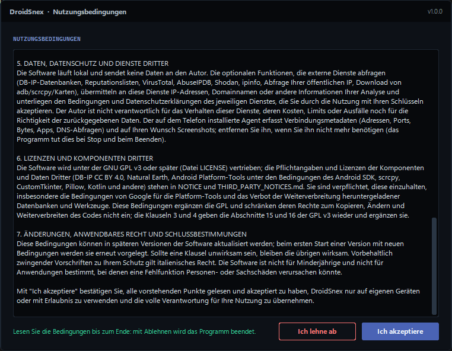

Die Zustimmung wird gespeichert: Das Fenster erscheint nur wieder, wenn sich die Version der Bedingungen ändert. Die Bedingungen können Sie jederzeit unter [Info und Lizenzen](#18-info-und-lizenzen) erneut lesen.

## 3. Einstellungen

Der Tab **Einstellungen** enthält die Einstellungen und Downloads. Jeder Download erfolgt nur, wenn Sie die Schaltfläche drücken, und lässt sich mit **Abbrechen** stoppen.

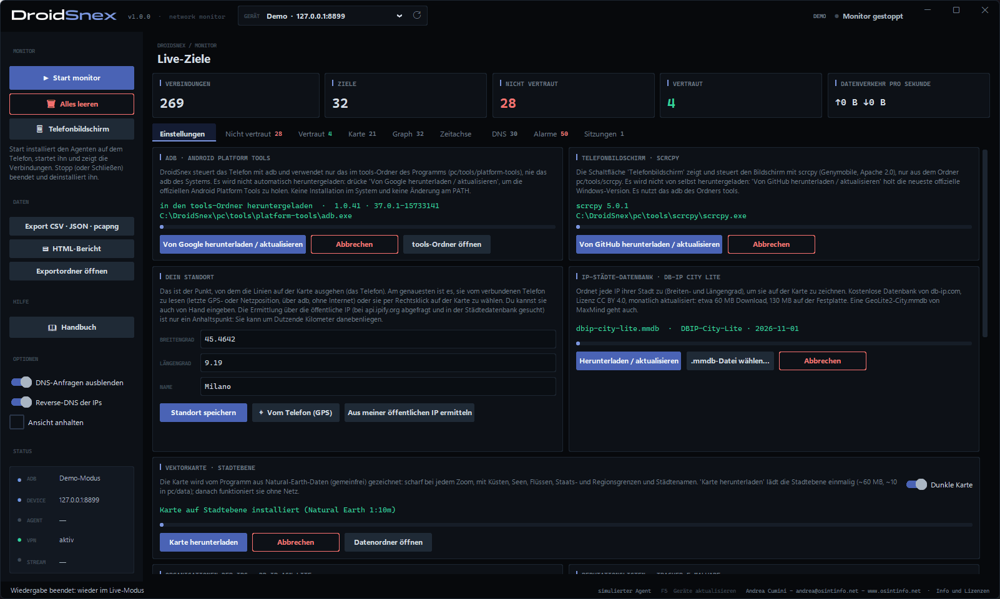

- **ADB · Android Platform Tools** — DroidSnex steuert das Telefon mit adb, ausschließlich aus dem Ordner `tools` des Programms. Drücken Sie **Von Google herunterladen / aktualisieren** für die offiziellen Android Platform Tools; **tools-Ordner öffnen** öffnet den Ordner.
- **Telefonbildschirm · scrcpy** — **Von GitHub herunterladen / aktualisieren** lädt scrcpy aus den offiziellen Releases.
- **Dein Standort** — der Punkt, von dem die Linien auf der Karte ausgehen, und das Land für die Gefahrenskala. Am genauesten ist **⌖ Vom Telefon (GPS)**: Es liest über adb die letzte Position des verbundenen Telefons und zeigt Quelle, Genauigkeit und Alter. Alternativ Rechtsklick auf die Karte › **Meine Position hier setzen**, oder geben Sie BREITENGRAD, LÄNGENGRAD und NAME ein und drücken Sie **Standort speichern**. **Aus meiner öffentlichen IP ermitteln** ist nur ein Richtwert: Es kann um Dutzende Kilometer danebenliegen.
- **IP-Städte-Datenbank · DB-IP City Lite** — ordnet jeder IP ihre Stadt zu, um sie auf der Karte darzustellen. **Herunterladen / aktualisieren** oder **.mmdb-Datei wählen…**; **Datenordner öffnen**.
- **Vektorkarte · Stadtebene** — **Karte herunterladen** installiert die detaillierte Karte (Natural Earth 1:10m, mit Küsten, Flüssen, Grenzen und Städtenamen); ohne sie wird die mitgelieferte Grundversion angezeigt. **Dunkle Karte** ändert die Farben der Karte.
- **Organisationen der IPs · DB-IP ASN Lite** — ordnet jeder IP die Organisation zu, die sie betreibt (Google, Meta, Amazon, ein unbekannter Hoster…). Grundlage für den Graph und die Spalte Org / ASN.
- **Reputationslisten · Tracker und Malware** — öffentliche Sperrlisten für Tracker, Malware, **Tor**-Exit-Knoten und Hinweise auf **VPN**-Anbieter. **Listen herunterladen / aktualisieren**. Gelistete Ziele erhalten ein Kennzeichen und einen Alarm.
- **IP-Details · Cloud-Bereiche** — **Cloud-Listen herunterladen / aktualisieren** und die Erlaubnis für den **aktiven Kontakt** (TLS-Zertifikat) der IP-Details.
- **IP-Details · Dienste mit API-Schlüssel** — optionale Schlüssel für VirusTotal, AbuseIPDB, Shodan und ipinfo.io. **Registrieren** öffnet die Seite des Dienstes; fügen Sie den Schlüssel ein und drücken Sie **Schlüssel speichern**. Ohne Schlüssel bleibt der Dienst deaktiviert. Die Schlüssel bleiben auf dem PC, in der Konfigurationsdatei.
- **Android-Agent · APK** — die APK des Agenten, die auf dem Telefon installiert wird. Meist passt die **Standard**-APK; mit **Durchsuchen…** wählen Sie eine andere, dann **Speichern**.
- **Aktualisierungen** — **Nach Updates suchen** prüft, nur wenn Sie es drücken, ob unter der angegebenen Adresse eine neuere Version vorliegt, und zeigt den Link zur Seite. Es wird nichts heruntergeladen oder installiert.
- **Sprache · Language** — die Sprache der Oberfläche; auch der Agent auf dem Telefon verwendet sie ab dem nächsten Start.

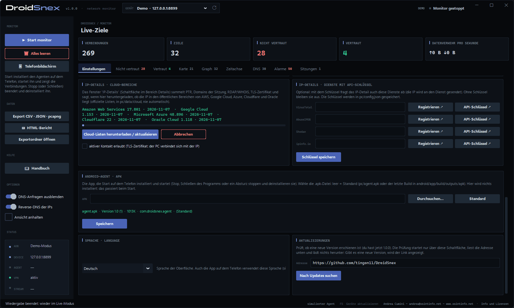

## 4. Das Hauptfenster

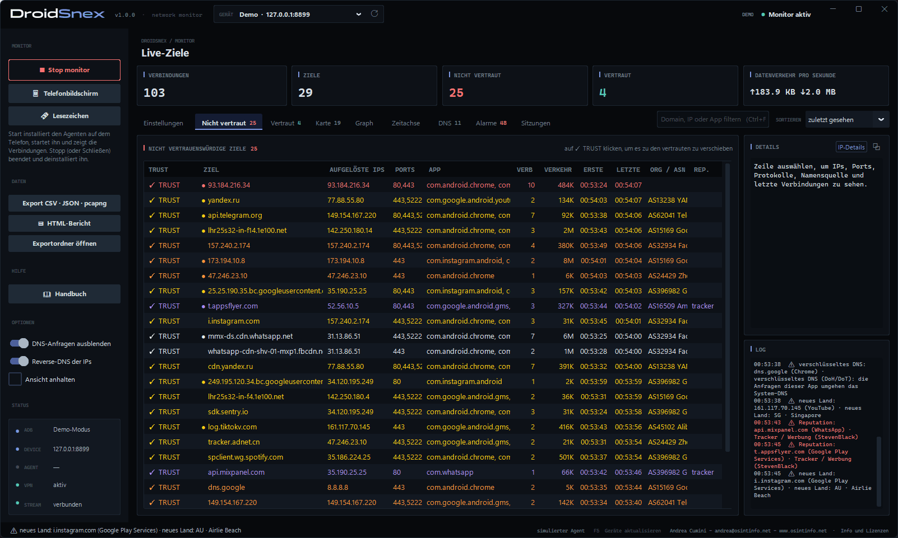

- **Kopfzeile (oben):** Logo und Version, das Menü **GERÄT** mit dem verbundenen Telefon (die Schaltfläche ↻ oder die Taste **F5** aktualisiert die Liste) und rechts der Status des Monitors.
- **Linke Spalte:** die Befehle.
  - *Monitor:* **Start monitor** (bei laufendem Monitor wird dieselbe Schaltfläche zu **Stop monitor**), **Alles leeren** (nur bei gestopptem Monitor), **Telefonbildschirm**, **Lesezeichen** (nur bei laufendem Monitor).
  - *Daten:* **Export CSV · JSON · pcapng**, **HTML-Bericht** und **Exportordner öffnen**.
  - *Hilfe:* **📖 Handbuch** öffnet dieses Handbuch in der Sprache der Oberfläche. Im Handbuchfenster hebt das Suchfeld oben links (**Strg+F**) alle Treffer hervor: **Enter** oder **F3** springt zum nächsten, **Umschalt+Enter** zum vorherigen, **Esc** leert die Suche.
  - *Optionen:* **DNS-Anfragen ausblenden** (entfernt Zeilen, die nur DNS-Anfragen sind, aus den Listen), **Reverse-DNS der IPs** (sucht einen Namen für IPs ohne Namen), **Ansicht anhalten** (friert die Listen ein, damit Sie sie in Ruhe lesen können; die Daten kommen weiter an).
  - *Status:* fünf Anzeigen (ADB, DEVICE, AGENT, VPN, STREAM): grün, wenn der jeweilige Teil funktioniert.
- **Zähler:** Verbindungen, Ziele, Nicht vertraut, Vertraut, Datenverkehr pro Sekunde.
- **Tabs:** Einstellungen, Nicht vertraut, Vertraut, Karte, Graph, Zeitachse, DNS, Alarme, Sitzungen. Rechts neben den Tabs, bei den Listen, das Feld **Domain, IP oder App filtern** (**Strg+F**) und das Menü **SORTIEREN** (zuletzt gesehen, Anz. Verbindungen, zuerst gesehen, Ziel, Datenverkehr).
- **Rechter Bereich:** **Details** der ausgewählten Zeile und darunter das **Log** mit den Meldungen des Programms.
- **Untere Leiste:** die Statusmeldung, **F5 Geräte aktualisieren** und der Link **Info und Lizenzen**.

## 5. Monitor starten und stoppen

1. Verbinden Sie das Telefon per USB und entsperren Sie es. Im Menü **GERÄT** erscheint sein Modell; bei mehreren Telefonen wählen Sie es im Menü aus.
2. Drücken Sie **▶ Start monitor**. DroidSnex installiert den Agenten auf dem Telefon, erteilt ihm die nötigen Berechtigungen und startet das lokale VPN. Wenn auf dem Telefon **Verbindungsanfrage** erscheint, entsperren Sie es und tippen Sie auf **OK**.
3. Sobald die *Status*-Anzeigen grün sind, erscheinen die Verbindungen in den Listen. Benutzen Sie das Telefon wie gewohnt: Jede App, die sich mit dem Internet verbindet, erscheint mit ihren Zielen.
4. Drücken Sie **■ Stop monitor**, um zu beenden. Der Agent wird gestoppt und vom Telefon **deinstalliert**; die Sitzung wird im Tab [Sitzungen](#15-sitzungen-wiedergabe-und-lesezeichen) gespeichert.

Auch beim Schließen des Programms wird der Agent gestoppt und deinstalliert. Löst sich das Kabel, versucht DroidSnex, die Verbindung selbst wiederherzustellen; schaltet sich der PC aus oder bricht das Programm ab, beendet sich der Agent nach kurzer Zeit von selbst (Watchdog).

## 6. Nicht vertraut und Vertraut

Jedes Ziel (eine Domain oder eine IP, wenn der Name unbekannt ist) steht in einer von zwei Listen:

- **Nicht vertraut** — die nicht vertrauenswürdigen Ziele. Jedes neue Ziel beginnt hier.
- **Vertraut** — die Ziele, die Sie als vertrauenswürdig markiert haben.

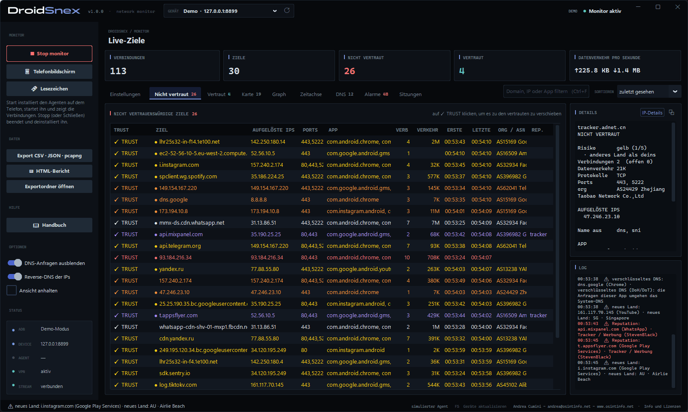

Die Spalten: Ziel, Aufgelöste IPs, Ports, App, Verb (Anzahl der Verbindungen), Verkehr, Erste und Letzte (Uhrzeiten), Org / ASN (die Organisation, die die IP betreibt) und Rep. (Kennzeichen *tracker*, *malware* oder *tor* aus den Reputationslisten). Klicken Sie auf eine Spaltenüberschrift, um A-Z zu sortieren, ein weiterer Klick sortiert Z-A.

- **Einem Ziel vertrauen:** Klicken Sie in der Liste Nicht vertraut in der ersten Spalte auf **✓ TRUST**. Das Ziel wechselt in die Liste Vertraut.
- **Rückgängig machen:** Klicken Sie in der Liste Vertraut auf **✕ UNTRUST**.
- **✕ Allen misstrauen** (oben in der Liste Vertraut) verschiebt nach einer Bestätigung alle vertrauten Ziele zurück zu den nicht vertrauten. Die gespeicherte Liste wird geleert; das lässt sich nicht rückgängig machen.

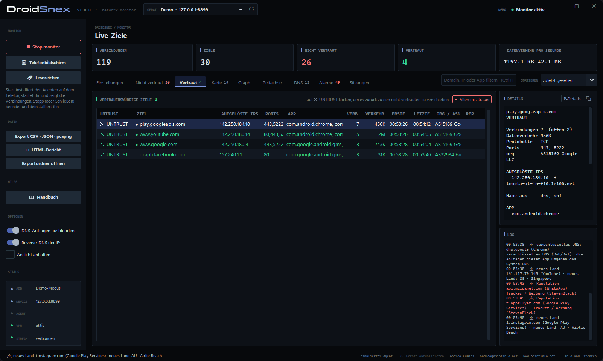

Die Liste der vertrauten Ziele wird gespeichert und gilt auch für spätere Sitzungen und andere Telefone.

## 7. Die Gefahrenskala

In der Liste Nicht vertraut hat jede Zeile eine Farbe, die anzeigt, wie verdächtig das Ziel ist. DroidSnex zählt für jedes Signal Punkte zusammen:

| Signal | Punkte |
|---|---|
| nur IP, kein Name | +1 |
| unbekannte Organisation (IP nicht in der ASN-Datenbank) | +1 |
| anderes Land als Ihres | +1 |
| verschlüsseltes DNS (DoH/DoT) | +1 |
| ungewöhnlicher Port (nicht 80, 443, 53…) | +2 |
| VPN-Anbieter (Hinweis) | +3 |
| gelisteter Tracker / Werbung | +4 |
| Tor-Exit-Knoten | +4 |
| gelistete Malware | +5 |

Die allgemeinen Signale (die ersten fünf Zeilen) ergeben höchstens 3 Punkte; Fuchsia und Violett werden nur über die Reputationslisten erreicht. Die Farbe ist die Summe, bis 5:

**0 weiß · 1 gelb · 2 orange · 3 rot · 4 fuchsia · 5 violett**

Im Bereich Details erklärt die Zeile *Gefahr*, welche Signale beigetragen haben. Für alle Signale brauchen Sie den Standort, die ASN-Datenbank und die Reputationslisten (siehe [Einstellungen](#3-einstellungen)).

## 8. Details und IP-Details

Wählen Sie eine Zeile in einer Liste: Der Bereich **Details** zeigt, ob das Ziel VERTRAUT oder NICHT VERTRAUT ist, die Anzahl der Verbindungen (und wie viele noch offen sind), Protokolle, Ports, die aufgelösten IPs mit der Quelle des Namens (SNI, DNS oder Reverse-DNS), die Gefahr und die letzten Verbindungen.

Die Schaltfläche **IP-Details** oben im Bereich öffnet ein Fenster mit allem, was sich über die IP herausfinden lässt:

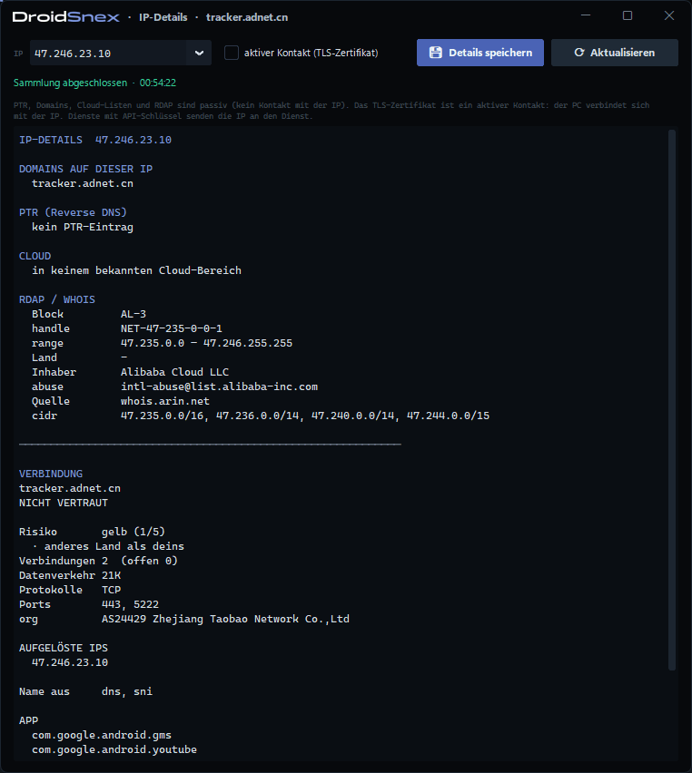

- **AUF DIESER IP GESEHENE DOMAINS** in der Sitzung;
- **PTR (Reverse-DNS)**;
- **CLOUD** — ob die IP zu den von AWS, Google Cloud, Azure, Cloudflare und anderen veröffentlichten Bereichen gehört (Listen aus den Einstellungen);
- **RDAP / WHOIS** — Block, Land, Inhaber;
- **TLS-ZERTIFIKAT (aktiver Kontakt)** — Aussteller, Gültigkeit, Namen im Zertifikat;
- **VIRUSTOTAL, ABUSEIPDB, SHODAN, IPINFO.IO** — nur wenn Sie die API-Schlüssel in den Einstellungen eingetragen haben.

Oben wählen Sie die **IP** (wenn das Ziel mehrere hat). PTR, Domains, Cloud-Listen und RDAP sind passiv: kein Kontakt mit der IP. Das TLS-Zertifikat ist dagegen ein aktiver Kontakt, der PC verbindet sich mit der IP, und wird nur abgefragt, wenn das Kästchen **aktiver Kontakt (TLS-Zertifikat)** angehakt ist. Dienste mit Schlüssel erhalten die abgefragte IP.

**Aktualisieren** wiederholt die Abfrage. **Details speichern** speichert das Ergebnis in einer Textdatei; der Pfad erscheint im Log.

Die IP-Details lassen sich auch von einer Linie auf der Karte oder einem Knoten im Graph aus öffnen: Wählen Sie zuerst das Ziel und drücken Sie dann die Schaltfläche.

## 9. Karte

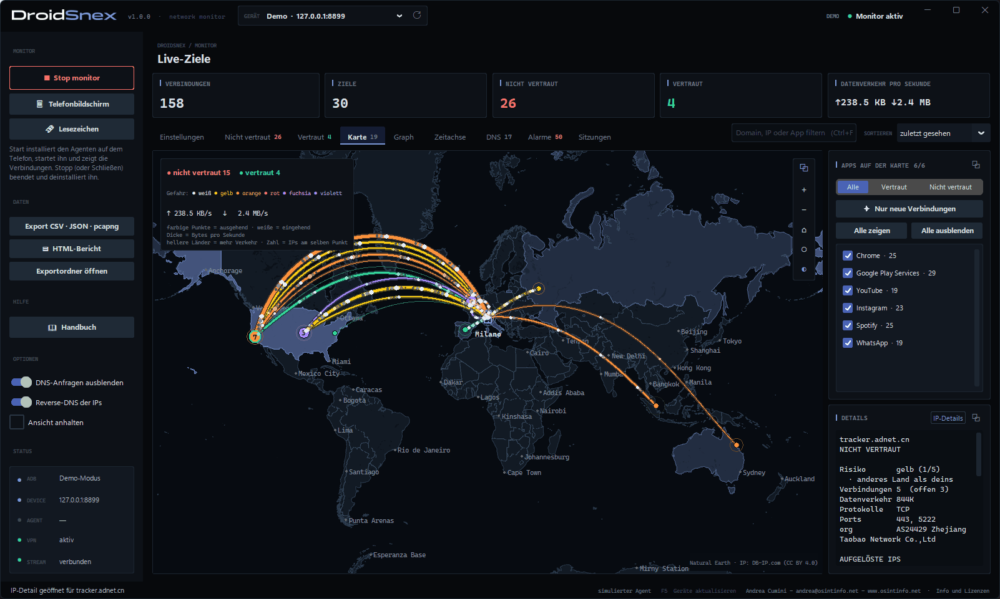

Das Telefon wird an Ihrem Standort gezeichnet (in den Einstellungen festlegen); von dort führt eine Linie zur Stadt jedes Ziels: **grün** bei vertrauten Zielen, bei nicht vertrauten in der Farbe der Gefahrenskala. Die Linienstärke wächst mit den Bytes pro Sekunde; farbige Punkte, die zum Ziel laufen, sind ausgehender Verkehr, weiße Punkte zum Telefon hin eingehender Verkehr.

- **Mausrad** oder **+ / −**: Zoom. **Ziehen**: verschieben. **Doppelklick**: heranzoomen.
- **Klick auf eine Linie oder einen Punkt**: Details des Ziels im Bereich Details.
- **Apps auf der Karte** (Bereich rechts): wählen Sie **Alle**, **Vertraut** oder **Nicht vertraut** und welche Apps angezeigt werden, mit **Alle zeigen** und **Alle ausblenden**.
- **✦ Nur neue Verbindungen**: Ab diesem Moment zeigt die Karte nur Verbindungen, die danach entstehen; erneut drücken, um wieder alle zu sehen.
- Aus der Ferne werden nahe Ziele in einer **Kugel mit der Anzahl der IPs** zusammengefasst: Mauszeiger darüber zeigt die Liste, ein Klick zoomt dorthin. Ab Zoomstufe 4 öffnen sich IPs am selben Punkt zu einzelnen Punkten rund um die Stadt.
- **◐** färbt die Länder nach dem ausgetauschten Datenverkehr (heller = mehr Bytes).
- Eine neue Verbindung kündigt sich mit einem Blitz vom Telefon zum Ziel an; die Impulse auf den Linien haben eine Spur und nehmen mit dem Verkehr zu.
- **Rechtsklick** auf die Karte › **Meine Position hier setzen**.
- **⧉** dockt die Karte in ein eigenes Fenster ab (siehe [Abgedockte Bereiche](#17-abgedockte-bereiche)).

Fehlen der Standort oder die Städte-Datenbank, weist die Karte mit einer Meldung darauf hin. Ziele ohne Standort (private IPs oder IPs, die nicht in der Datenbank stehen) werden gesondert gezählt.

## 10. Graph

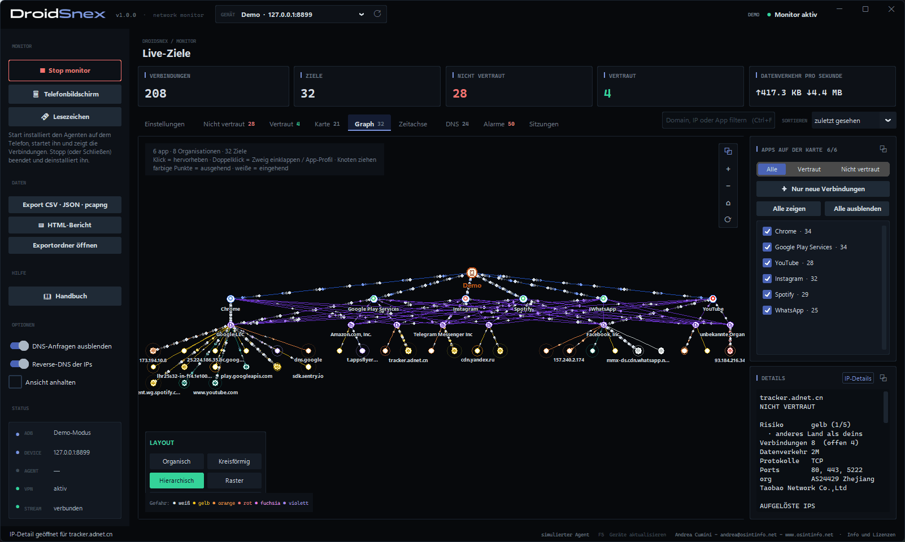

Der Graph zeigt, wer mit wem spricht: **Telefon → App → Organisation (ASN) → Ziel**.

- **Klick** auf einen Knoten: hebt ihn mit seinen Nachbarn hervor; die anderen werden blasser.
- **Doppelklick** auf eine App oder Organisation: klappt den Zweig zu oder auf. Ein Doppelklick auf die App (oder die App in der Liste) öffnet das **App-Profil**: Version, ob System-App, Installations- und Aktualisierungsdatum, Berechtigungen (sensible in Gelb), Ziele.
- **Ziehen** Sie die Knoten, um sie anzuordnen, ziehen Sie den Hintergrund, um die Ansicht zu verschieben, **Mausrad** oder **+ / −** zum Zoomen, **⌂** passt den Graph ans Fenster an, **⟳** ordnet ihn neu an.
- **Layout:** **Hierarchisch** (Standard: Telefon → App → Organisation → Ziel, von oben nach unten), **Organisch**, **Kreisförmig**, **Raster**. **Kreuzungen reduzieren** probiert mehrere Anordnungen aus und behält die mit den wenigsten sich kreuzenden Linien.
- Auf den Verbindungen laufen Verkehrsimpulse wie auf der Karte (farbig = ausgehend, hell = eingehend); Ziele mit offenen Verbindungen haben einen pulsierenden Ring. Beschriftungen überlappen sich nicht: Fahren Sie mit der Maus über einen Knoten, um den vollständigen Namen zu lesen.
- **⧉** dockt den Graph in ein eigenes Fenster ab.

Für die Organisationen wird die ASN-Datenbank benötigt (Einstellungen).

## 11. Zeitachse

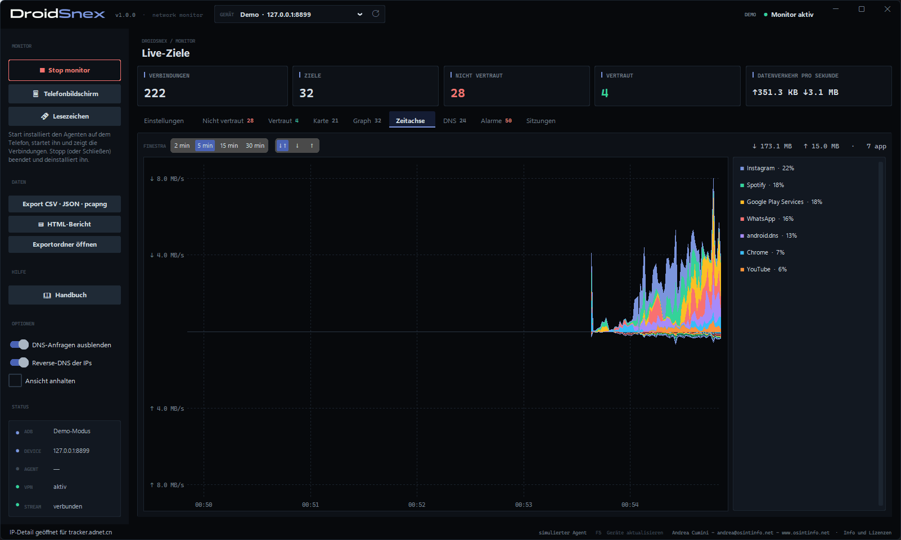

Die Zeitachse zeigt die Bytes pro Sekunde jeder App im Zeitverlauf. Über der Achse der eingehende Verkehr (↓, vom Server zum Telefon), darunter der ausgehende (↑): So sehen Sie sofort, welche App bei ruhendem Telefon im Hintergrund kommuniziert und welche herunterlädt.

- Wählen Sie das Zeitfenster: **2, 5, 15 oder 30 min**.
- **Klick auf einen Legendeneintrag** blendet diese App aus oder ein.
- **Fahren Sie mit der Maus** über das Diagramm, um die Werte dieses Zeitpunkts abzulesen.
- Apps jenseits der ersten zehn werden unter *andere* zusammengefasst.

## 12. DNS

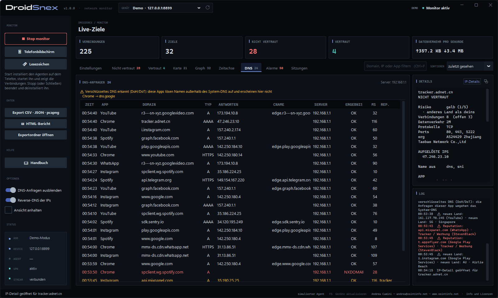

Der Tab **DNS** listet die DNS-Anfragen des Telefons auf: Zeit, App, Domain, Typ (A, AAAA, HTTPS…), Antworten, Ergebnis, Antwortzeit in ms und Rep. **Leeren** löscht die Liste.

Manche Apps verwenden **verschlüsseltes DNS** (DoH/DoT): Ihre Anfragen laufen nicht über das System-DNS und erscheinen hier nicht. Wenn DroidSnex das bemerkt, zeigt es einen Hinweis und erzeugt einen Alarm.

## 13. Alarme

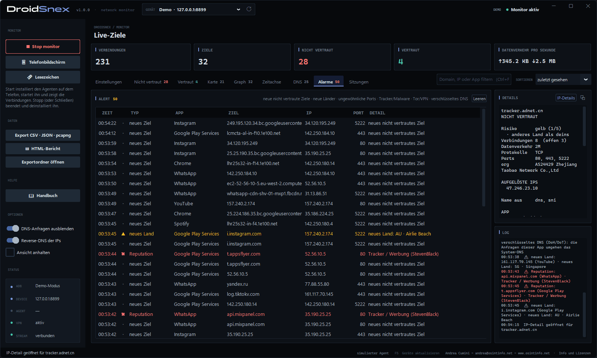

Der Tab **Alarme** sammelt Ereignisse, die Aufmerksamkeit verdienen: **neue nicht vertraute Ziele · neue Länder · ungewöhnliche Ports · Tracker/Malware · Tor/VPN · verschlüsseltes DNS**. Jede Zeile zeigt Zeit, Stufe, Typ, App, Ziel, IP, Port und Detail. **Leeren** löscht die Liste.

## 14. Telefonbildschirm

Die Schaltfläche **📱 Telefonbildschirm** zeigt den Bildschirm des Telefons auf dem PC und lässt Sie ihn mit Maus und Tastatur bedienen; dafür wird scrcpy verwendet (vorher in den Einstellungen herunterladen). Das Fenster bleibt im Vordergrund; ziehen Sie die Kopfzeile, um es zu verschieben. Die Schaltflächen oben senden Android-Tasten: Zurück, Home, letzte Apps, Ein/Aus, Lautstärke − und +.

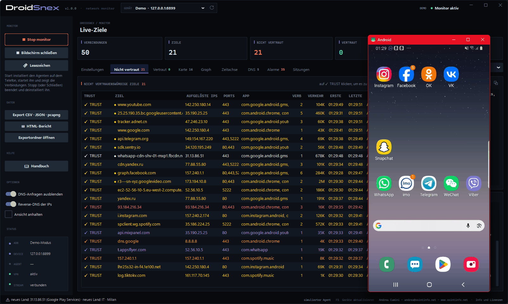

Drücken Sie die Schaltfläche erneut (**Bildschirm schließen**), um es zu schließen.

## 15. Sitzungen, Wiedergabe und Lesezeichen

Jede Überwachung, von Start bis Stop, wird als **Sitzung** mit allen aufgezeichneten Ereignissen gespeichert.

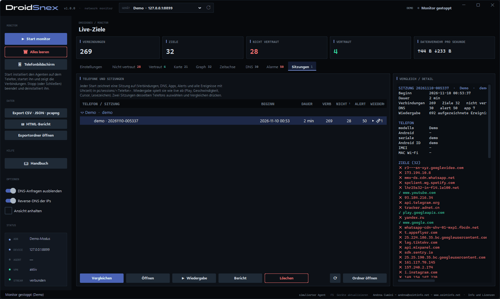

Im Tab **Sitzungen**:

- **Telefone und Sitzungen** (links) listet die gespeicherten Sitzungen mit Telefon, Beginn, Dauer, Verbindungen, nicht vertrauten Zielen und einer Spalte **Wiedergabe** (▶, wenn die Sitzung wiedergegeben werden kann, 🔖 mit der Anzahl der Lesezeichen).
- Wählen Sie eine Sitzung: Unter **Vergleich / Detail** (rechts) erscheinen Telefon, Beginn, Dauer, Ziele, Apps, Organisationen und die Lesezeichen.
- **Vergleichen:** Wählen Sie mit **Strg+Klick** zwei Sitzungen desselben Telefons und drücken Sie Vergleichen. Sie sehen gemeinsame, neue und verschwundene Ziele, neue Apps, verschwundene Apps, neue Organisationen und neue Länder.
- **Bericht** erstellt den HTML-Bericht der ausgewählten Sitzung (siehe [Kapitel 16](#16-daten-exportieren-und-alles-leeren)).
- **Öffnen** öffnet eine Sitzung aus einer Datei, **Ordner öffnen** öffnet den Sitzungsordner, **Sitzungen löschen** löscht die ausgewählten nach einer Bestätigung (nicht rückgängig zu machen).

### Wiedergabe

Wählen Sie eine Sitzung und drücken Sie **▶ Wiedergabe** (bei gestopptem Monitor). Alle Ansichten (Listen, Karte, Graph, Zeitachse, DNS, Alarme) durchlaufen die Sitzung erneut, als wäre sie live.

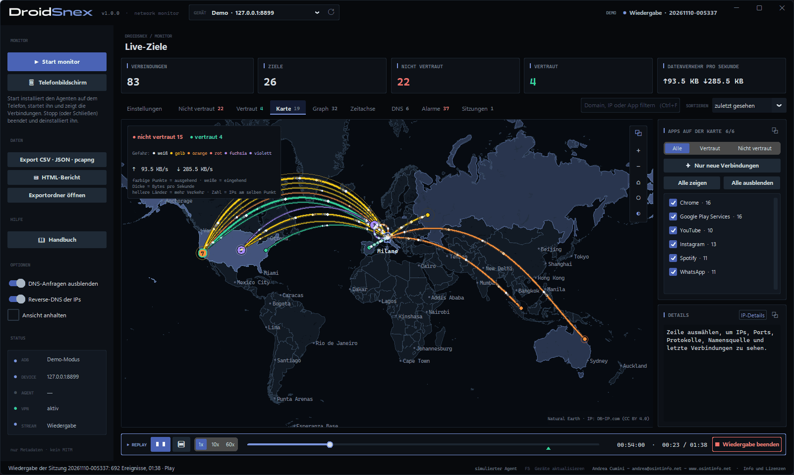

Die Wiedergabeleiste unten:

- **▶ / ❚❚** Wiedergabe und Pause, **⏮** zurück zum Anfang;
- Geschwindigkeit **1x, 10x, 60x**;
- der Zeitregler: Ziehen Sie ihn, um zu einem Zeitpunkt zu springen; Lesezeichen sind auf dem Regler markiert. **Rechtsklick** auf ein Lesezeichen öffnet seinen Screenshot;
- **■ Wiedergabe beenden** kehrt in den Live-Modus zurück.

### Lesezeichen

Drücken Sie während der Überwachung **🔖 Lesezeichen** in der linken Spalte, um einen Moment zu markieren, zum Beispiel „Instagram geöffnet“. Schreiben Sie eine Notiz und drücken Sie **Lesezeichen speichern**. Das Lesezeichen wird mit der Uhrzeit und einem Screenshot des Telefons in der Sitzung gespeichert.

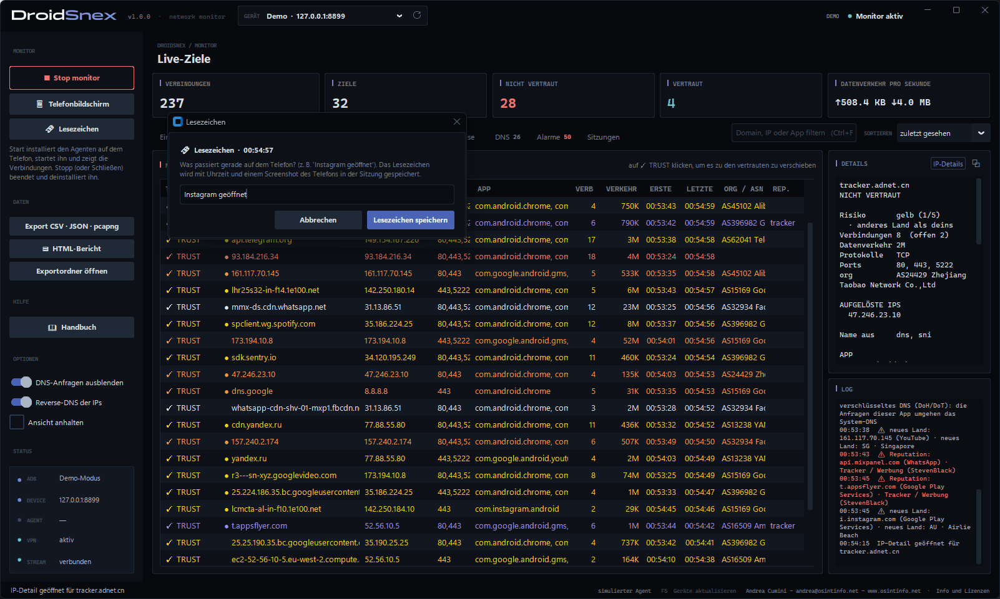

## 16. Daten exportieren und Alles leeren

- **Export CSV · JSON · pcapng** speichert die Verbindungen der Sitzung in drei Formaten: CSV (für Tabellenkalkulationen), JSON und pcapng (in Wireshark zu öffnen, nur Metadaten). **Exportordner öffnen** öffnet den Ordner mit den Dateien.
- **HTML-Bericht** erstellt eine einzige HTML-Datei der Sitzung (der laufenden, der wiedergegebenen oder der im Tab Sitzungen gewählten) und öffnet sie im Browser: Übersicht, Telefon, Karte, nicht vertraute Ziele nach Gefahr mit den Gründen, vertraute Ziele, Verkehr pro App und pro Land, Alarme und Lesezeichen mit den Screenshots. Für ein PDF verwenden Sie im Browser *Drucken › Als PDF speichern*.
- **🗑 Alles leeren** erscheint bei gestopptem Monitor: Nach einer Bestätigung werden Verbindungen, DNS-Anfragen, Alarme, Karte, Graph und Zeitachse der aktuellen Sitzung gelöscht. Gespeicherte Sitzungen und die Liste der vertrauten Ziele bleiben erhalten.

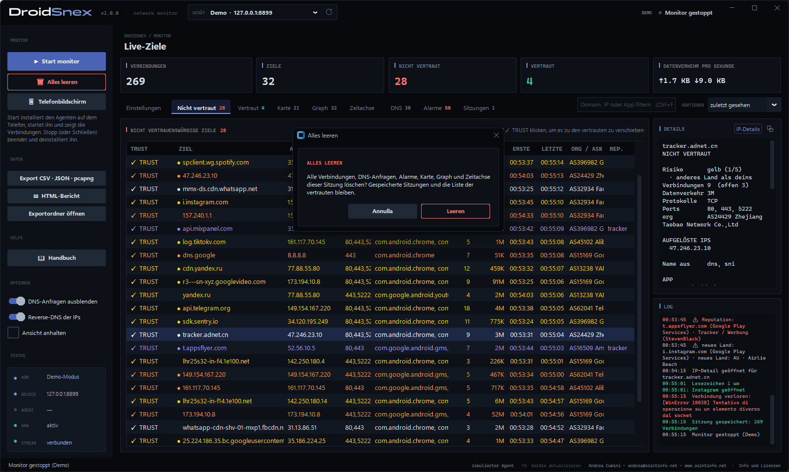

## 17. Abgedockte Bereiche

Karte, Graph, Details und Apps auf der Karte haben oben rechts die Schaltfläche **⧉**: Der Bereich wird in ein eigenes Fenster abgedockt, das Sie verschieben und in der Größe ändern können, zum Beispiel auf einem zweiten Monitor. Der Bereich wird weiter aktualisiert.

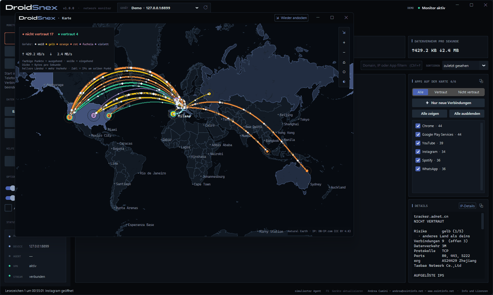

Um ihn zurückzuholen, drücken Sie **⇲ Wieder andocken** in der Kopfzeile des Fensters, schließen das Fenster oder drücken **Wieder andocken** im leeren Tab.

## 18. Info und Lizenzen

Klicken Sie in der unteren Leiste auf **Info und Lizenzen**: Das Fenster zeigt Version, Autor, Lizenz des Programms sowie Daten und Komponenten von Drittanbietern mit ihren Lizenzen (**Alle Lizenzen**); mit der Schaltfläche **Nutzungsbedingungen** lesen Sie die Bedingungen erneut. DroidSnex ist freie Software, ohne jegliche Gewährleistung.

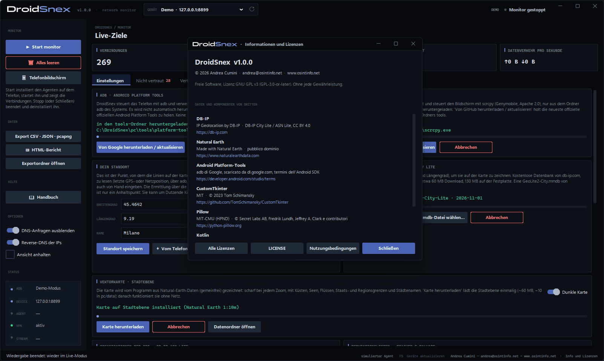

## 19. Häufige Probleme

| Meldung | Was tun |
|---|---|
| Kein Gerät verbunden | Verbinden Sie das Telefon per USB mit aktivem USB-Debugging und drücken Sie F5. |
| Gerät nicht autorisiert | Entsperren Sie das Telefon und bestätigen Sie „USB-Debugging zulassen?“ mit Häkchen bei „Von diesem Computer immer zulassen“. |
| adb nicht im Ordner tools | Einstellungen › ADB › Von Google herunterladen / aktualisieren. |
| scrcpy nicht im Ordner tools | Einstellungen › Telefonbildschirm › Von GitHub herunterladen / aktualisieren. |
| Das VPN ist nicht aktiv | Tippen Sie auf dem Telefon bei der VPN-Verbindungsanfrage auf OK; ist ein anderes VPN aktiv, schalten Sie es aus und drücken Sie erneut Start. |
| Städte-Datenbank fehlt | Einstellungen › IP-Städte-Datenbank › Herunterladen / aktualisieren. |
| Standort festlegen | Einstellungen › Dein Standort › Aus meiner öffentlichen IP ermitteln (oder von Hand eingeben). |
