# DroidSnex — Εγχειρίδιο χρήσης

Το DroidSnex δείχνει σε πραγματικό χρόνο με ποιους διακομιστές συνδέεται ένα τηλέφωνο Android: ποια εφαρμογή, ποιος τομέας, ποια IP, σε ποια χώρα και με πόση κίνηση. Το τηλέφωνο συνδέεται στον υπολογιστή με καλώδιο USB· όσο διαρκεί η παρακολούθηση, στο τηλέφωνο τρέχει μια μικρή εφαρμογή (ο *πράκτορας*, agent) που δημιουργεί ένα τοπικό VPN και διαβάζει μόνο τα μεταδεδομένα των συνδέσεων. Το περιεχόμενο της κίνησης δεν αποκρυπτογραφείται ποτέ (χωρίς MITM).

## Περιεχόμενα

1. [Πριν ξεκινήσετε](#1-πριν-ξεκινήσετε)
2. [Πρώτη εκκίνηση: γλώσσα και όροι χρήσης](#2-πρώτη-εκκίνηση-γλώσσα-και-όροι-χρήσης)
3. [Ρυθμίσεις](#3-ρυθμίσεις)
4. [Το κύριο παράθυρο](#4-το-κύριο-παράθυρο)
5. [Έναρξη και διακοπή της παρακολούθησης](#5-έναρξη-και-διακοπή-της-παρακολούθησης)
6. [Μη έμπιστα και Έμπιστα](#6-μη-έμπιστα-και-έμπιστα)
7. [Η κλίμακα επικινδυνότητας](#7-η-κλίμακα-επικινδυνότητας)
8. [Λεπτομέρειες και Λεπτομέρειες IP](#8-λεπτομέρειες-και-λεπτομέρειες-ip)
9. [Χάρτης](#9-χάρτης)
10. [Γράφος](#10-γράφος)
11. [Χρονογραμμή](#11-χρονογραμμή)
12. [DNS](#12-dns)
13. [Ειδοποιήσεις](#13-ειδοποιήσεις)
14. [Οθόνη τηλεφώνου](#14-οθόνη-τηλεφώνου)
15. [Συνεδρίες, επανάληψη και σελιδοδείκτες](#15-συνεδρίες-επανάληψη-και-σελιδοδείκτες)
16. [Εξαγωγή δεδομένων και Εκκαθάριση όλων](#16-εξαγωγή-δεδομένων-και-εκκαθάριση-όλων)
17. [Αποσπασμένα πλαίσια](#17-αποσπασμένα-πλαίσια)
18. [Πληροφορίες και άδειες](#18-πληροφορίες-και-άδειες)
19. [Συχνά προβλήματα](#19-συχνά-προβλήματα)

---

## 1. Πριν ξεκινήσετε

Χρειάζεστε:

- έναν υπολογιστή Windows με το DroidSnex·
- ένα τηλέφωνο Android και ένα καλώδιο USB δεδομένων·
- ενεργοποιημένο τον **εντοπισμό σφαλμάτων USB** στο τηλέφωνο: *Ρυθμίσεις › Σχετικά με το τηλέφωνο*, πατήστε επτά φορές τον *Αριθμό έκδοσης* για να ξεκλειδώσετε τις *Επιλογές για προγραμματιστές* και μετά ενεργοποιήστε στις *Επιλογές για προγραμματιστές* τον *Εντοπισμό σφαλμάτων USB*.

Στην πρώτη σύνδεση το τηλέφωνο ρωτά **«Να επιτρέπεται ο εντοπισμός σφαλμάτων USB;»**: ξεκλειδώστε την οθόνη, επιλέξτε *Να επιτρέπεται πάντα από αυτόν τον υπολογιστή* και πατήστε *OK*.

Το DroidSnex χρησιμοποιεί μόνο τα εργαλεία του δικού του φακέλου `tools` (adb και scrcpy) και δεν εγκαθιστά τίποτα στο σύστημα. Την πρώτη φορά κατεβάστε τα από την καρτέλα **Ρυθμίσεις** (δείτε το [κεφάλαιο 3](#3-ρυθμίσεις)).

## 2. Πρώτη εκκίνηση: γλώσσα και όροι χρήσης

Στην πρώτη εκκίνηση εμφανίζεται ένα παράθυρο που δεν κλείνει και δεν μπορεί να μπει πίσω από άλλα παράθυρα.

1. **Επιλέξτε γλώσσα.** Τα κουμπιά δείχνουν τις εννέα διαθέσιμες γλώσσες: Italiano, English, Deutsch, Français, Español, Nederlands, Polski, Ελληνικά, Shqip. Η γλώσσα ισχύει για όλο το πρόγραμμα και για τον πράκτορα στο τηλέφωνο· μπορείτε να την αλλάξετε αργότερα στην καρτέλα Ρυθμίσεις.

   

2. **Διαβάστε τους όρους χρήσης.** Το κείμενο είναι στη γλώσσα που επιλέξατε. Το κουμπί **Αποδέχομαι** ενεργοποιείται μόνο αφού κυλήσετε το κείμενο μέχρι το τέλος. Το **Απορρίπτω** κλείνει το πρόγραμμα.

   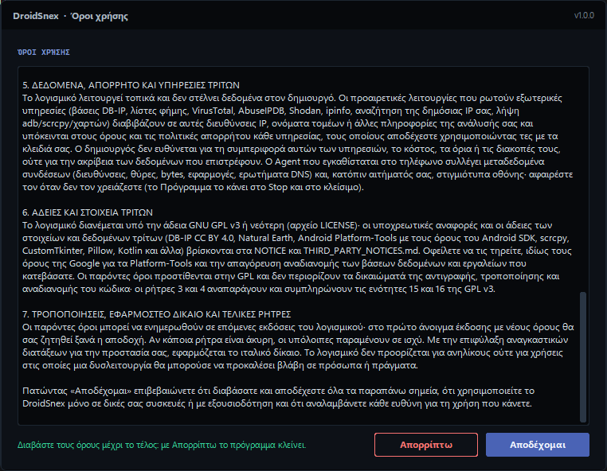

Η αποδοχή αποθηκεύεται: το παράθυρο εμφανίζεται ξανά μόνο αν αλλάξει η έκδοση των όρων. Μπορείτε να ξαναδιαβάσετε τους όρους οποιαδήποτε στιγμή από τις [Πληροφορίες και άδειες](#18-πληροφορίες-και-άδειες).

## 3. Ρυθμίσεις

Η καρτέλα **Ρυθμίσεις** συγκεντρώνει τις ρυθμίσεις και τις λήψεις. Κάθε λήψη γίνεται μόνο όταν πατήσετε το κουμπί και μπορεί να σταματήσει με τη **Διακοπή**.

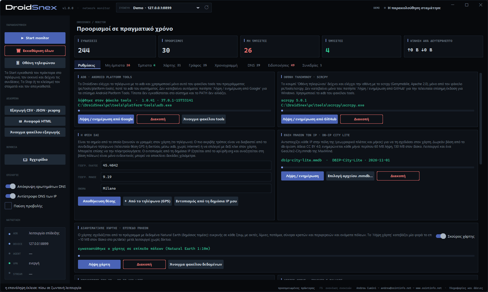

- **ADB · Android Platform Tools** — Το DroidSnex χειρίζεται το τηλέφωνο με το adb, μόνο από τον φάκελο `tools` του προγράμματος. Πατήστε **Λήψη / ενημέρωση από Google** για τα επίσημα Android Platform Tools· το **Άνοιγμα φακέλου tools** ανοίγει τον φάκελο.
- **Οθόνη τηλεφώνου · scrcpy** — Η **Λήψη / ενημέρωση από GitHub** κατεβάζει το scrcpy από τις επίσημες εκδόσεις.
- **Η θέση σας** — το σημείο από το οποίο ξεκινούν οι γραμμές στον χάρτη και η χώρα που χρησιμοποιεί η κλίμακα επικινδυνότητας. Ο πιο ακριβής τρόπος είναι το **⌖ Από το τηλέφωνο (GPS)**: διαβάζει μέσω adb την τελευταία θέση του συνδεδεμένου τηλεφώνου και δείχνει πηγή, ακρίβεια και ηλικία. Εναλλακτικά κάντε δεξί κλικ στον χάρτη › **Ορισμός της θέσης μου εδώ**, ή συμπληρώστε ΓΕΩΓΡ. ΠΛΑΤΟΣ, ΓΕΩΓΡ. ΜΗΚΟΣ και ΟΝΟΜΑ και πατήστε **Αποθήκευση θέσης**. Ο **Εντοπισμός από τη δημόσια IP μου** είναι μόνο ενδεικτικός: μπορεί να απέχει δεκάδες χιλιόμετρα.
- **Βάση πόλεων των IP · DB-IP City Lite** — αντιστοιχίζει κάθε IP στην πόλη της για να σχεδιαστεί στον χάρτη. **Λήψη / ενημέρωση** ή **Επιλογή αρχείου .mmdb…**· **Άνοιγμα φακέλου δεδομένων**.
- **Διανυσματικός χάρτης · επίπεδο πόλεων** — Η **Λήψη χάρτη** εγκαθιστά τον λεπτομερή χάρτη (Natural Earth 1:10m, με ακτές, ποτάμια, σύνορα και ονόματα πόλεων)· χωρίς αυτόν φαίνεται η βασική έκδοση που περιλαμβάνεται. Ο **Σκούρος χάρτης** αλλάζει τα χρώματα του χάρτη.
- **Οργανισμοί των IP · DB-IP ASN Lite** — αντιστοιχίζει κάθε IP στον οργανισμό που τη διαχειρίζεται (Google, Meta, Amazon, άγνωστος πάροχος φιλοξενίας…). Είναι η βάση του Γράφου και της στήλης Org / ASN.
- **Λίστες φήμης · trackers και malware** — δημόσιες λίστες αποκλεισμού για trackers, malware, κόμβους εξόδου **Tor** και ενδείξεις για παρόχους **VPN**. **Λήψη / ενημέρωση λιστών**. Οι προορισμοί που βρίσκονται σε λίστα παίρνουν σήμα και ειδοποίηση.
- **Λεπτομέρειες IP · εύρη cloud** — **Λήψη / ενημέρωση λιστών cloud** και η άδεια για την **ενεργή επαφή** (πιστοποιητικό TLS) των Λεπτομερειών IP.
- **Λεπτομέρειες IP · υπηρεσίες με κλειδί API** — προαιρετικά κλειδιά για VirusTotal, AbuseIPDB, Shodan και ipinfo.io. Η **Εγγραφή** ανοίγει τη σελίδα της υπηρεσίας· επικολλήστε το κλειδί και πατήστε **Αποθήκευση κλειδιών**. Χωρίς κλειδί η υπηρεσία μένει ανενεργή. Τα κλειδιά μένουν στον υπολογιστή, στο αρχείο ρυθμίσεων.
- **Agent Android · APK** — το APK του πράκτορα που εγκαθίσταται στο τηλέφωνο. Συνήθως αρκεί η **Προεπιλογή**· με την **Αναζήτηση…** επιλέγετε άλλο και μετά **Αποθήκευση**.
- **Ενημερώσεις** — Ο **Έλεγχος ενημερώσεων** ελέγχει, μόνο όταν τον πατήσετε, αν υπάρχει νεότερη έκδοση στη διεύθυνση που ορίζεται και δείχνει τον σύνδεσμο προς τη σελίδα της. Δεν κατεβάζει και δεν εγκαθιστά τίποτα.
- **Γλώσσα · Language** — η γλώσσα της διεπαφής· ο πράκτορας στο τηλέφωνο θα τη χρησιμοποιεί κι αυτός από το επόμενο Start.

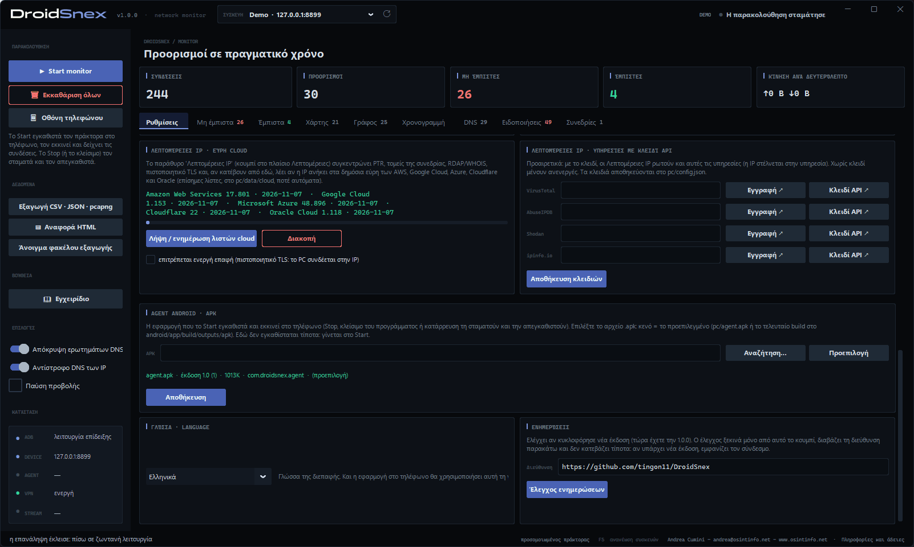

## 4. Το κύριο παράθυρο

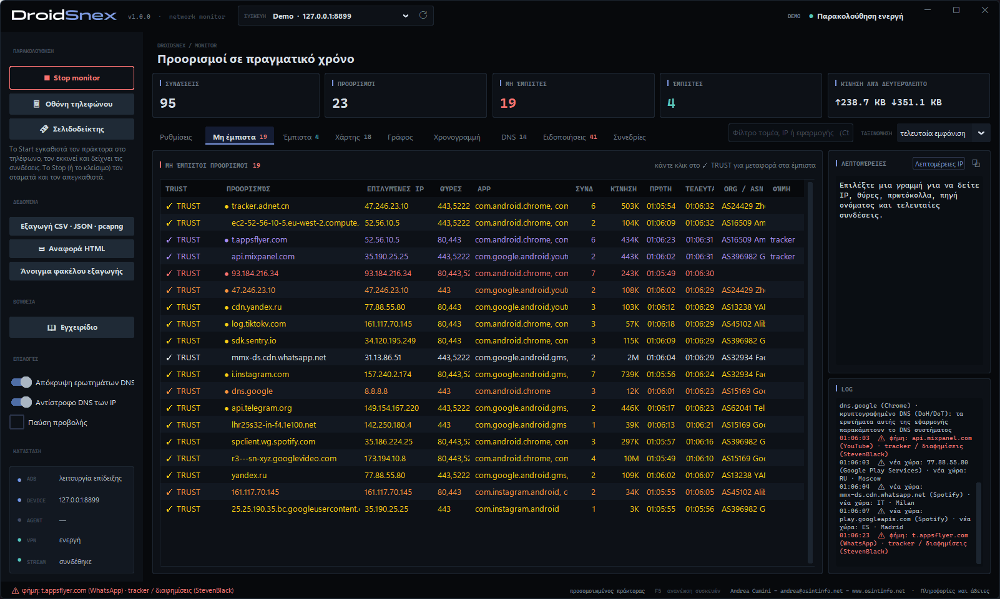

- **Κεφαλίδα (επάνω):** το λογότυπο και η έκδοση, το μενού **ΣΥΣΚΕΥΗ** με το συνδεδεμένο τηλέφωνο (το κουμπί ↻ ή το πλήκτρο **F5** ανανεώνουν τη λίστα) και, δεξιά, η κατάσταση της παρακολούθησης.
- **Αριστερή στήλη:** οι εντολές.
  - *Παρακολούθηση:* **Start monitor** (με ενεργή παρακολούθηση το ίδιο κουμπί γίνεται **Stop monitor**), **Εκκαθάριση όλων** (μόνο με σταματημένη παρακολούθηση), **Οθόνη τηλεφώνου**, **Σελιδοδείκτης** (μόνο με ενεργή παρακολούθηση).
  - *Δεδομένα:* **Εξαγωγή CSV · JSON · pcapng**, **Αναφορά HTML** και **Άνοιγμα φακέλου εξαγωγής**.
  - *Βοήθεια:* το **📖 Εγχειρίδιο** ανοίγει αυτό το εγχειρίδιο στη γλώσσα της διεπαφής. Στο παράθυρο του εγχειριδίου το πεδίο αναζήτησης επάνω αριστερά (**Ctrl+F**) επισημαίνει όλα τα αποτελέσματα: το **Enter** ή το **F3** πηγαίνει στο επόμενο, το **Shift+Enter** στο προηγούμενο, το **Esc** καθαρίζει την αναζήτηση.
  - *Επιλογές:* **Απόκρυψη ερωτημάτων DNS** (αφαιρεί από τις λίστες τις γραμμές που είναι μόνο ερωτήματα DNS), **Αντίστροφο DNS των IP** (αναζητά όνομα για τις IP που δεν έχουν), **Παύση προβολής** (παγώνει τις λίστες για να τις διαβάσετε με την ησυχία σας· τα δεδομένα συνεχίζουν να έρχονται).
  - *Κατάσταση:* πέντε ενδείξεις (ADB, DEVICE, AGENT, VPN, STREAM): πράσινες όταν το αντίστοιχο τμήμα λειτουργεί.
- **Μετρητές:** Συνδέσεις, Προορισμοί, Μη έμπιστες, Έμπιστες, Κίνηση ανά δευτερόλεπτο.
- **Καρτέλες:** Ρυθμίσεις, Μη έμπιστα, Έμπιστα, Χάρτης, Γράφος, Χρονογραμμή, DNS, Ειδοποιήσεις, Συνεδρίες. Δεξιά από τις καρτέλες, στις λίστες, το πεδίο **Φίλτρο τομέα, IP ή εφαρμογής** (**Ctrl+F**) και το μενού **ΤΑΞΙΝΟΜΗΣΗ** (τελευταία εμφάνιση, αρ. συνδέσεων, πρώτη εμφάνιση, προορισμός, κίνηση).
- **Δεξί πλαίσιο:** οι **Λεπτομέρειες** της επιλεγμένης γραμμής και, από κάτω, το **Log** με τα μηνύματα του προγράμματος.
- **Κάτω γραμμή:** το μήνυμα κατάστασης, το **F5 ανανέωση συσκευών** και ο σύνδεσμος **Πληροφορίες και άδειες**.

## 5. Έναρξη και διακοπή της παρακολούθησης

1. Συνδέστε το τηλέφωνο μέσω USB και ξεκλειδώστε το. Στο μενού **ΣΥΣΚΕΥΗ** εμφανίζεται το μοντέλο του· αν έχετε περισσότερα από ένα, επιλέξτε το από το μενού.
2. Πατήστε **▶ Start monitor**. Το DroidSnex εγκαθιστά τον πράκτορα στο τηλέφωνο, του δίνει τα απαραίτητα δικαιώματα και ξεκινά το τοπικό VPN. Αν στο τηλέφωνο εμφανιστεί **Αίτημα σύνδεσης**, ξεκλειδώστε το και πατήστε **OK**.
3. Όταν οι ενδείξεις της *Κατάστασης* είναι πράσινες, οι συνδέσεις αρχίζουν να εμφανίζονται στις λίστες. Χρησιμοποιήστε το τηλέφωνο κανονικά: κάθε εφαρμογή που συνδέεται στο διαδίκτυο εμφανίζεται με τους προορισμούς της.
4. Πατήστε **■ Stop monitor** για να τελειώσετε. Ο πράκτορας σταματά και **απεγκαθίσταται** από το τηλέφωνο· η συνεδρία αποθηκεύεται στην καρτέλα [Συνεδρίες](#15-συνεδρίες-επανάληψη-και-σελιδοδείκτες).

Και με το κλείσιμο του προγράμματος ο πράκτορας σταματά και απεγκαθίσταται. Αν το καλώδιο αποσυνδεθεί, το DroidSnex προσπαθεί να επανασυνδεθεί μόνο του· αν ο υπολογιστής κλείσει ή το πρόγραμμα διακοπεί, ο πράκτορας σταματά μόνος του λίγο αργότερα (watchdog).

## 6. Μη έμπιστα και Έμπιστα

Κάθε προορισμός (ένας τομέας, ή μια IP όταν το όνομα δεν είναι γνωστό) βρίσκεται σε μία από τις δύο λίστες:

- **Μη έμπιστα** — οι μη έμπιστοι προορισμοί. Κάθε νέος προορισμός ξεκινά από εδώ.
- **Έμπιστα** — οι προορισμοί που έχετε σημειώσει ως έμπιστους.

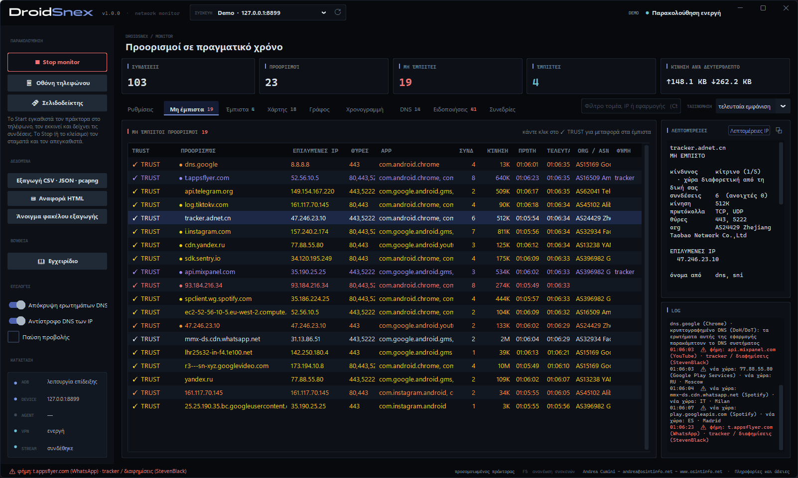

Οι στήλες: Προορισμός, Επιλυμένες IP, Θύρες, App, Συνδ (αριθμός συνδέσεων), Κίνηση, Πρώτη και Τελευταία (ώρες), Org / ASN (ο οργανισμός που διαχειρίζεται την IP) και Φήμη (σήμα *tracker*, *malware* ή *tor* από τις λίστες φήμης). Κάντε κλικ στον τίτλο μιας στήλης για ταξινόμηση Α-Ω και ξανά για Ω-Α.

- **Εμπιστοσύνη σε προορισμό:** στη λίστα Μη έμπιστα κάντε κλικ στο **✓ TRUST** στην πρώτη στήλη. Ο προορισμός μεταφέρεται στη λίστα Έμπιστα.
- **Αναίρεση:** στη λίστα Έμπιστα κάντε κλικ στο **✕ UNTRUST**.
- Το **✕ Άρση εμπιστοσύνης σε όλες** (επάνω στη λίστα Έμπιστα) επιστρέφει, μετά από επιβεβαίωση, όλους τους έμπιστους προορισμούς στους μη έμπιστους. Η αποθηκευμένη λίστα αδειάζει και η ενέργεια δεν αναιρείται.

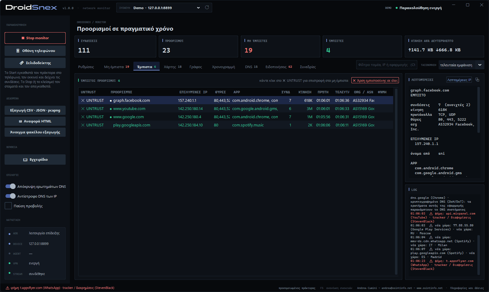

Η λίστα των έμπιστων προορισμών αποθηκεύεται και ισχύει και για επόμενες συνεδρίες και για άλλα τηλέφωνα.

## 7. Η κλίμακα επικινδυνότητας

Στη λίστα Μη έμπιστα κάθε γραμμή έχει ένα χρώμα που δείχνει πόσο ύποπτος είναι ο προορισμός. Το DroidSnex προσθέτει πόντους για κάθε ένδειξη:

| Ένδειξη | Πόντοι |
|---|---|
| μόνο IP, χωρίς όνομα | +1 |
| άγνωστος οργανισμός (IP που δεν υπάρχει στη βάση ASN) | +1 |
| χώρα διαφορετική από τη δική σας | +1 |
| κρυπτογραφημένο DNS (DoH/DoT) | +1 |
| ασυνήθιστη θύρα (όχι 80, 443, 53…) | +2 |
| πάροχος VPN (ενδεικτικά) | +3 |
| tracker / διαφήμιση σε λίστα | +4 |
| κόμβος εξόδου Tor | +4 |
| malware σε λίστα | +5 |

Οι γενικές ενδείξεις (οι πέντε πρώτες γραμμές) φτάνουν το πολύ στους 3 πόντους· το φούξια και το μοβ προκύπτουν μόνο από τις λίστες φήμης. Το χρώμα είναι το σύνολο, έως 5:

**0 λευκό · 1 κίτρινο · 2 πορτοκαλί · 3 κόκκινο · 4 φούξια · 5 μοβ**

Στο πλαίσιο Λεπτομέρειες η γραμμή *επικινδυνότητα* εξηγεί ποιες ενδείξεις μέτρησαν. Για να έχετε όλες τις ενδείξεις χρειάζονται η θέση σας, η βάση ASN και οι λίστες φήμης (δείτε [Ρυθμίσεις](#3-ρυθμίσεις)).

## 8. Λεπτομέρειες και Λεπτομέρειες IP

Επιλέξτε μια γραμμή σε μια λίστα: το πλαίσιο **Λεπτομέρειες** δείχνει αν ο προορισμός είναι ΕΜΠΙΣΤΟΣ ή ΜΗ ΕΜΠΙΣΤΟΣ, τον αριθμό των συνδέσεων (και πόσες είναι ακόμη ανοιχτές), πρωτόκολλα, θύρες, τις επιλυμένες IP με την πηγή του ονόματος (SNI, DNS ή αντίστροφο DNS), την επικινδυνότητα και τις τελευταίες συνδέσεις.

Το κουμπί **Λεπτομέρειες IP** επάνω στο πλαίσιο ανοίγει ένα παράθυρο με όλα όσα μπορούν να βρεθούν για την IP:

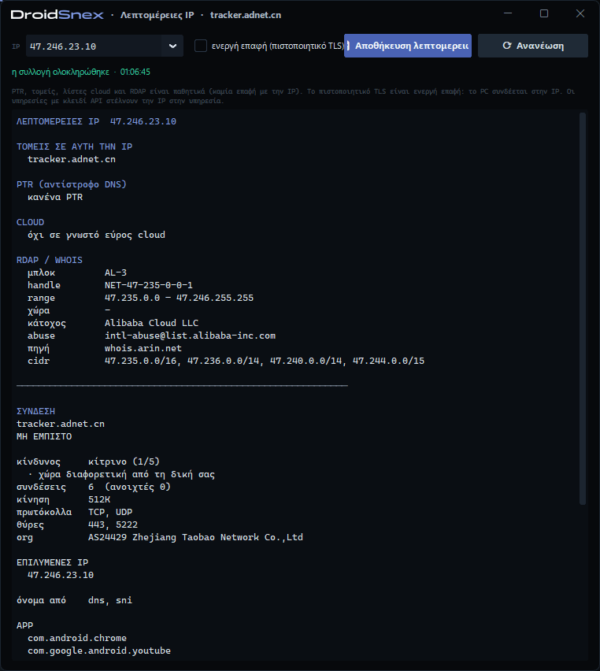

- **ΤΟΜΕΙΣ ΠΟΥ ΕΜΦΑΝΙΣΤΗΚΑΝ ΣΕ ΑΥΤΗ ΤΗΝ IP** στη συνεδρία·
- **PTR (αντίστροφο DNS)**·
- **CLOUD** — αν η IP ανήκει στα εύρη που δημοσιεύουν η AWS, η Google Cloud, η Azure, η Cloudflare και άλλοι (λίστες που κατεβαίνουν από τις Ρυθμίσεις)·
- **RDAP / WHOIS** — μπλοκ, χώρα, κάτοχος·
- **ΠΙΣΤΟΠΟΙΗΤΙΚΟ TLS (ενεργή επαφή)** — εκδότης, ισχύς, ονόματα του πιστοποιητικού·
- **VIRUSTOTAL, ABUSEIPDB, SHODAN, IPINFO.IO** — μόνο αν έχετε καταχωρίσει τα κλειδιά API τους στις Ρυθμίσεις.

Επάνω επιλέγετε την **IP** (αν ο προορισμός έχει περισσότερες από μία). Τα PTR, οι τομείς, οι λίστες cloud και το RDAP είναι παθητικά: καμία επαφή με την IP. Το πιστοποιητικό TLS αντίθετα είναι ενεργή επαφή, ο υπολογιστής συνδέεται στην IP, και συλλέγεται μόνο όταν είναι επιλεγμένο το πλαίσιο **ενεργή επαφή (πιστοποιητικό TLS)**. Οι υπηρεσίες με κλειδί λαμβάνουν την IP που ελέγχετε.

Η **Ανανέωση** επαναλαμβάνει τη συλλογή. Η **Αποθήκευση λεπτομερειών** αποθηκεύει το αποτέλεσμα σε αρχείο κειμένου· η διαδρομή εμφανίζεται στο Log.

Οι Λεπτομέρειες IP ανοίγουν επίσης από μια γραμμή στον Χάρτη ή από έναν κόμβο στον Γράφο: επιλέξτε πρώτα τον προορισμό και μετά πατήστε το κουμπί.

## 9. Χάρτης

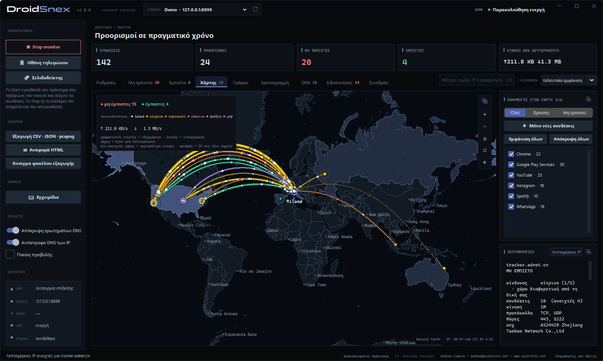

Το τηλέφωνο σχεδιάζεται στη θέση σας (ορίστε τη στις Ρυθμίσεις)· από εκεί ξεκινά μια γραμμή προς την πόλη κάθε προορισμού: **πράσινη** αν είναι έμπιστος, στο χρώμα της κλίμακας επικινδυνότητας αν δεν είναι. Το πάχος μεγαλώνει με τα byte ανά δευτερόλεπτο· οι χρωματιστές κουκκίδες που κινούνται προς τον προορισμό είναι η εξερχόμενη κίνηση, οι λευκές που κινούνται προς το τηλέφωνο η εισερχόμενη.

- **Ροδέλα** ή **+ / −**: ζουμ. **Σύρσιμο**: μετακίνηση. **Διπλό κλικ**: μεγέθυνση.
- **Κλικ σε γραμμή ή σημείο**: οι λεπτομέρειες του προορισμού στο πλαίσιο Λεπτομέρειες.
- **Εφαρμογές στον χάρτη** (πλαίσιο δεξιά): επιλέξτε **Όλες**, **Έμπιστες** ή **Μη έμπιστες** και ποιες εφαρμογές να εμφανίζονται, με **Εμφάνιση όλων** και **Απόκρυψη όλων**.
- **✦ Μόνο νέες συνδέσεις**: από εκείνη τη στιγμή ο χάρτης δείχνει μόνο τις συνδέσεις που ξεκινούν μετά· πατήστε ξανά για να επιστρέψετε σε όλες.
- Από μακριά οι κοντινοί προορισμοί ομαδοποιούνται σε μια **μπάλα με τον αριθμό των IP**: περάστε τον δείκτη για τη λίστα, κάντε κλικ για μεγέθυνση εκεί. Από το ζουμ 4 οι IP στο ίδιο σημείο ανοίγουν σε ξεχωριστές κουκκίδες γύρω από την πόλη.
- Το **◐** χρωματίζει τις χώρες ανάλογα με την κίνηση (πιο ανοιχτό = περισσότερα byte).
- Μια νέα σύνδεση αναγγέλλεται με μια λάμψη από το τηλέφωνο προς τον προορισμό· οι παλμοί στις γραμμές έχουν ουρά και πληθαίνουν με την κίνηση.
- **Δεξί κλικ** στον χάρτη › **Ορισμός της θέσης μου εδώ**.
- Το **⧉** αποσπά τον χάρτη σε ξεχωριστό παράθυρο (δείτε [Αποσπασμένα πλαίσια](#17-αποσπασμένα-πλαίσια)).

Αν λείπει η θέση ή η βάση πόλεων, ο χάρτης το επισημαίνει με μήνυμα. Οι προορισμοί χωρίς θέση (ιδιωτικές IP ή IP που δεν υπάρχουν στη βάση) μετρώνται χωριστά.

## 10. Γράφος

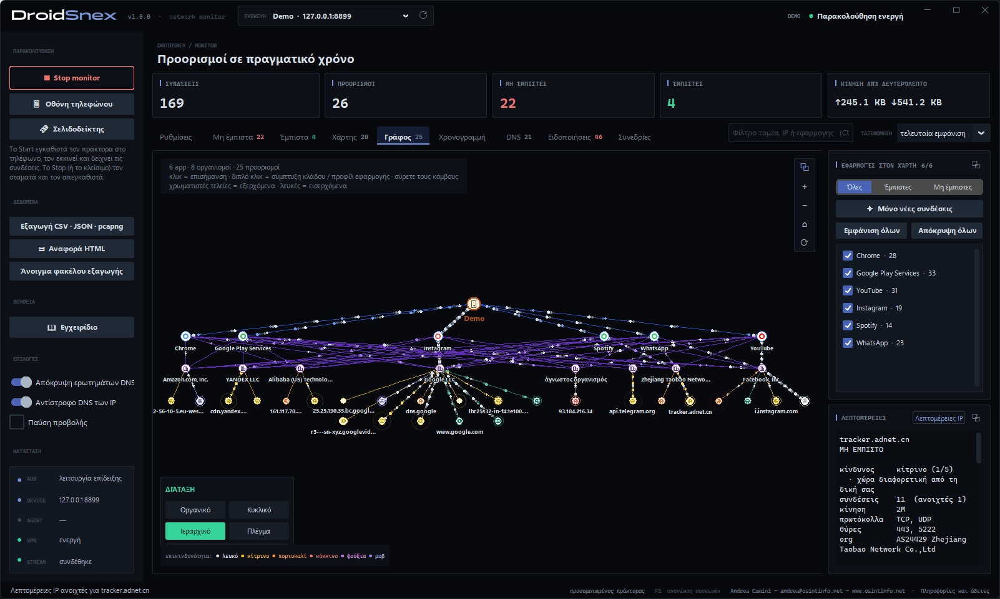

Ο γράφος δείχνει ποιος μιλά με ποιον: **τηλέφωνο → εφαρμογή → οργανισμός (ASN) → προορισμός**.

- **Κλικ** σε κόμβο: τον επισημαίνει μαζί με τους γείτονές του· οι υπόλοιποι ξεθωριάζουν.
- **Διπλό κλικ** σε εφαρμογή ή οργανισμό: κλείνει ή ανοίγει τον κλάδο. Το διπλό κλικ στην εφαρμογή (ή στην εφαρμογή της λίστας) ανοίγει το **προφίλ της εφαρμογής**: έκδοση, αν είναι εφαρμογή συστήματος, ημερομηνίες εγκατάστασης και ενημέρωσης, δικαιώματα (τα ευαίσθητα με κίτρινο), προορισμοί.
- **Σύρετε** τους κόμβους για να τους τακτοποιήσετε, σύρετε το φόντο για να μετακινήσετε την προβολή, **ροδέλα** ή **+ / −** για ζουμ, **⌂** για προσαρμογή του γράφου στο παράθυρο, **⟳** για νέα διάταξη.
- **Διάταξη:** **Ιεραρχικό** (προεπιλογή: τηλέφωνο → εφαρμογή → οργανισμός → προορισμός, από πάνω προς τα κάτω), **Οργανικό**, **Κυκλικό**, **Πλέγμα**. Οι **Λιγότερες διασταυρώσεις** δοκιμάζουν διάφορες διατάξεις και κρατούν εκείνη με τις λιγότερες γραμμές που διασταυρώνονται.
- Στους συνδέσμους κινούνται παλμοί κίνησης όπως στον χάρτη (χρωματιστοί = εξερχόμενα, ανοιχτοί = εισερχόμενα)· οι προορισμοί με ανοιχτές συνδέσεις έχουν έναν δακτύλιο που πάλλεται. Οι ετικέτες δεν επικαλύπτονται: περάστε τον δείκτη πάνω από έναν κόμβο για να δείτε το πλήρες όνομα.
- Το **⧉** αποσπά τον γράφο σε ξεχωριστό παράθυρο.

Για τους οργανισμούς χρειάζεται η βάση ASN (Ρυθμίσεις).

## 11. Χρονογραμμή

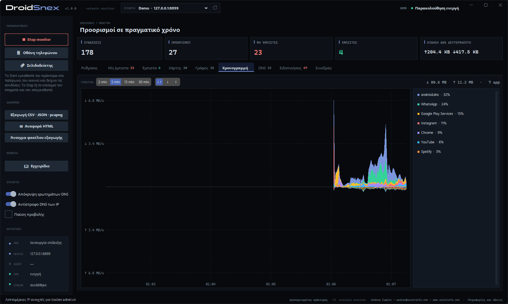

Η χρονογραμμή δείχνει τα byte ανά δευτερόλεπτο κάθε εφαρμογής στον χρόνο. Πάνω από τον άξονα η εισερχόμενη κίνηση (↓, από τον διακομιστή στο τηλέφωνο), κάτω η εξερχόμενη (↑): φαίνεται αμέσως ποια εφαρμογή επικοινωνεί στο παρασκήνιο ενώ το τηλέφωνο δεν χρησιμοποιείται και ποια κατεβάζει.

- Επιλέξτε το χρονικό παράθυρο: **2, 5, 15 ή 30 min**.
- **Κλικ σε στοιχείο του υπομνήματος**: απόκρυψη ή εμφάνιση αυτής της εφαρμογής.
- **Περάστε τον δείκτη** πάνω από το γράφημα για να διαβάσετε τις τιμές εκείνης της στιγμής.
- Οι εφαρμογές πέρα από τις δέκα πρώτες ομαδοποιούνται στις *άλλες*.

## 12. DNS

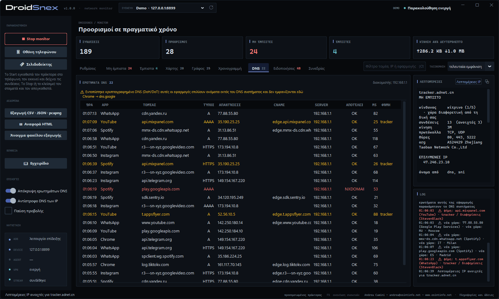

Η καρτέλα **DNS** απαριθμεί τα ερωτήματα DNS του τηλεφώνου: Ώρα, App, Τομέας, Τύπος (A, AAAA, HTTPS…), Απαντήσεις, Αποτέλεσμα, χρόνος απόκρισης σε ms και Φήμη. Η **Εκκαθάριση** αδειάζει τη λίστα.

Ορισμένες εφαρμογές χρησιμοποιούν **κρυπτογραφημένο DNS** (DoH/DoT): τα ερωτήματά τους δεν περνούν από το DNS του συστήματος και δεν εμφανίζονται εδώ. Όταν το DroidSnex το αντιληφθεί, εμφανίζει προειδοποίηση και δημιουργεί ειδοποίηση.

## 13. Ειδοποιήσεις

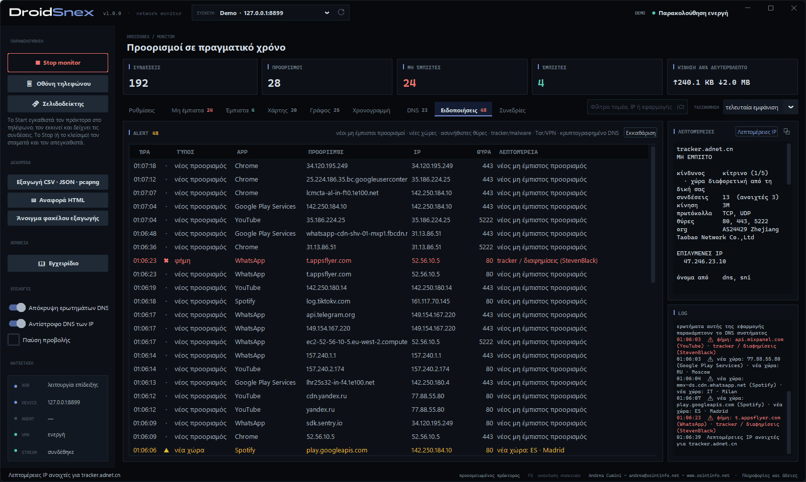

Η καρτέλα **Ειδοποιήσεις** συγκεντρώνει τα συμβάντα που αξίζουν προσοχή: **νέοι μη έμπιστοι προορισμοί · νέες χώρες · ασυνήθιστες θύρες · tracker/malware · Tor/VPN · κρυπτογραφημένο DNS**. Κάθε γραμμή δείχνει Ώρα, επίπεδο, Τύπο, App, Προορισμό, IP, Θύρα και Λεπτομέρεια. Η **Εκκαθάριση** αδειάζει τη λίστα.

## 14. Οθόνη τηλεφώνου

Το κουμπί **📱 Οθόνη τηλεφώνου** δείχνει την οθόνη του τηλεφώνου στον υπολογιστή και επιτρέπει να τη χειρίζεστε με ποντίκι και πληκτρολόγιο, μέσω του scrcpy (κατεβάστε το πρώτα από τις Ρυθμίσεις). Το παράθυρο μένει πάντα μπροστά· σύρετε την κεφαλίδα για να το μετακινήσετε. Τα κουμπιά επάνω στέλνουν πλήκτρα Android: πίσω, αρχική, πρόσφατες εφαρμογές, ενεργοποίηση, ένταση − και +.

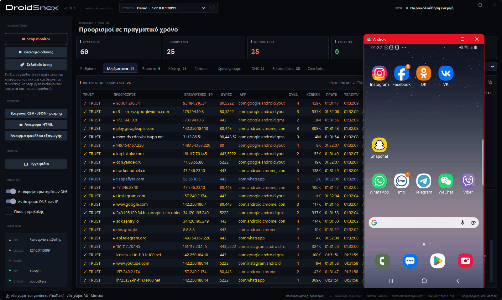

Πατήστε ξανά το κουμπί (**Κλείσιμο οθόνης**) για να το κλείσετε.

## 15. Συνεδρίες, επανάληψη και σελιδοδείκτες

Κάθε παρακολούθηση, από το Start ως το Stop, αποθηκεύεται ως **συνεδρία**, με όλα τα καταγεγραμμένα συμβάντα.

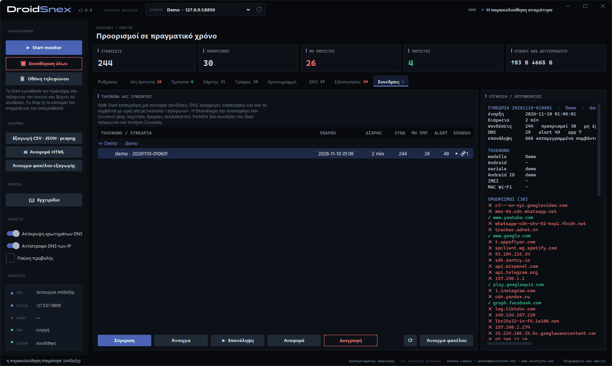

Στην καρτέλα **Συνεδρίες**:

- Το **Τηλέφωνα και συνεδρίες** (αριστερά) απαριθμεί τις αποθηκευμένες συνεδρίες με τηλέφωνο, έναρξη, διάρκεια, συνδέσεις, μη έμπιστους και μια στήλη **Επανάληψη** (▶ αν η συνεδρία μπορεί να αναπαραχθεί, 🔖 με τον αριθμό των σελιδοδεικτών).
- Επιλέξτε μια συνεδρία: στο **Σύγκριση / λεπτομέρειες** (δεξιά) εμφανίζονται τηλέφωνο, έναρξη, διάρκεια, προορισμοί, εφαρμογές, οργανισμοί και οι σελιδοδείκτες.
- **Σύγκριση:** επιλέξτε δύο συνεδρίες του ίδιου τηλεφώνου με **Ctrl+κλικ** και πατήστε Σύγκριση. Βλέπετε τους κοινούς, νέους και χαμένους προορισμούς, τις νέες εφαρμογές, τις εφαρμογές που χάθηκαν, τους νέους οργανισμούς και τις νέες χώρες.
- Η **Αναφορά** δημιουργεί την αναφορά HTML της επιλεγμένης συνεδρίας (δείτε το [κεφάλαιο 16](#16-εξαγωγή-δεδομένων-και-εκκαθάριση-όλων)).
- Το **Άνοιγμα** ανοίγει συνεδρία από αρχείο, το **Άνοιγμα φακέλου** ανοίγει τον φάκελο των συνεδριών, η **Διαγραφή συνεδριών** διαγράφει τις επιλεγμένες μετά από επιβεβαίωση (δεν αναιρείται).

### Επανάληψη

Επιλέξτε μια συνεδρία και πατήστε **▶ Επανάληψη** (με σταματημένη παρακολούθηση). Όλες οι προβολές (λίστες, χάρτης, γράφος, χρονογραμμή, DNS, ειδοποιήσεις) ξαναπερνούν τη συνεδρία σαν να ήταν ζωντανή.

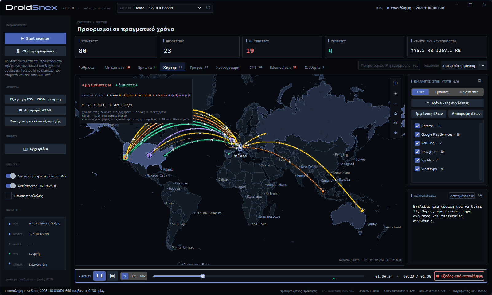

Η γραμμή επανάληψης, κάτω:

- **▶ / ❚❚** αναπαραγωγή και παύση, **⏮** επιστροφή στην αρχή·
- ταχύτητα **1x, 10x, 60x**·
- ο δρομέας χρόνου: σύρετέ τον για να πάτε σε μια στιγμή· οι σελιδοδείκτες σημειώνονται πάνω στον δρομέα. **Δεξί κλικ** σε σελιδοδείκτη ανοίγει το στιγμιότυπο οθόνης του·
- η **■ Έξοδος από επανάληψη** επιστρέφει στη ζωντανή λειτουργία.

### Σελιδοδείκτες

Κατά την παρακολούθηση πατήστε **🔖 Σελιδοδείκτης** στην αριστερή στήλη για να σημειώσετε μια στιγμή, για παράδειγμα «άνοιξα το Instagram». Γράψτε μια σημείωση και πατήστε **Αποθήκευση σελιδοδείκτη**. Ο σελιδοδείκτης αποθηκεύεται στη συνεδρία με την ώρα και ένα στιγμιότυπο της οθόνης του τηλεφώνου.

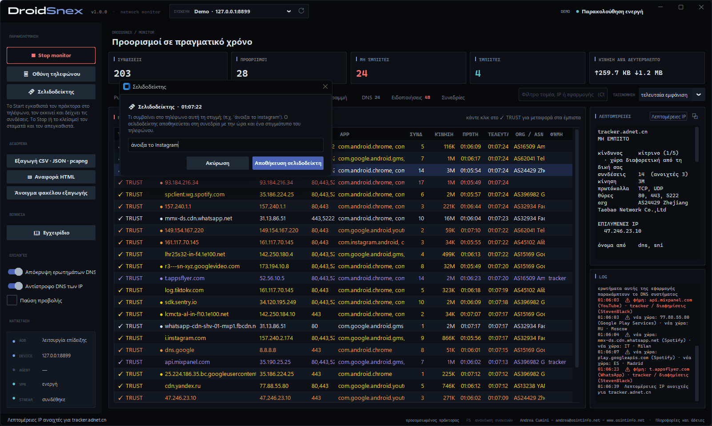

## 16. Εξαγωγή δεδομένων και Εκκαθάριση όλων

- Η **Εξαγωγή CSV · JSON · pcapng** αποθηκεύει τις συνδέσεις της συνεδρίας σε τρεις μορφές: CSV (για υπολογιστικά φύλλα), JSON και pcapng (ανοίγει με το Wireshark, μόνο μεταδεδομένα). Το **Άνοιγμα φακέλου εξαγωγής** ανοίγει τον φάκελο με τα αρχεία.
- Η **Αναφορά HTML** δημιουργεί ένα μόνο αρχείο HTML της συνεδρίας (της τρέχουσας, αυτής σε επανάληψη ή αυτής που επιλέξατε στην καρτέλα Συνεδρίες) και το ανοίγει στο πρόγραμμα περιήγησης: σύνοψη, τηλέφωνο, χάρτης, μη έμπιστοι προορισμοί κατά επικινδυνότητα με τους λόγους, έμπιστοι προορισμοί, κίνηση ανά εφαρμογή και χώρα, ειδοποιήσεις και σελιδοδείκτες με τα στιγμιότυπα. Για PDF χρησιμοποιήστε *Εκτύπωση › Αποθήκευση ως PDF* στο πρόγραμμα περιήγησης.
- Η **🗑 Εκκαθάριση όλων** εμφανίζεται με σταματημένη παρακολούθηση: μετά από επιβεβαίωση διαγράφει συνδέσεις, ερωτήματα DNS, ειδοποιήσεις, χάρτη, γράφο και χρονογραμμή της τρέχουσας συνεδρίας. Οι αποθηκευμένες συνεδρίες και η λίστα των έμπιστων παραμένουν.

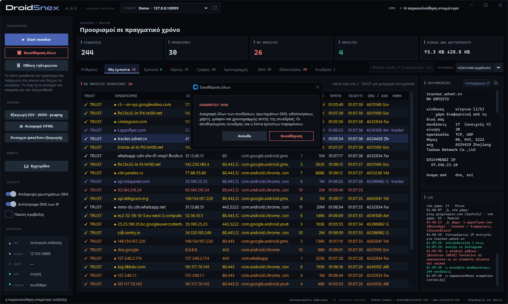

## 17. Αποσπασμένα πλαίσια

Ο Χάρτης, ο Γράφος, οι Λεπτομέρειες και οι Εφαρμογές στον χάρτη έχουν επάνω δεξιά το κουμπί **⧉**: το πλαίσιο αποσπάται σε ξεχωριστό παράθυρο, που μπορείτε να μετακινήσετε και να αλλάξετε μέγεθος, για παράδειγμα σε δεύτερη οθόνη. Το πλαίσιο συνεχίζει να ενημερώνεται.

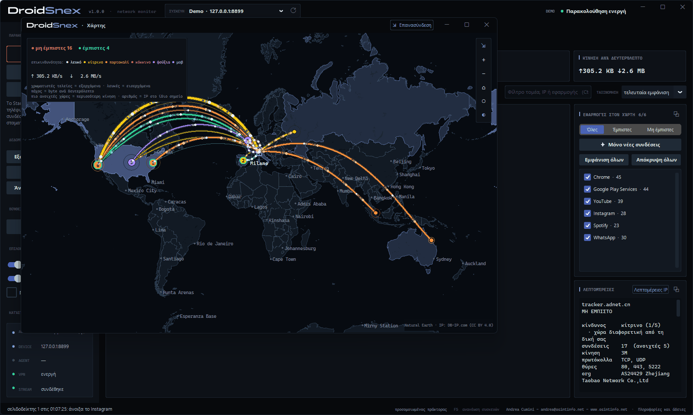

Για να το επαναφέρετε, πατήστε **⇲ Επανασύνδεση** στην κεφαλίδα του παραθύρου, κλείστε το ή πατήστε **Επανασύνδεση** στην κενή καρτέλα.

## 18. Πληροφορίες και άδειες

Κάντε κλικ στις **Πληροφορίες και άδειες** στην κάτω γραμμή: το παράθυρο δείχνει την έκδοση, τον δημιουργό, την άδεια του προγράμματος, τα δεδομένα και τα στοιχεία τρίτων με τις άδειές τους (**Όλες οι άδειες**), και το κουμπί **Όροι χρήσης** σας επιτρέπει να ξαναδιαβάσετε τους όρους. Το DroidSnex είναι ελεύθερο λογισμικό, χωρίς καμία εγγύηση.

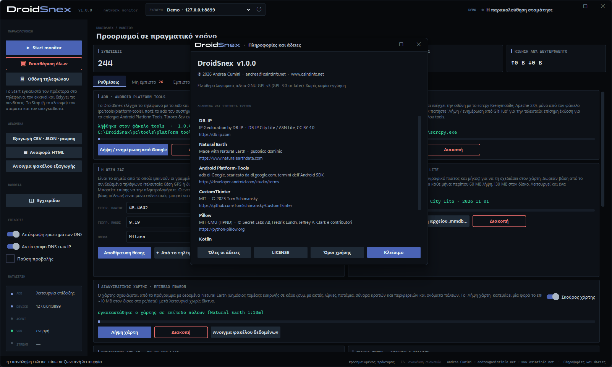

## 19. Συχνά προβλήματα

| Μήνυμα | Τι να κάνετε |
|---|---|
| Καμία συνδεδεμένη συσκευή | Συνδέστε το τηλέφωνο μέσω USB με ενεργό τον εντοπισμό σφαλμάτων USB και πατήστε F5. |
| Μη εξουσιοδοτημένη συσκευή | Ξεκλειδώστε το τηλέφωνο και αποδεχτείτε το «Να επιτρέπεται ο εντοπισμός σφαλμάτων USB;» επιλέγοντας «Να επιτρέπεται πάντα από αυτόν τον υπολογιστή». |
| Το adb δεν υπάρχει στον φάκελο tools | Ρυθμίσεις › ADB › Λήψη / ενημέρωση από Google. |
| Το scrcpy δεν υπάρχει στον φάκελο tools | Ρυθμίσεις › Οθόνη τηλεφώνου › Λήψη / ενημέρωση από GitHub. |
| Το VPN δεν είναι ενεργό | Στο τηλέφωνο πατήστε OK στο αίτημα σύνδεσης VPN· αν είναι ενεργό άλλο VPN, απενεργοποιήστε το και πατήστε ξανά Start. |
| Λείπει η βάση πόλεων | Ρυθμίσεις › Βάση πόλεων των IP › Λήψη / ενημέρωση. |
| Ορίστε τη θέση σας | Ρυθμίσεις › Η θέση σας › Εντοπισμός από τη δημόσια IP μου (ή καταχωρίστε τη με το χέρι). |
