# DroidSnex — User manual

DroidSnex shows, in real time, which servers an Android phone connects to: which app, which domain, which IP, in which country, and how much traffic. The phone is connected to the PC with a USB cable; while monitoring, a small app (the *agent*) runs on the phone, creates a local VPN and reads only the metadata of the connections. The content of the traffic is never decrypted (no MITM).

## Contents

1. [Before you start](#1-before-you-start)
2. [First launch: language and terms of use](#2-first-launch-language-and-terms-of-use)
3. [Settings](#3-settings)
4. [The main window](#4-the-main-window)
5. [Starting and stopping the monitor](#5-starting-and-stopping-the-monitor)
6. [Untrusted and Trusted](#6-untrusted-and-trusted)
7. [The danger scale](#7-the-danger-scale)
8. [Details and IP detail](#8-details-and-ip-detail)
9. [Map](#9-map)
10. [Graph](#10-graph)
11. [Timeline](#11-timeline)
12. [DNS](#12-dns)
13. [Alerts](#13-alerts)
14. [Phone screen](#14-phone-screen)
15. [Sessions, replay and bookmarks](#15-sessions-replay-and-bookmarks)
16. [Exporting data and Clear everything](#16-exporting-data-and-clear-everything)
17. [Detached panels](#17-detached-panels)
18. [Info and licenses](#18-info-and-licenses)
19. [Troubleshooting](#19-troubleshooting)

---

## 1. Before you start

You need:

- a Windows PC with DroidSnex;
- an Android phone and a USB data cable;
- **USB debugging** enabled on the phone: *Settings › About phone*, tap *Build number* seven times to unlock *Developer options*, then turn on *USB debugging* in *Developer options*.

The first time you connect, the phone asks **"Allow USB debugging?"**: unlock the screen, tick *Always allow from this computer* and tap *OK*.

DroidSnex only uses the tools inside its own `tools` folder (adb and scrcpy) and installs nothing on the system. The first time, download them from the **Settings** tab (see [chapter 3](#3-settings)).

## 2. First launch: language and terms of use

On first launch a window appears that cannot be closed or moved behind other windows.

1. **Choose your language.** The buttons show the nine available languages: Italiano, English, Deutsch, Français, Español, Nederlands, Polski, Ελληνικά, Shqip. The language applies to the whole program and to the agent on the phone; you can change it later in the Settings tab.

   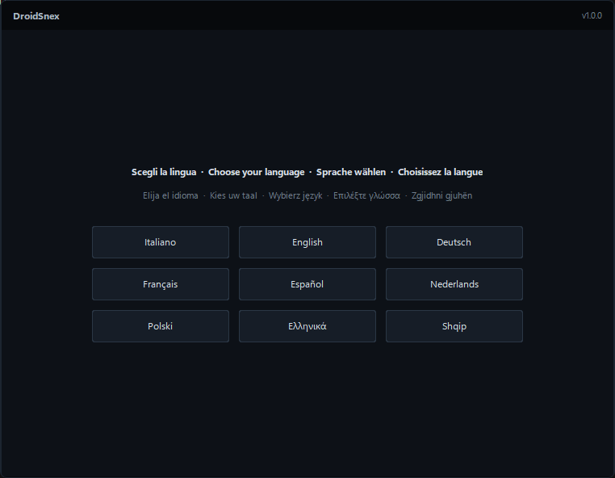

2. **Read the terms of use.** The text is in the chosen language. The **I accept** button becomes active only after you scroll the text to the end. **I decline** closes the program.

   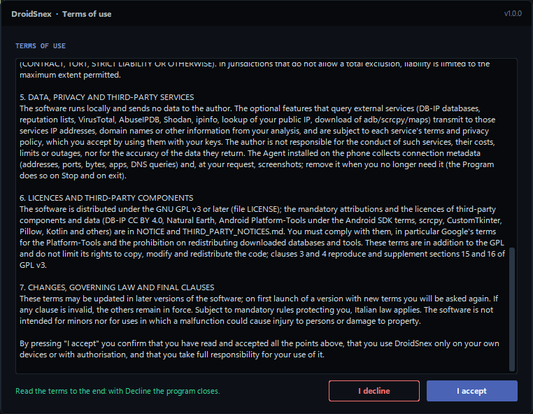

Your acceptance is saved: the window appears again only if the terms change version. You can read the terms again at any time from [Info and licenses](#18-info-and-licenses).

## 3. Settings

The **Settings** tab collects the settings and downloads. Each download happens only when you press its button and can be stopped with **Cancel**.

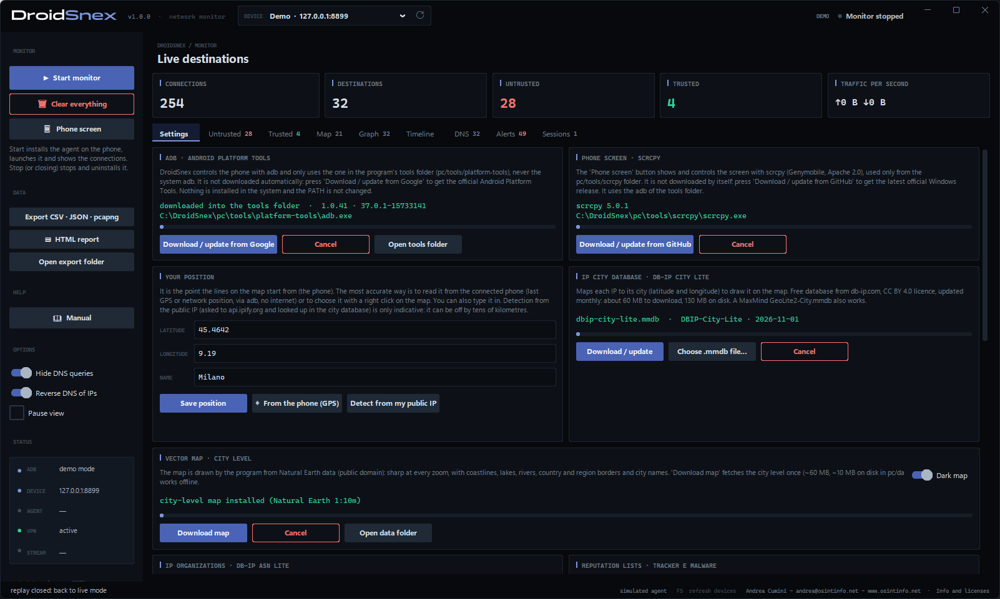

- **ADB · Android Platform Tools** — DroidSnex controls the phone with adb, taken only from the program's `tools` folder. Press **Download / update from Google** for the official Android Platform Tools; **Open tools folder** opens the folder.
- **Phone screen · scrcpy** — **Download / update from GitHub** downloads scrcpy from the official releases.
- **Your position** — the point the map lines start from and the country used by the danger scale. The most accurate way is **⌖ From the phone (GPS)**: it reads the connected phone's last position via adb and shows source, accuracy and age. Alternatively right-click on the map › **Set my position here**, or enter LATITUDE, LONGITUDE and NAME and press **Save position**. **Detect from my public IP** is only indicative: it can be off by tens of kilometres.
- **IP city database · DB-IP City Lite** — maps each IP to its city so it can be drawn on the map. **Download / update**, or **Choose .mmdb file…**; **Open data folder**.
- **Vector map · city level** — **Download map** installs the detailed map (Natural Earth 1:10m, with coasts, rivers, borders and city names); without it you see the included basic version. **Dark map** changes the map colours.
- **IP organizations · DB-IP ASN Lite** — maps each IP to the organization that runs it (Google, Meta, Amazon, an unknown hoster…). It is the basis of the Graph and of the Org / ASN column.
- **Reputation lists · tracker and malware** — public blocklists of trackers, malware, **Tor** exit nodes and hints about **VPN** providers. **Download / update lists**. Listed destinations get a badge and an alert.
- **IP detail · cloud ranges** — **Download / update cloud lists** and the permission for the IP detail's **active contact** (TLS certificate).
- **IP detail · services with API key** — optional keys for VirusTotal, AbuseIPDB, Shodan and ipinfo.io. **Sign up** opens the service's page; paste the key and press **Save keys**. Without a key the service stays off. Keys stay on the PC, in the configuration file.
- **Android agent · APK** — the agent APK to install on the phone. The **Default** one is usually fine; **Browse…** to choose another, then **Save**.
- **Updates** — **Check for updates** checks, only when you press it, whether a newer version is available at the given address and shows the link to its page. It downloads and installs nothing.
- **Language · Language** — the interface language; the agent on the phone will also use it from the next Start.

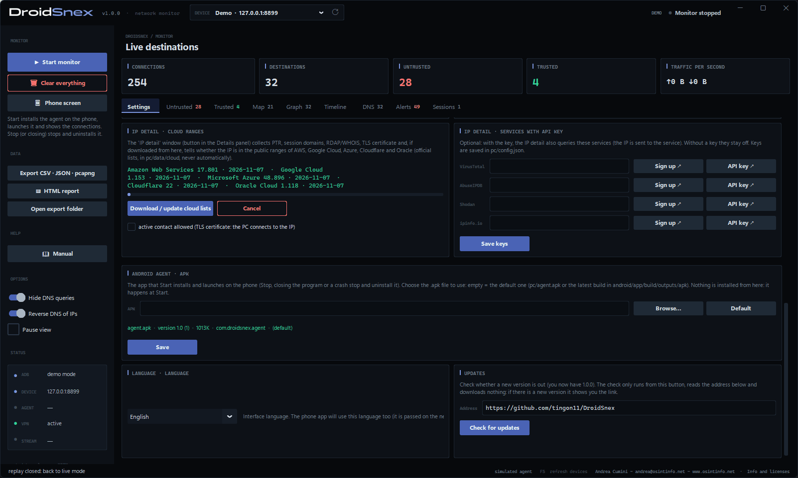

## 4. The main window

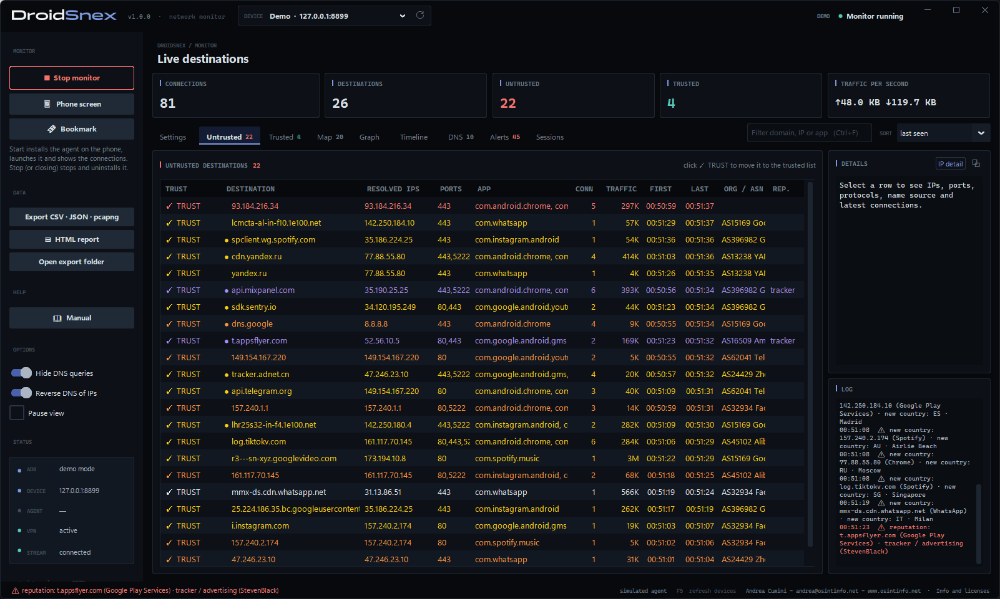

- **Header (top):** logo and version, the **DEVICE** menu with the connected phone (the ↻ button or the **F5** key refreshes the list) and, on the right, the monitor status.
- **Left column:** the commands.
  - *Monitor:* **Start monitor** (while the monitor is running the same button becomes **Stop monitor**), **Clear everything** (only when the monitor is stopped), **Phone screen**, **Bookmark** (only while the monitor is running).
  - *Data:* **Export CSV · JSON · pcapng**, **HTML report** and **Open export folder**.
  - *Help:* **📖 Manual** opens this manual in the interface language. In the manual window, the search box at the top left (**Ctrl+F**) highlights every match: **Enter** or **F3** goes to the next one, **Shift+Enter** to the previous one, **Esc** clears the search.
  - *Options:* **Hide DNS queries** (removes rows that are only DNS queries from the lists), **Reverse DNS of IPs** (looks up a name for IPs that have none), **Pause view** (freezes the lists so you can read them calmly; data keeps arriving).
  - *Status:* five indicators (ADB, DEVICE, AGENT, VPN, STREAM): green when that part is working.
- **Counters:** Connections, Destinations, Untrusted, Trusted, Traffic per second.
- **Tabs:** Settings, Untrusted, Trusted, Map, Graph, Timeline, DNS, Alerts, Sessions. To the right of the tabs, in the lists, the **Filter domain, IP or app** box (**Ctrl+F**) and the **SORT** menu (last seen, no. of connections, first seen, destination, traffic).
- **Right panel:** **Details** of the selected row and, below, the **Log** with the program messages.
- **Bottom bar:** the status message, **F5 refresh devices** and the **Info and licenses** link.

## 5. Starting and stopping the monitor

1. Connect the phone via USB and unlock it. Its model appears in the **DEVICE** menu; if you have more than one, choose it from the menu.
2. Press **▶ Start monitor**. DroidSnex installs the agent on the phone, grants it the required permissions and starts the local VPN. If **Connection request** appears on the phone, unlock it and tap **OK**.
3. When the *Status* indicators are green, connections start arriving in the lists. Use the phone as usual: every app that connects to the internet shows up with its destinations.
4. Press **■ Stop monitor** to finish. The agent is stopped and **uninstalled** from the phone; the session is saved in the [Sessions](#15-sessions-replay-and-bookmarks) tab.

Closing the program also stops and uninstalls the agent. If the cable comes loose, DroidSnex tries to reconnect by itself; if the PC shuts down or the program stops, the agent stops by itself shortly afterwards (watchdog).

## 6. Untrusted and Trusted

Every destination (a domain, or an IP when the name is unknown) is in one of two lists:

- **Untrusted** — destinations not trusted. Every new destination starts here.
- **Trusted** — destinations you have marked as trusted.

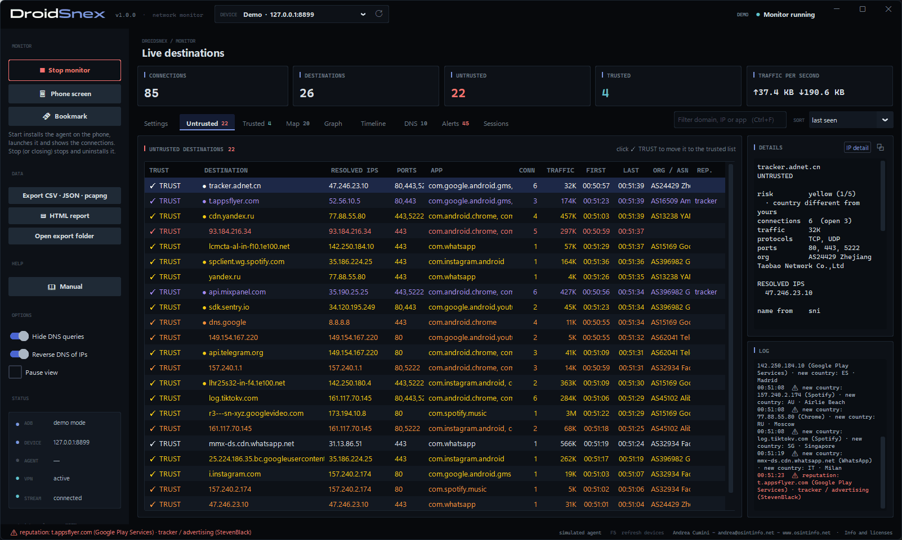

The columns: Destination, Resolved IPs, Ports, App, Conn (number of connections), Traffic, First and Last (times), Org / ASN (the organization that runs the IP) and Rep. (*tracker*, *malware* or *tor* badge from the reputation lists). Click a column title to sort A-Z, click again for Z-A.

- **Trust a destination:** in the Untrusted list click **✓ TRUST** in the first column. The destination moves to the Trusted list.
- **Undo:** in the Trusted list click **✕ UNTRUST**.
- **✕ Untrust all** (at the top of the Trusted list) moves all trusted destinations back to untrusted, after a confirmation. It empties the saved list and cannot be undone.

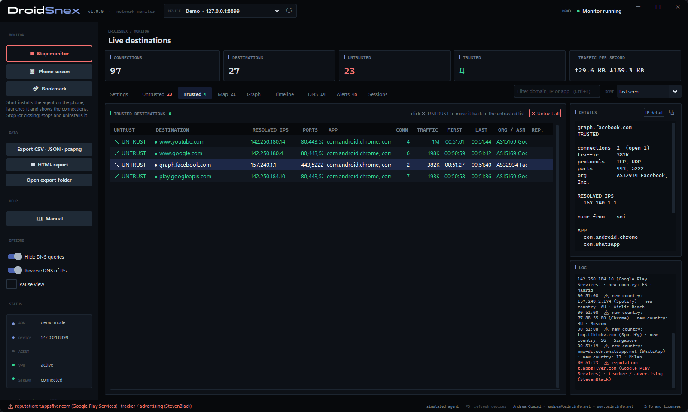

The list of trusted destinations is saved and also applies to later sessions and to other phones.

## 7. The danger scale

In the Untrusted list every row has a colour that shows how suspicious the destination is. DroidSnex adds up points for each signal:

| Signal | Points |
|---|---|
| IP only, no name | +1 |
| unknown organization (IP not in the ASN database) | +1 |
| country different from yours | +1 |
| encrypted DNS (DoH/DoT) | +1 |
| unusual port (not 80, 443, 53…) | +2 |
| VPN provider (indicative) | +3 |
| listed tracker / advertising | +4 |
| Tor exit node | +4 |
| listed malware | +5 |

The generic signals (the first five rows) add up to 3 points at most; fuchsia and violet can only be reached through the reputation lists. The colour is the total, up to 5:

**0 white · 1 yellow · 2 orange · 3 red · 4 fuchsia · 5 violet**

In the Details panel the *danger* line explains which signals contributed. To get all signals you need your position, the ASN database and the reputation lists (see [Settings](#3-settings)).

## 8. Details and IP detail

Select a row in a list: the **Details** panel shows whether the destination is TRUSTED or UNTRUSTED, the number of connections (and how many are still open), protocols, ports, the resolved IPs with the source of the name (SNI, DNS or reverse DNS), the danger level and the latest connections.

The **IP detail** button at the top of the panel opens a window with everything that can be found out about the IP:

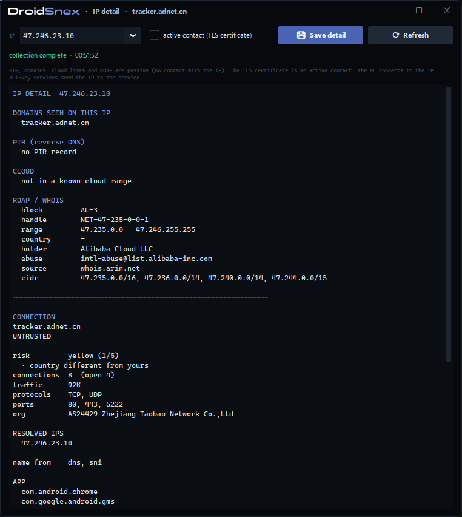

- **DOMAINS SEEN ON THIS IP** in the session;
- **PTR (reverse DNS)**;
- **CLOUD** — whether the IP belongs to the ranges published by AWS, Google Cloud, Azure, Cloudflare and others (lists downloaded from Settings);
- **RDAP / WHOIS** — block, country, holder;
- **TLS CERTIFICATE (active contact)** — issuer, validity, certificate names;
- **VIRUSTOTAL, ABUSEIPDB, SHODAN, IPINFO.IO** — only if you entered their API keys in Settings.

At the top, choose the **IP** (if the destination has more than one). PTR, domains, cloud lists and RDAP are passive: no contact with the IP. The TLS certificate is an active contact, the PC connects to the IP, and it is collected only when the **active contact (TLS certificate)** box is ticked. Services with a key receive the IP you look up.

**Refresh** collects everything again. **Save detail** saves the result to a text file; the path appears in the Log.

You can also open the IP detail from a line on the Map or a node in the Graph: select the destination first, then press the button.

## 9. Map

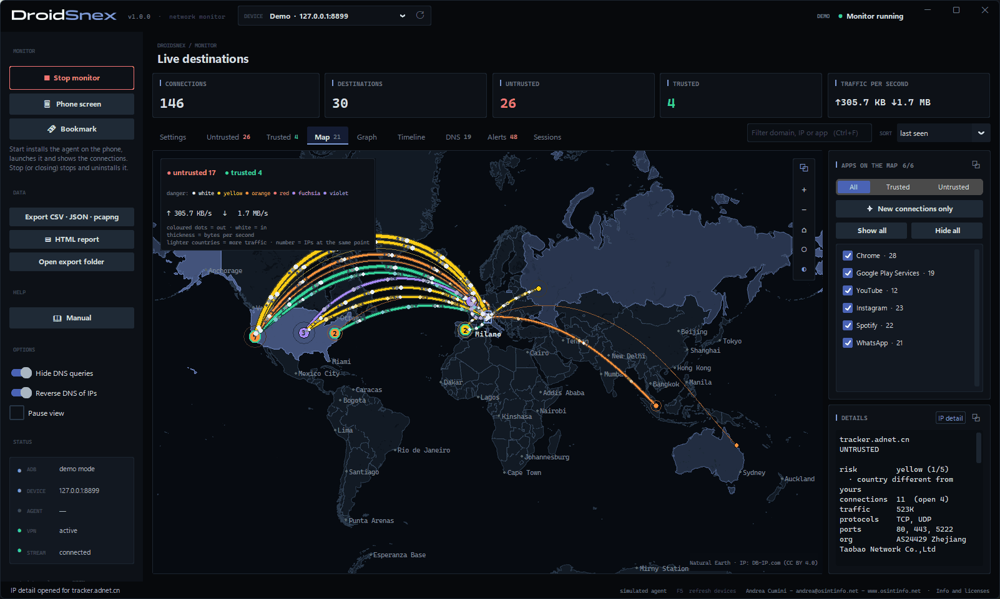

The phone is drawn at your position (set it in Settings); from there a line goes to the city of every destination: **green** if trusted, coloured according to the danger scale if untrusted. The thickness grows with the bytes per second; coloured dots moving towards the destination are outgoing traffic, white dots moving towards the phone are incoming traffic.

- **Mouse wheel** or **+ / −**: zoom. **Drag**: pan. **Double click**: zoom in.
- **Click a line or a point**: the destination details in the Details panel.
- **Apps on the map** (panel on the right): choose **All**, **Trusted** or **Untrusted** and which apps to show, with **Show all** and **Hide all**.
- **✦ New connections only**: from that moment the map shows only connections that start afterwards; press again to go back to all.
- When zoomed out, nearby destinations are grouped into a **ball with the number of IPs**: hover over it for the list, click to zoom in there. From zoom 4, IPs at the same point spread out into separate dots around the city.
- **◐** colours countries by the traffic exchanged (lighter = more bytes).
- A new connection is announced by a flash from the phone to the destination; the pulses on the lines have a trail and grow with the traffic.
- **Right-click** on the map › **Set my position here**.
- **⧉** detaches the map into a separate window (see [Detached panels](#17-detached-panels)).

If the position or the city database is missing, the map says so with a message. Destinations without a position (private IPs or IPs not in the database) are counted separately.

## 10. Graph

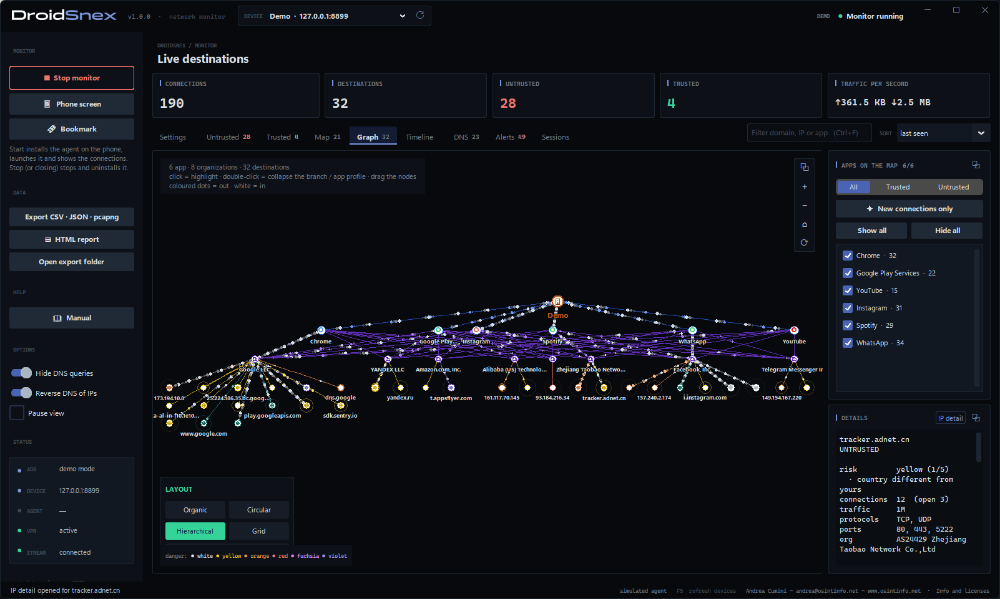

The graph shows who talks to whom: **phone → app → organization (ASN) → destination**.

- **Click** a node: it is highlighted together with its neighbours; the others fade.
- **Double click** an app or an organization: collapses or expands the branch. Double clicking the app (or the app in the list) opens the **app profile**: version, whether it is a system app, install and update dates, permissions (sensitive ones in yellow), destinations.
- **Drag** nodes to arrange them, drag the background to move the view, **mouse wheel** or **+ / −** to zoom, **⌂** to fit the graph to the window, **⟳** to lay it out again.
- **Layout:** **Hierarchical** (default: phone → app → organization → destination, top to bottom), **Organic**, **Circular**, **Grid**. **Reduce crossings** tries several arrangements and keeps the one with the fewest crossing lines.
- Traffic pulses run along the links as on the map (coloured = out, light = in); destinations with open connections have a pulsing ring. Labels never overlap: hover over a node to read its full name.
- **⧉** detaches the graph into a separate window.

The organizations require the ASN database (Settings).

## 11. Timeline

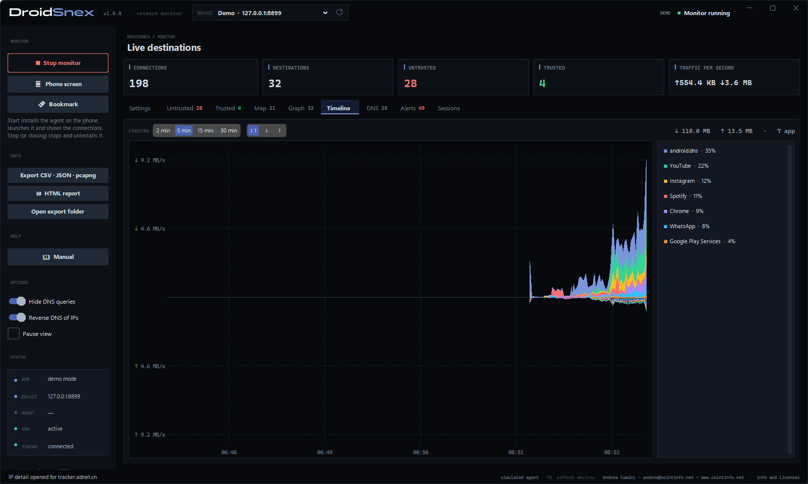

The timeline shows each app's bytes per second over time. Above the axis is incoming traffic (↓, from the server to the phone), below it outgoing traffic (↑): you can see at a glance which app talks in the background while the phone is idle and which one downloads.

- Choose the time window: **2, 5, 15 or 30 min**.
- **Click a legend entry** to hide or show that app.
- **Hover** over the chart to read the values at that moment.
- Apps beyond the top ten are grouped as *other*.

## 12. DNS

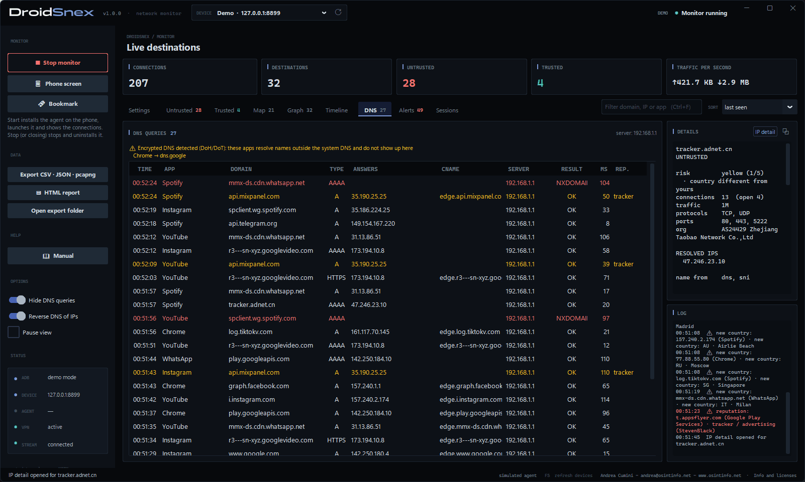

The **DNS** tab lists the phone's DNS queries: Time, App, Domain, Type (A, AAAA, HTTPS…), Answers, Result, response time in ms and Rep. **Clear** empties the list.

Some apps use **encrypted DNS** (DoH/DoT): their queries do not go through the system DNS and do not appear here. When DroidSnex notices this, it shows a warning and raises an alert.

## 13. Alerts

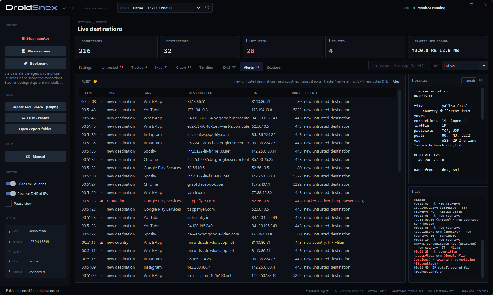

The **Alerts** tab collects events that deserve attention: **new untrusted destinations · new countries · unusual ports · tracker/malware · Tor/VPN · encrypted DNS**. Each row shows Time, level, Type, App, Destination, IP, Port and Detail. **Clear** empties the list.

## 14. Phone screen

The **📱 Phone screen** button shows the phone's screen on the PC and lets you control it with mouse and keyboard, using scrcpy (download it first from Settings). The window stays on top; drag the header to move it. The buttons at the top send Android keys: back, home, recent apps, power, volume − and +.

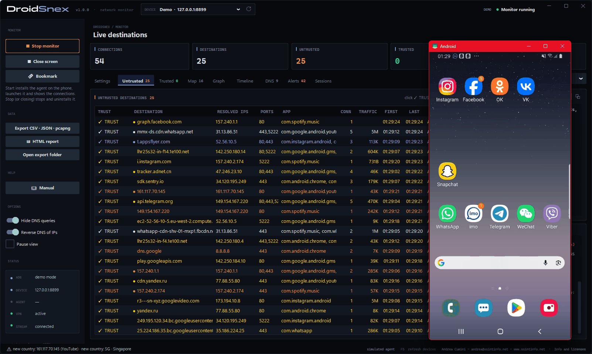

Press the button again (**Close screen**) to close it.

## 15. Sessions, replay and bookmarks

Every monitoring run, from Start to Stop, is saved as a **session**, with all recorded events.

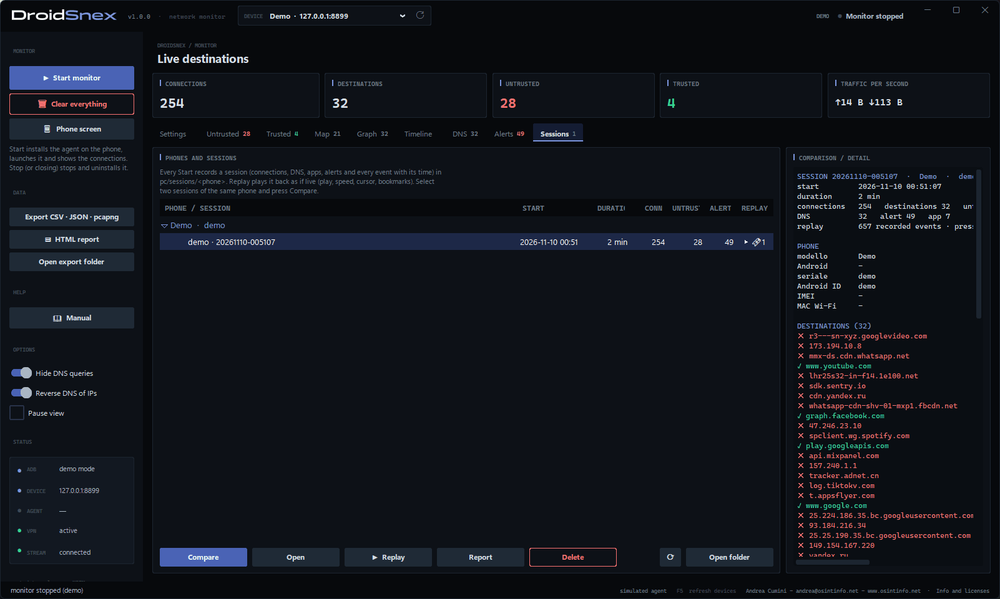

In the **Sessions** tab:

- **Phones and sessions** (left) lists the saved sessions with phone, start, duration, connections, untrusted and a **Replay** column (▶ if the session can be replayed, 🔖 with the number of bookmarks).
- Select a session: **Comparison / detail** (right) shows phone, start, duration, destinations, apps, organizations and the bookmarks.
- **Compare:** select two sessions of the same phone with **Ctrl+click** and press Compare. You see the shared, new and disappeared destinations, new apps, disappeared apps, new organizations and new countries.
- **Report** creates the HTML report of the selected session (see [chapter 16](#16-exporting-data-and-clear-everything)).
- **Open** opens a session from a file, **Open folder** opens the sessions folder, **Delete sessions** deletes the selected ones after a confirmation (cannot be undone).

### Replay

Select a session and press **▶ Replay** (with the monitor stopped). All views (lists, map, graph, timeline, DNS, alerts) go through the session again as if it were live.

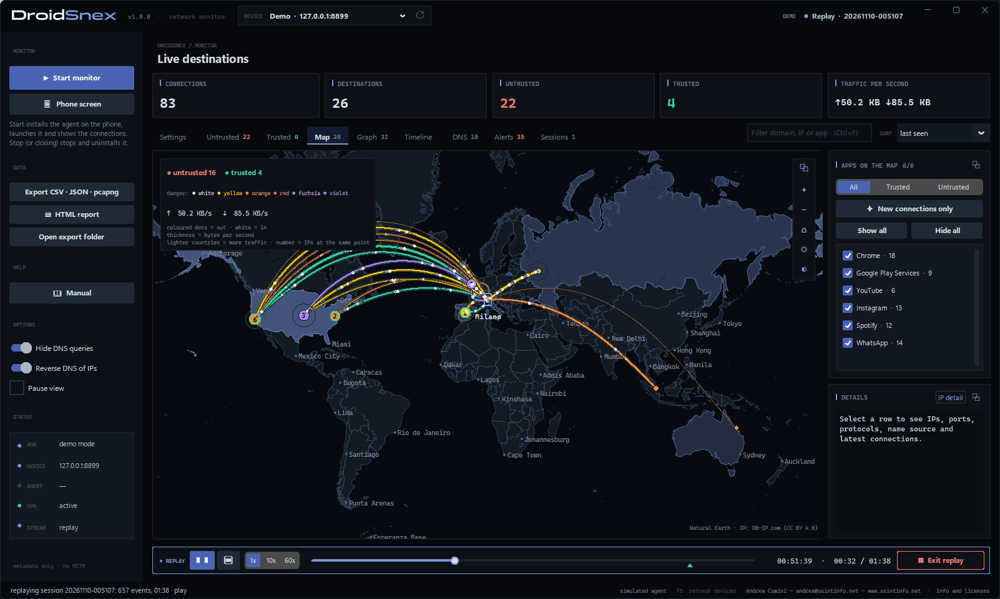

The replay bar, at the bottom:

- **▶ / ❚❚** play and pause, **⏮** back to the start;
- speed **1x, 10x, 60x**;
- the time slider: drag it to jump to a moment; bookmarks are marked on the slider. **Right-click** a bookmark to open its screenshot;
- **■ Exit replay** returns to live mode.

### Bookmarks

While monitoring, press **🔖 Bookmark** in the left column to mark a moment, for example "opened Instagram". Type a note and press **Save bookmark**. The bookmark is saved in the session with the time and a screenshot of the phone.

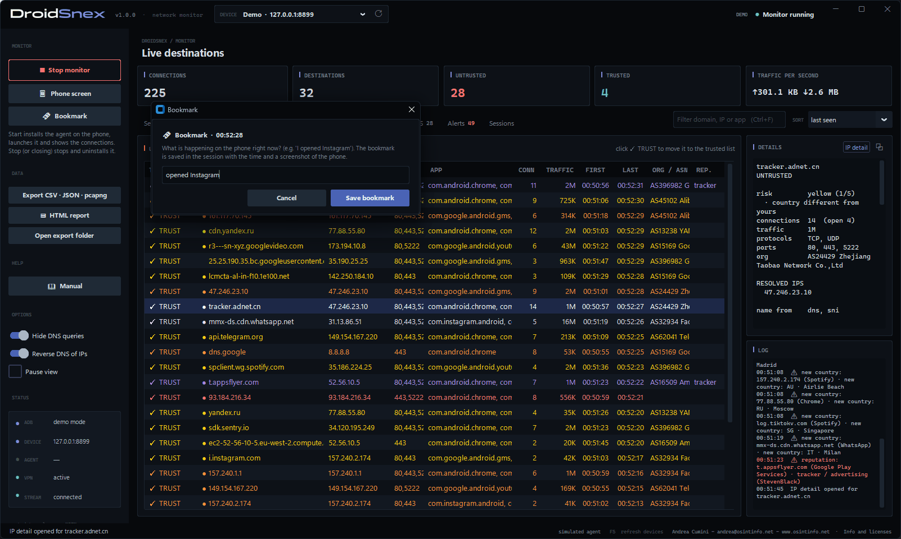

## 16. Exporting data and Clear everything

- **Export CSV · JSON · pcapng** saves the session's connections in three formats: CSV (for spreadsheets), JSON and pcapng (opens in Wireshark, metadata only). **Open export folder** opens the folder with the files.
- **HTML report** creates a single HTML file for the session (the current one, the one being replayed or the one chosen in the Sessions tab) and opens it in the browser: summary, phone, map, untrusted destinations by danger level with the reasons, trusted destinations, traffic per app and per country, alerts and bookmarks with their screenshots. For a PDF use *Print › Save as PDF* in the browser.
- **🗑 Clear everything** appears when the monitor is stopped: after a confirmation it deletes the connections, DNS queries, alerts, map, graph and timeline of the current session. Saved sessions and the trusted list are kept.

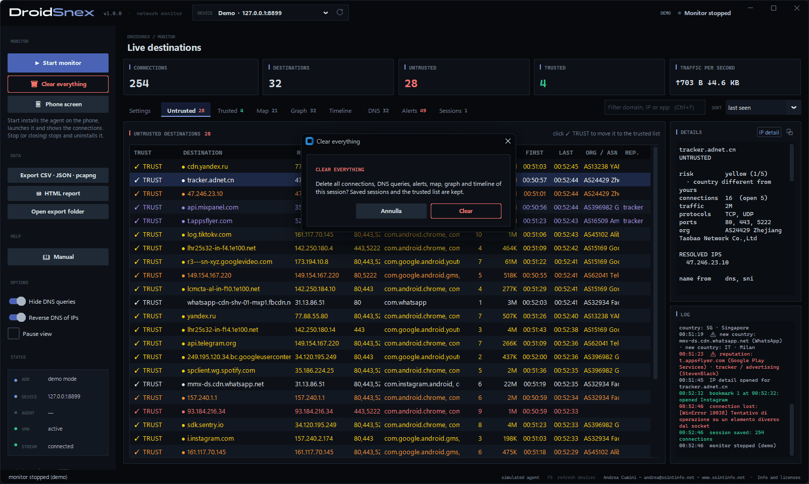

## 17. Detached panels

Map, Graph, Details and Apps on the map have a **⧉** button in the top right corner: the panel detaches into a separate window that you can move and resize, for example onto a second monitor. The panel keeps updating.

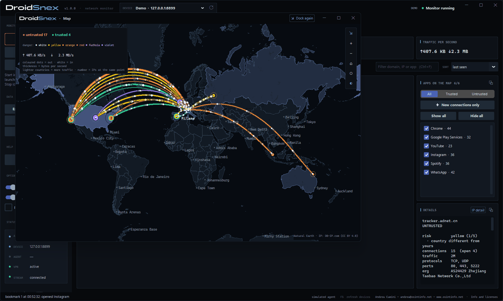

To put it back, press **⇲ Dock again** in the window header, close it, or press **Dock again** in the empty tab.

## 18. Info and licenses

Click **Info and licenses** in the bottom bar: the window shows the version, the author, the program's licence, third-party data and components with their licences (**All licenses**), and the **Terms of use** button lets you read the terms again. DroidSnex is free software, without any warranty.

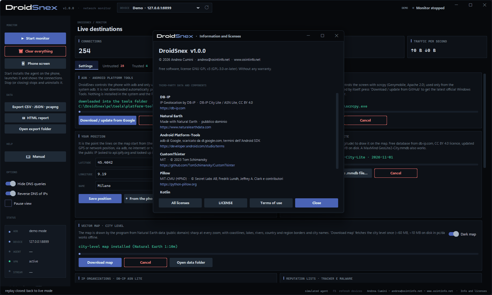

## 19. Troubleshooting

| Message | What to do |
|---|---|
| No device connected | Connect the phone via USB with USB debugging on, then press F5. |
| Device not authorized | Unlock the phone and accept "Allow USB debugging?", ticking "Always allow from this computer". |
| adb not in the tools folder | Settings › ADB › Download / update from Google. |
| scrcpy not in the tools folder | Settings › Phone screen › Download / update from GitHub. |
| The VPN is not active | On the phone tap OK on the VPN connection request; if another VPN is active, turn it off and press Start again. |
| City database missing | Settings › IP city database › Download / update. |
| Set your position | Settings › Your position › Detect from my public IP (or enter it by hand). |
