# DroidSnex — Manual de usuario

DroidSnex muestra, en tiempo real, a qué servidores se conecta un teléfono Android: qué app, qué dominio, qué IP, en qué país y con cuánto tráfico. El teléfono se conecta al PC con el cable USB; durante la monitorización se ejecuta en el teléfono una pequeña app (el *agente*) que crea una VPN local y solo lee los metadatos de las conexiones. El contenido del tráfico nunca se descifra (sin MITM).

## Índice

1. [Antes de empezar](#1-antes-de-empezar)
2. [Primer inicio: idioma y términos de uso](#2-primer-inicio-idioma-y-términos-de-uso)
3. [Ajustes](#3-ajustes)
4. [La ventana principal](#4-la-ventana-principal)
5. [Iniciar y detener el monitor](#5-iniciar-y-detener-el-monitor)
6. [No fiables y Fiables](#6-no-fiables-y-fiables)
7. [La escala de peligrosidad](#7-la-escala-de-peligrosidad)
8. [Detalles y Detalle IP](#8-detalles-y-detalle-ip)
9. [Mapa](#9-mapa)
10. [Grafo](#10-grafo)
11. [Línea temporal](#11-línea-temporal)
12. [DNS](#12-dns)
13. [Alertas](#13-alertas)
14. [Pantalla del teléfono](#14-pantalla-del-teléfono)
15. [Sesiones, repetición y marcadores](#15-sesiones-repetición-y-marcadores)
16. [Exportar los datos y Limpiar todo](#16-exportar-los-datos-y-limpiar-todo)
17. [Paneles separados](#17-paneles-separados)
18. [Info y licencias](#18-info-y-licencias)
19. [Problemas frecuentes](#19-problemas-frecuentes)

---

## 1. Antes de empezar

Necesitas:

- un PC con Windows y DroidSnex;
- un teléfono Android y un cable USB de datos;
- la **depuración USB** activada en el teléfono: *Ajustes › Información del teléfono*, toca siete veces *Número de compilación* para desbloquear las *Opciones para desarrolladores* y, en *Opciones para desarrolladores*, activa *Depuración USB*.

La primera vez que lo conectes, el teléfono pregunta **«¿Permitir depuración USB?»**: desbloquea la pantalla, marca *Permitir siempre desde este ordenador* y toca *Aceptar*.

DroidSnex solo usa las herramientas de su propia carpeta `tools` (adb y scrcpy) y no instala nada en el sistema. La primera vez, descárgalas desde la pestaña **Ajustes** (consulta el [capítulo 3](#3-ajustes)).

## 2. Primer inicio: idioma y términos de uso

En el primer inicio aparece una ventana que no se puede cerrar ni dejar detrás de las demás.

1. **Elige el idioma.** Los botones muestran los nueve idiomas disponibles: Italiano, English, Deutsch, Français, Español, Nederlands, Polski, Ελληνικά, Shqip. El idioma se aplica a todo el programa y al agente del teléfono; puedes cambiarlo después en la pestaña Ajustes.

   

2. **Lee los términos de uso.** El texto está en el idioma elegido. El botón **Acepto** solo se activa después de desplazar el texto hasta el final. **Rechazo** cierra el programa.

   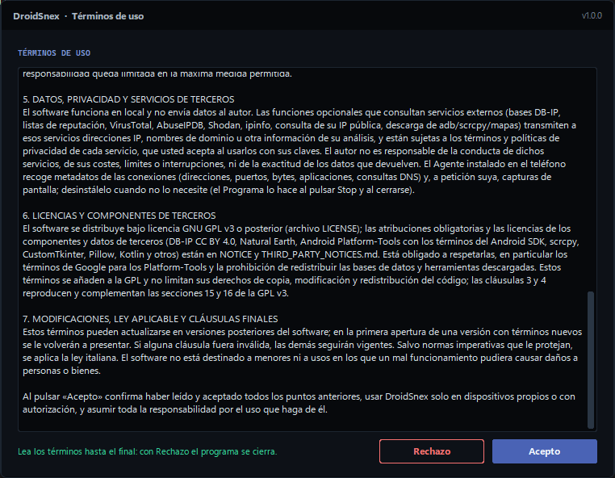

La aceptación se guarda: la ventana solo vuelve a aparecer si los términos cambian de versión. Puedes releer los términos en cualquier momento desde [Info y licencias](#18-info-y-licencias).

## 3. Ajustes

La pestaña **Ajustes** reúne la configuración y las descargas. Cada descarga se hace solo cuando pulsas el botón y se puede detener con **Interrumpir**.

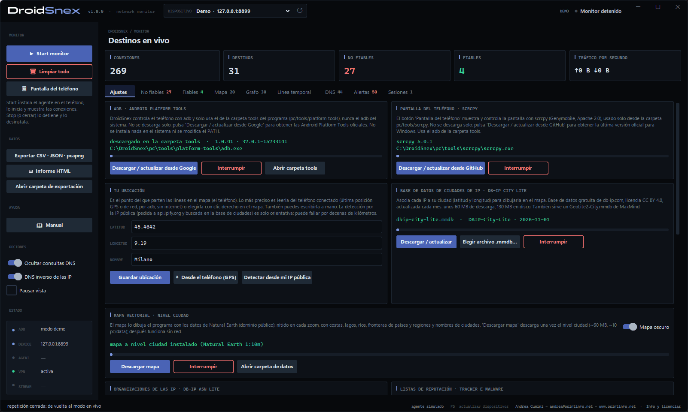

- **ADB · Android Platform Tools** — DroidSnex maneja el teléfono con adb, tomado solo de la carpeta `tools` del programa. Pulsa **Descargar / actualizar desde Google** para las Android Platform Tools oficiales; **Abrir carpeta tools** abre la carpeta.
- **Pantalla del teléfono · scrcpy** — **Descargar / actualizar desde GitHub** descarga scrcpy de las versiones oficiales.
- **Tu ubicación** — el punto del que salen las líneas del mapa y el país que usa la escala de peligrosidad. Lo más preciso es **⌖ Desde el teléfono (GPS)**: lee por adb la última posición del teléfono conectado y muestra fuente, precisión y antigüedad. Si no, haz clic derecho en el mapa › **Fijar aquí mi posición**, o introduce LATITUD, LONGITUD y NOMBRE y pulsa **Guardar ubicación**. **Detectar desde mi IP pública** es solo orientativo: puede errar en decenas de kilómetros.
- **Base de datos de ciudades de IP · DB-IP City Lite** — asocia cada IP a su ciudad para dibujarla en el mapa. **Descargar / actualizar**, o **Elegir archivo .mmdb…**; **Abrir carpeta de datos**.
- **Mapa vectorial · nivel ciudad** — **Descargar mapa** instala el mapa detallado (Natural Earth 1:10m, con costas, ríos, fronteras y nombres de ciudades); sin él se ve la versión básica incluida. **Mapa oscuro** cambia los colores del mapa.
- **Organizaciones de las IP · DB-IP ASN Lite** — asocia cada IP a la organización que la gestiona (Google, Meta, Amazon, un hosting desconocido…). Es la base del Grafo y de la columna Org / ASN.
- **Listas de reputación · trackers y malware** — listas de bloqueo públicas de trackers, malware, nodos de salida **Tor** e indicaciones sobre proveedores **VPN**. **Descargar / actualizar listas**. Los destinos en lista reciben el distintivo y una alerta.
- **Detalle IP · rangos cloud** — **Descargar / actualizar listas cloud** y el permiso para el **contacto activo** (certificado TLS) del Detalle IP.
- **Detalle IP · servicios con clave API** — claves opcionales para VirusTotal, AbuseIPDB, Shodan e ipinfo.io. **Registrarse** abre la página del servicio; pega la clave y pulsa **Guardar claves**. Sin clave el servicio queda desactivado. Las claves se quedan en el PC, en el archivo de configuración.
- **Agente Android · APK** — el APK del agente que se instala en el teléfono. Normalmente sirve el **Predeterminado**; **Examinar…** para elegir otro y luego **Guardar**.
- **Actualizaciones** — **Buscar actualizaciones** comprueba, solo cuando lo pulsas, si hay una versión más nueva en la dirección indicada y muestra el enlace a su página. No descarga ni instala nada.
- **Idioma · Language** — el idioma de la interfaz; el agente del teléfono también lo usará desde el próximo Start.

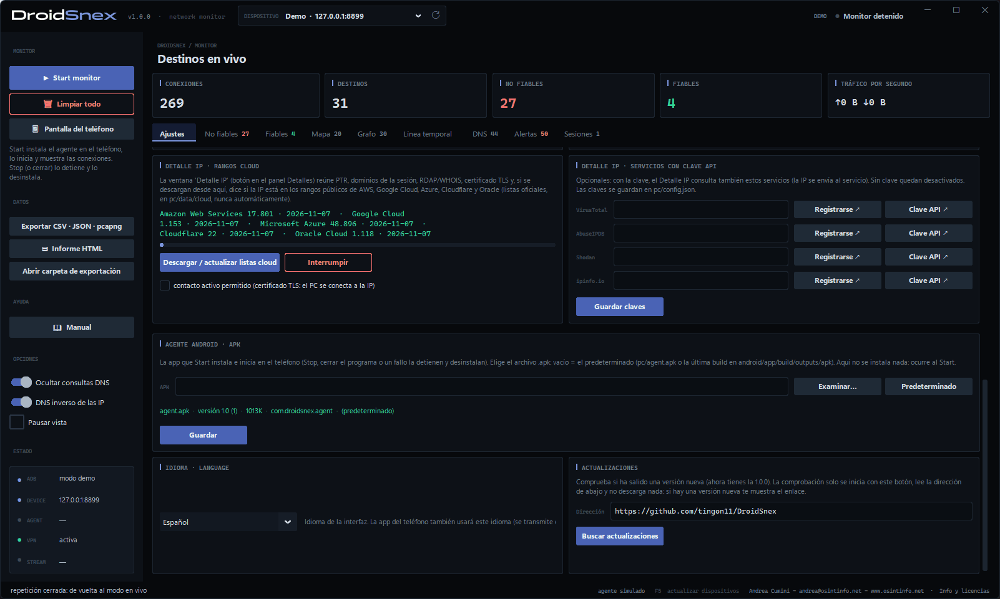

## 4. La ventana principal

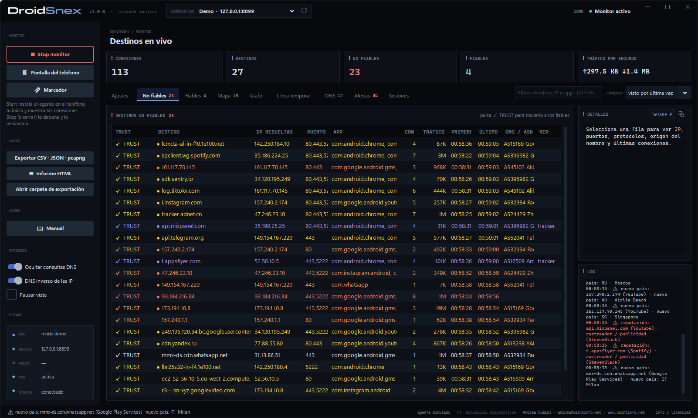

- **Cabecera (arriba):** el logotipo y la versión, el menú **DISPOSITIVO** con el teléfono conectado (el botón ↻ o la tecla **F5** actualizan la lista) y, a la derecha, el estado del monitor.
- **Columna izquierda:** los comandos.
  - *Monitor:* **Start monitor** (con el monitor activo el mismo botón pasa a ser **Stop monitor**), **Limpiar todo** (solo con el monitor detenido), **Pantalla del teléfono**, **Marcador** (solo con el monitor activo).
  - *Datos:* **Exportar CSV · JSON · pcapng**, **Informe HTML** y **Abrir carpeta de exportación**.
  - *Ayuda:* **📖 Manual** abre este manual en el idioma de la interfaz. En la ventana del manual, el cuadro de búsqueda arriba a la izquierda (**Ctrl+F**) resalta todas las coincidencias: **Intro** o **F3** pasa a la siguiente, **Mayús+Intro** a la anterior, **Esc** vacía la búsqueda.
  - *Opciones:* **Ocultar consultas DNS** (quita de las listas las filas que son solo consultas DNS), **DNS inverso de las IP** (busca un nombre para las IP que no lo tienen), **Pausar vista** (congela las listas para leerlas con calma; los datos siguen llegando).
  - *Estado:* cinco indicadores (ADB, DEVICE, AGENT, VPN, STREAM): verdes cuando esa parte funciona.
- **Contadores:** Conexiones, Destinos, No fiables, Fiables, Tráfico por segundo.
- **Pestañas:** Ajustes, No fiables, Fiables, Mapa, Grafo, Línea temporal, DNS, Alertas, Sesiones. A la derecha de las pestañas, en las listas, el cuadro **Filtrar dominio, IP o app** (**Ctrl+F**) y el menú **ORDENAR** (visto por última vez, n.º de conexiones, visto por primera vez, destino, tráfico).
- **Panel derecho:** **Detalles** de la fila seleccionada y, debajo, el **Log** con los mensajes del programa.
- **Barra inferior:** el mensaje de estado, **F5 actualizar dispositivos** y el enlace **Info y licencias**.

## 5. Iniciar y detener el monitor

1. Conecta el teléfono por USB y desbloquéalo. En el menú **DISPOSITIVO** aparece su modelo; si tienes más de uno, elígelo en el menú.
2. Pulsa **▶ Start monitor**. DroidSnex instala el agente en el teléfono, le concede los permisos necesarios e inicia la VPN local. Si en el teléfono aparece **Solicitud de conexión**, desbloquéalo y toca **Aceptar**.
3. Cuando los indicadores de *Estado* están en verde, las conexiones empiezan a llegar a las listas. Usa el teléfono como siempre: cada app que se conecta a internet aparece con sus destinos.
4. Pulsa **■ Stop monitor** para terminar. El agente se detiene y se **desinstala** del teléfono; la sesión se guarda en la pestaña [Sesiones](#15-sesiones-repetición-y-marcadores).

Al cerrar el programa el agente también se detiene y se desinstala. Si el cable se suelta, DroidSnex intenta volver a conectarse solo; si el PC se apaga o el programa se interrumpe, el agente se detiene solo poco después (watchdog).

## 6. No fiables y Fiables

Cada destino (un dominio, o una IP cuando no se conoce el nombre) está en una de las dos listas:

- **No fiables** — los destinos no fiables. Todo destino nuevo empieza aquí.
- **Fiables** — los destinos que has marcado como fiables.

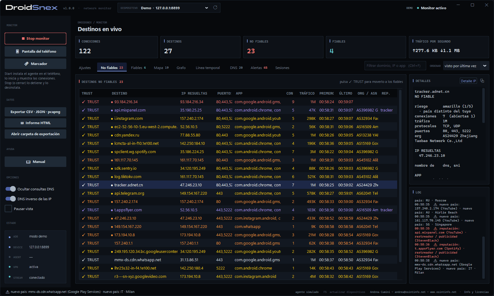

Las columnas: Destino, IP resueltas, Puertos, App, Con (número de conexiones), Tráfico, Primero y Último (horas), Org / ASN (la organización que gestiona la IP) y Rep. (distintivo *tracker*, *malware* o *tor* de las listas de reputación). Haz clic en el título de una columna para ordenar A-Z y otra vez para Z-A.

- **Confiar en un destino:** en la lista No fiables haz clic en **✓ TRUST** en la primera columna. El destino pasa a la lista Fiables.
- **Deshacer:** en la lista Fiables haz clic en **✕ UNTRUST**.
- **✕ Quitar confianza a todas** (arriba en la lista Fiables) devuelve todos los destinos fiables a los no fiables, tras una confirmación. Vacía la lista guardada y no se puede deshacer.

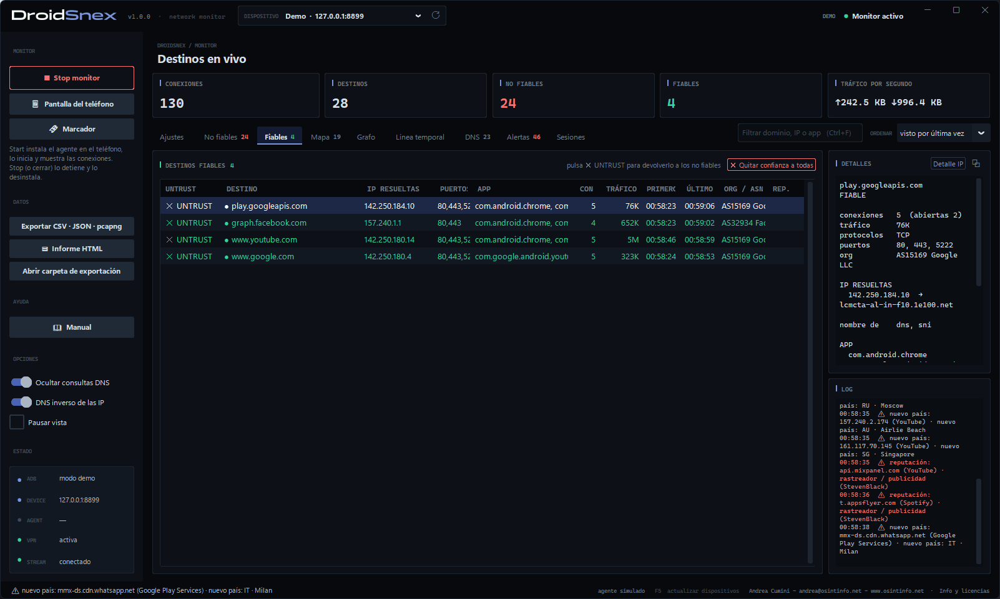

La lista de destinos fiables se guarda y vale también para las sesiones siguientes y para otros teléfonos.

## 7. La escala de peligrosidad

En la lista No fiables cada fila tiene un color que indica lo sospechoso que es el destino. DroidSnex suma puntos por cada señal:

| Señal | Puntos |
|---|---|
| solo IP, sin nombre | +1 |
| organización desconocida (IP no presente en la base ASN) | +1 |
| país distinto del tuyo | +1 |
| DNS cifrado (DoH/DoT) | +1 |
| puerto inusual (no 80, 443, 53…) | +2 |
| proveedor VPN (orientativo) | +3 |
| tracker / publicidad en lista | +4 |
| nodo de salida Tor | +4 |
| malware en lista | +5 |

Las señales genéricas (las cinco primeras filas) llegan como máximo a 3 puntos; el fucsia y el violeta solo se alcanzan con las listas de reputación. El color es el total, hasta 5:

**0 blanco · 1 amarillo · 2 naranja · 3 rojo · 4 fucsia · 5 violeta**

En el panel Detalles, la línea *peligrosidad* explica qué señales han contado. Para tener todas las señales se necesitan la ubicación, la base ASN y las listas de reputación (consulta [Ajustes](#3-ajustes)).

## 8. Detalles y Detalle IP

Selecciona una fila de una lista: el panel **Detalles** muestra si el destino es FIABLE o NO FIABLE, el número de conexiones (y cuántas siguen abiertas), protocolos, puertos, las IP resueltas con el origen del nombre (SNI, DNS o DNS inverso), la peligrosidad y las últimas conexiones.

El botón **Detalle IP**, arriba en el panel, abre una ventana con todo lo que se puede saber sobre la IP:

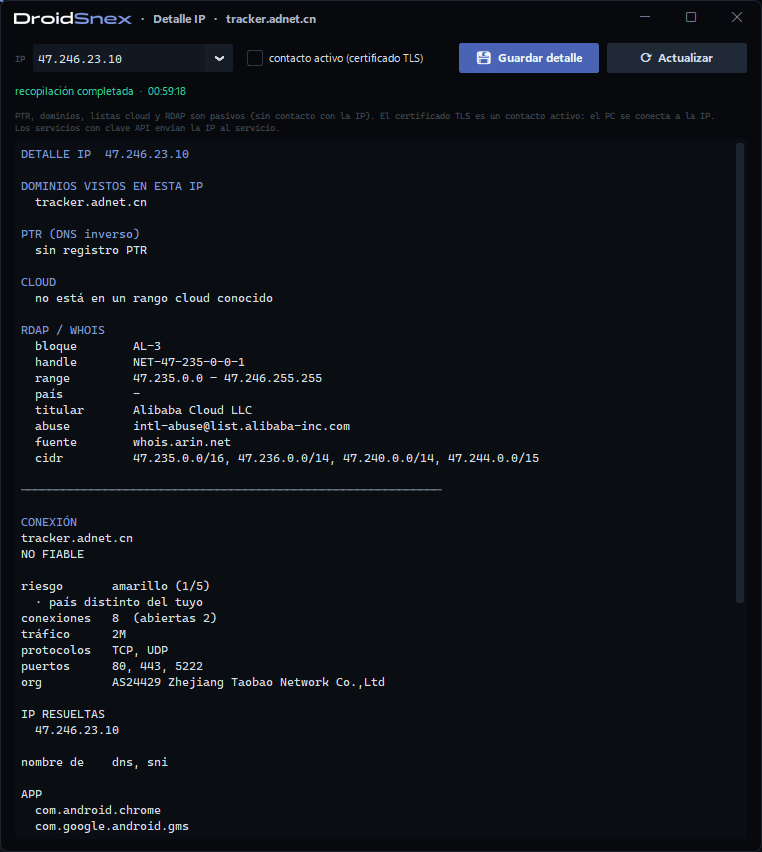

- **DOMINIOS VISTOS EN ESTA IP** durante la sesión;
- **PTR (DNS inverso)**;
- **CLOUD** — si la IP pertenece a los rangos publicados por AWS, Google Cloud, Azure, Cloudflare y otros (listas descargadas desde Ajustes);
- **RDAP / WHOIS** — bloque, país, titular;
- **CERTIFICADO TLS (contacto activo)** — emisor, validez, nombres del certificado;
- **VIRUSTOTAL, ABUSEIPDB, SHODAN, IPINFO.IO** — solo si has introducido sus claves API en Ajustes.

Arriba eliges la **IP** (si el destino tiene más de una). PTR, dominios, listas cloud y RDAP son pasivos: ningún contacto con la IP. El certificado TLS, en cambio, es un contacto activo, el PC se conecta a la IP, y solo se obtiene con la casilla **contacto activo (certificado TLS)** marcada. Los servicios con clave reciben la IP que consultas.

**Actualizar** repite la recogida. **Guardar detalle** guarda el resultado en un archivo de texto; la ruta aparece en el Log.

El Detalle IP también se abre desde una línea del Mapa o un nodo del Grafo: selecciona primero el destino y luego pulsa el botón.

## 9. Mapa

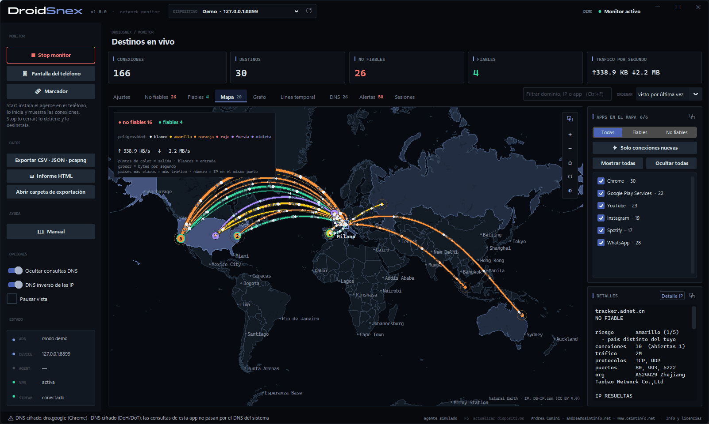

El teléfono se dibuja en tu ubicación (configúrala en Ajustes); desde ahí sale una línea hacia la ciudad de cada destino: **verde** si es fiable, del color de la escala de peligrosidad si no lo es. El grosor crece con los bytes por segundo; los puntos de color que van hacia el destino son el tráfico saliente y los blancos que van hacia el teléfono, el entrante.

- **Rueda** o **+ / −**: zoom. **Arrastrar**: mover. **Doble clic**: acercar.
- **Clic en una línea o en un punto**: los detalles del destino en el panel Detalles.
- **Apps en el mapa** (panel de la derecha): elige **Todas**, **Fiables** o **No fiables** y qué apps mostrar, con **Mostrar todas** y **Ocultar todas**.
- **✦ Solo conexiones nuevas**: desde ese momento el mapa solo muestra las conexiones que nacen después; pulsa de nuevo para volver a todas.
- De lejos, los destinos cercanos se agrupan en una **bola con el número de IP**: pasa el ratón para ver la lista, haz clic para acercarte ahí. Desde el zoom 4, las IP en el mismo punto se abren en puntos distintos alrededor de la ciudad.
- **◐** colorea los países según el tráfico intercambiado (más claro = más bytes).
- Una conexión nueva se anuncia con un destello del teléfono al destino; los impulsos de las líneas tienen estela y aumentan con el tráfico.
- **Clic derecho** en el mapa › **Fijar aquí mi posición**.
- **⧉** separa el mapa en una ventana aparte (consulta [Paneles separados](#17-paneles-separados)).

Si faltan la ubicación o la base de ciudades, el mapa lo indica con un mensaje. Los destinos sin ubicación (IP privadas o no presentes en la base) se cuentan aparte.

## 10. Grafo

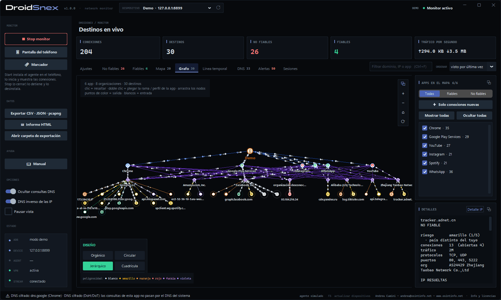

El grafo muestra quién habla con quién: **teléfono → app → organización (ASN) → destino**.

- **Clic** en un nodo: lo resalta junto con sus vecinos; los demás se atenúan.
- **Doble clic** en una app o una organización: pliega o despliega la rama. Un doble clic en la app (o en la app de la lista) abre el **perfil de la app**: versión, si es de sistema, fechas de instalación y actualización, permisos (los sensibles en amarillo), destinos.
- **Arrastra** los nodos para ordenarlos, arrastra el fondo para mover la vista, **rueda** o **+ / −** para el zoom, **⌂** para ajustar el grafo a la ventana, **⟳** para redistribuirlo.
- **Diseño:** **Jerárquico** (predeterminado: teléfono → app → organización → destino, de arriba abajo), **Orgánico**, **Circular**, **Cuadrícula**. **Reducir cruces** prueba varias distribuciones y se queda con la que tiene menos líneas que se cruzan.
- Por los enlaces corren los impulsos del tráfico como en el mapa (de color = salida, claros = entrada); los destinos con conexiones abiertas tienen un anillo que late. Las etiquetas no se superponen: pasa el ratón sobre un nodo para leer su nombre completo.
- **⧉** separa el grafo en una ventana aparte.

Para ver las organizaciones se necesita la base ASN (Ajustes).

## 11. Línea temporal

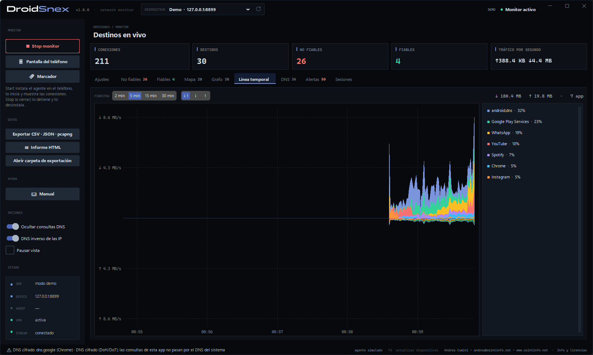

La línea temporal muestra los bytes por segundo de cada app a lo largo del tiempo. Encima del eje, el tráfico entrante (↓, del servidor al teléfono); debajo, el saliente (↑): se ve enseguida qué app habla en segundo plano con el teléfono en reposo y cuál descarga.

- Elige la ventana de tiempo: **2, 5, 15 o 30 min**.
- **Clic en una entrada de la leyenda** oculta o muestra esa app.
- **Pasa el ratón** por el gráfico para leer los valores de ese instante.
- Las apps más allá de las diez primeras se agrupan en *otras*.

## 12. DNS

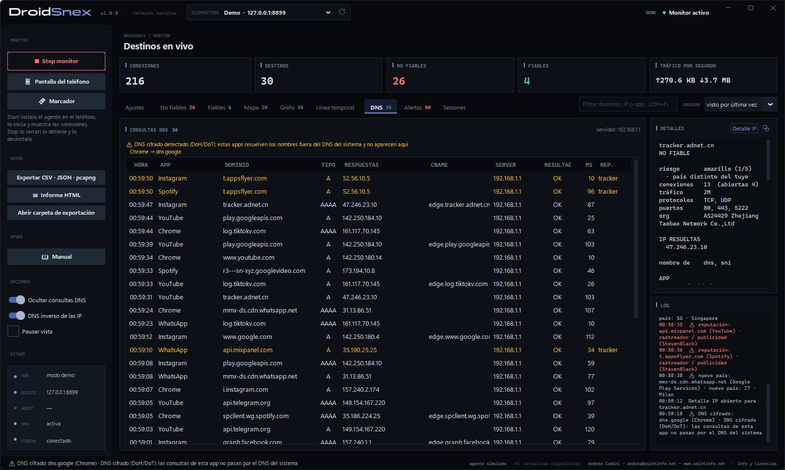

La pestaña **DNS** lista las consultas DNS del teléfono: Hora, App, Dominio, Tipo (A, AAAA, HTTPS…), Respuestas, Resultado, tiempo de respuesta en ms y Rep. **Vaciar** borra la lista.

Algunas apps usan **DNS cifrado** (DoH/DoT): sus consultas no pasan por el DNS del sistema y no aparecen aquí. Cuando DroidSnex lo detecta, muestra un aviso y genera una alerta.

## 13. Alertas

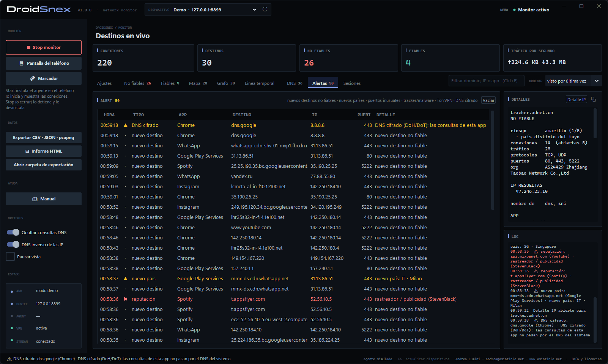

La pestaña **Alertas** recoge los eventos que merecen atención: **nuevos destinos no fiables · nuevos países · puertos inusuales · tracker/malware · Tor/VPN · DNS cifrado**. Cada fila indica Hora, nivel, Tipo, App, Destino, IP, Puerto y Detalle. **Vaciar** borra la lista.

## 14. Pantalla del teléfono

El botón **📱 Pantalla del teléfono** muestra la pantalla del teléfono en el PC y permite manejarla con el ratón y el teclado, mediante scrcpy (descárgalo antes desde Ajustes). La ventana permanece en primer plano; arrastra la cabecera para moverla. Los botones de arriba envían las teclas de Android: atrás, inicio, apps recientes, encendido, volumen − y +.

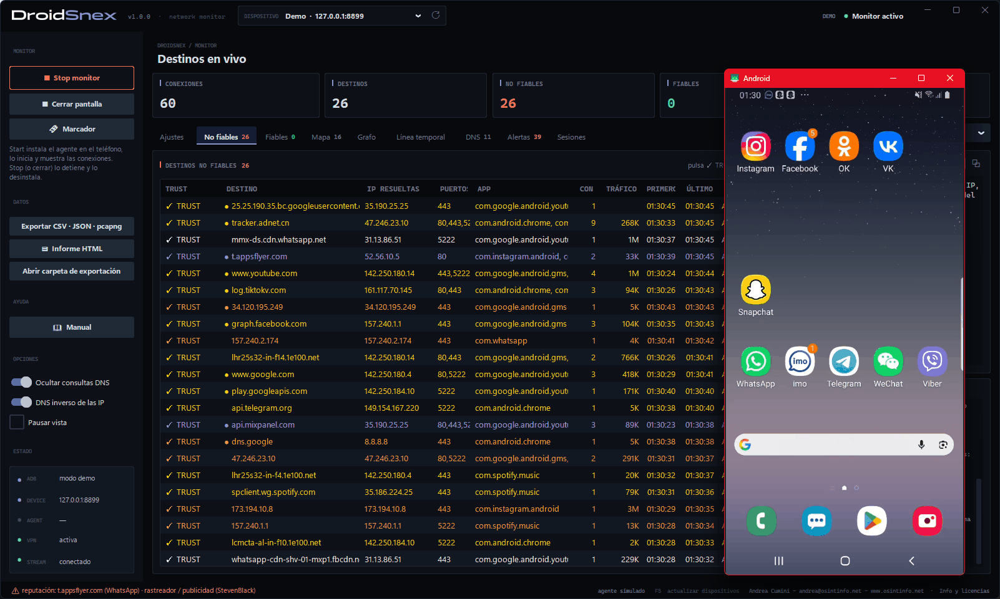

Pulsa de nuevo el botón (**Cerrar pantalla**) para cerrarla.

## 15. Sesiones, repetición y marcadores

Cada monitorización, de Start a Stop, se guarda como **sesión**, con todos los eventos registrados.

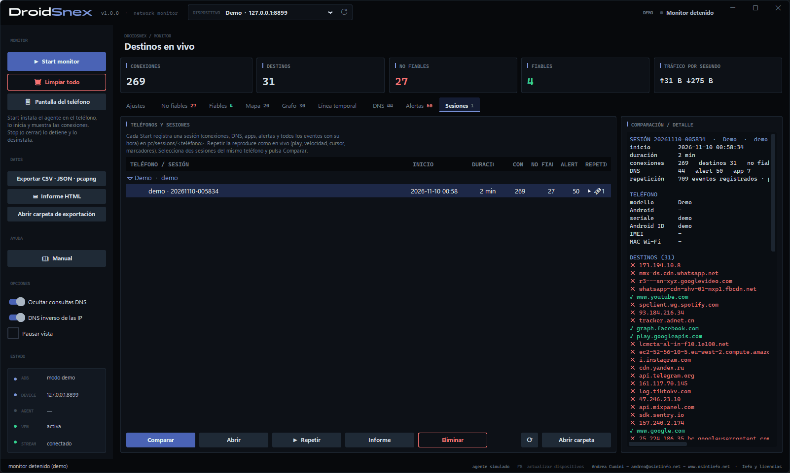

En la pestaña **Sesiones**:

- **Teléfonos y sesiones** (a la izquierda) lista las sesiones guardadas con teléfono, inicio, duración, conexiones, no fiables y una columna **Repetición** (▶ si la sesión se puede volver a ver, 🔖 con el número de marcadores).
- Selecciona una sesión: en **Comparación / detalle** (a la derecha) aparecen teléfono, inicio, duración, destinos, apps, organizaciones y los marcadores.
- **Comparar:** selecciona dos sesiones del mismo teléfono con **Ctrl+clic** y pulsa Comparar. Verás los destinos en común, nuevos y desaparecidos, las apps nuevas, las desaparecidas, las organizaciones nuevas y los países nuevos.
- **Informe** crea el informe HTML de la sesión seleccionada (consulta el [capítulo 16](#16-exportar-los-datos-y-limpiar-todo)).
- **Abrir** abre una sesión desde un archivo, **Abrir carpeta** abre la carpeta de las sesiones, **Eliminar sesiones** borra las seleccionadas tras una confirmación (no se puede deshacer).

### Repetición

Selecciona una sesión y pulsa **▶ Repetir** (con el monitor detenido). Todas las vistas (listas, mapa, grafo, línea temporal, DNS, alertas) recorren la sesión como si fuera en directo.

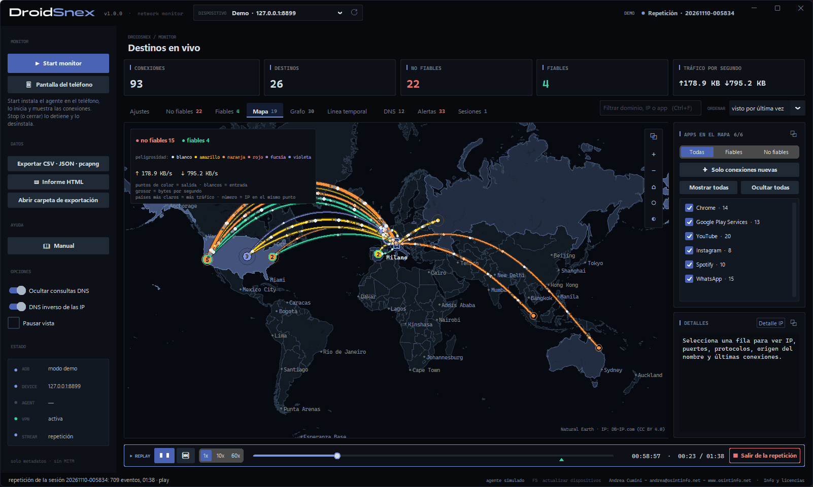

La barra de repetición, abajo:

- **▶ / ❚❚** reproducir y pausa, **⏮** volver al inicio;
- velocidad **1x, 10x, 60x**;
- el cursor del tiempo: arrástralo para saltar a un instante; los marcadores aparecen sobre el cursor. **Clic derecho** en un marcador abre su captura de pantalla;
- **■ Salir de la repetición** vuelve al modo en directo.

### Marcadores

Durante la monitorización pulsa **🔖 Marcador** en la columna izquierda para señalar un momento, por ejemplo «he abierto Instagram». Escribe una nota y pulsa **Guardar marcador**. El marcador se guarda en la sesión con la hora y una captura de pantalla del teléfono.

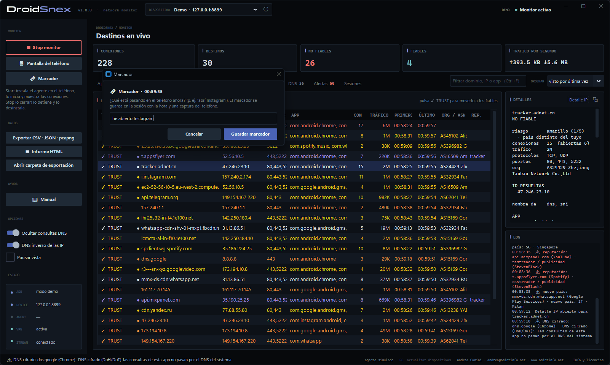

## 16. Exportar los datos y Limpiar todo

- **Exportar CSV · JSON · pcapng** guarda las conexiones de la sesión en tres formatos: CSV (para hojas de cálculo), JSON y pcapng (se abre con Wireshark, solo metadatos). **Abrir carpeta de exportación** abre la carpeta de los archivos.
- **Informe HTML** crea un único archivo HTML de la sesión (la actual, la que está en repetición o la elegida en la pestaña Sesiones) y lo abre en el navegador: resumen, teléfono, mapa, destinos no fiables por peligrosidad con los motivos, destinos fiables, tráfico por app y por país, alertas y marcadores con sus capturas. Para un PDF usa *Imprimir › Guardar como PDF* en el navegador.
- **🗑 Limpiar todo** aparece con el monitor detenido: tras una confirmación borra conexiones, consultas DNS, alertas, mapa, grafo y línea temporal de la sesión actual. Las sesiones guardadas y la lista de fiables se conservan.

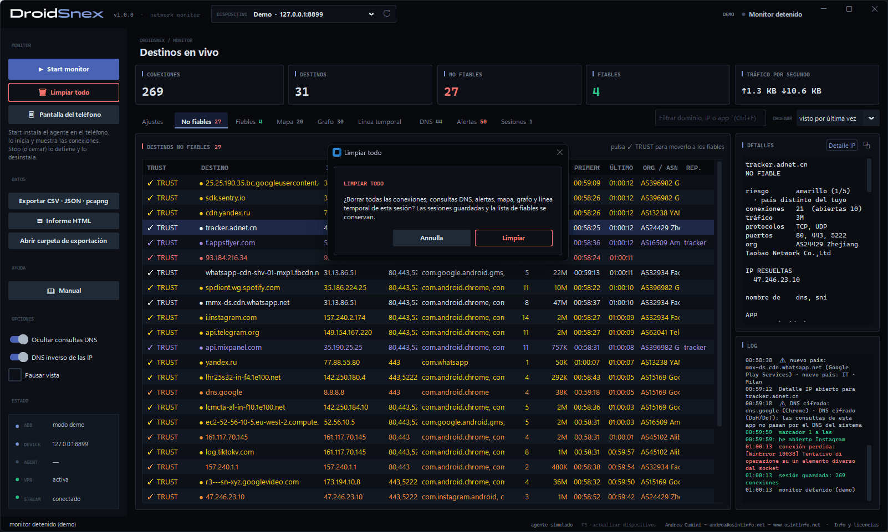

## 17. Paneles separados

Mapa, Grafo, Detalles y Apps en el mapa tienen arriba a la derecha el botón **⧉**: el panel se separa en una ventana aparte que puedes mover y redimensionar, por ejemplo en un segundo monitor. El panel se sigue actualizando.

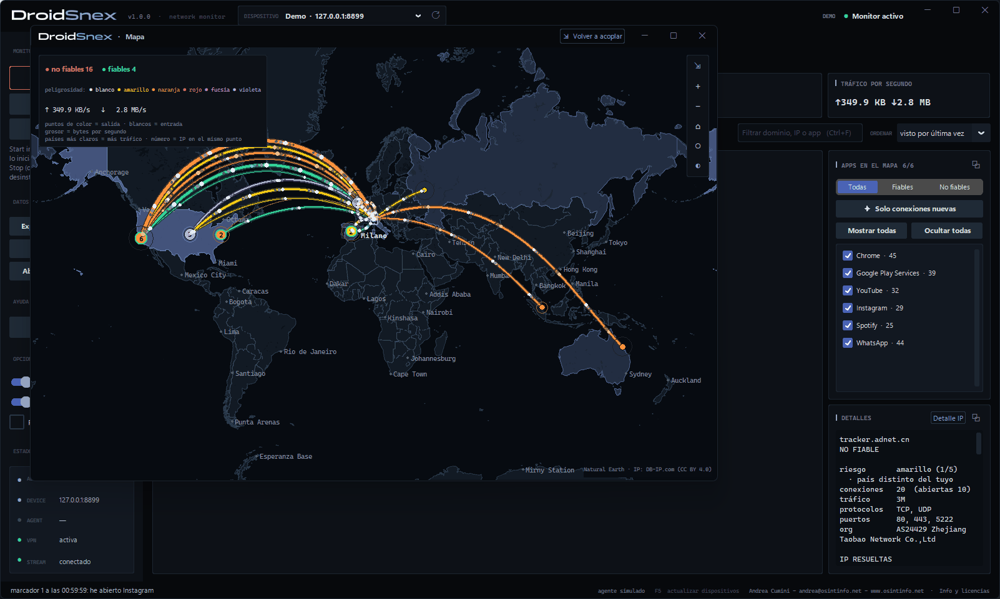

Para devolverlo a su sitio pulsa **⇲ Volver a acoplar** en la cabecera de la ventana, ciérrala o pulsa **Volver a acoplar** en la pestaña vacía.

## 18. Info y licencias

Haz clic en **Info y licencias** en la barra inferior: la ventana muestra la versión, el autor, la licencia del programa, los datos y componentes de terceros con sus licencias (**Todas las licencias**), y el botón **Términos de uso** permite releer los términos. DroidSnex es software libre, sin ninguna garantía.

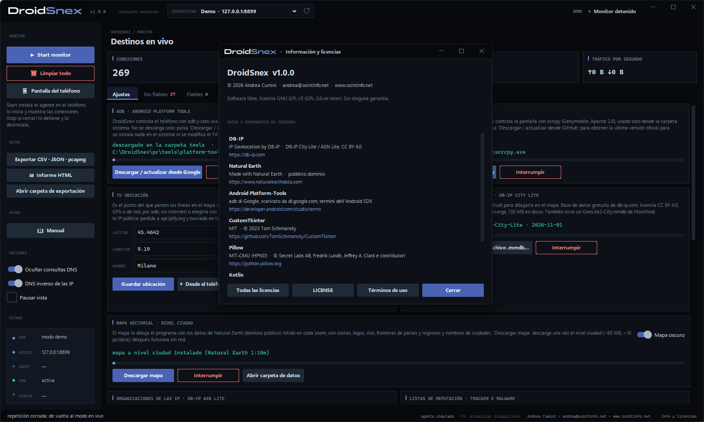

## 19. Problemas frecuentes

| Mensaje | Qué hacer |
|---|---|
| Ningún dispositivo conectado | Conecta el teléfono por USB con la depuración USB activada y pulsa F5. |
| Dispositivo no autorizado | Desbloquea el teléfono y acepta «¿Permitir depuración USB?» marcando «Permitir siempre desde este ordenador». |
| adb no está en la carpeta tools | Ajustes › ADB › Descargar / actualizar desde Google. |
| scrcpy no está en la carpeta tools | Ajustes › Pantalla del teléfono › Descargar / actualizar desde GitHub. |
| La VPN no está activa | En el teléfono toca Aceptar en la solicitud de conexión VPN; si hay otra VPN activa, desactívala y pulsa Start de nuevo. |
| Falta la base de ciudades | Ajustes › Base de datos de ciudades de IP › Descargar / actualizar. |
| Configura tu ubicación | Ajustes › Tu ubicación › Detectar desde mi IP pública (o introdúcela a mano). |
