# DroidSnex — Manuel d'utilisation

DroidSnex montre, en temps réel, à quels serveurs se connecte un téléphone Android : quelle app, quel domaine, quelle IP, dans quel pays, avec combien de trafic. Le téléphone est relié au PC par un câble USB ; pendant la surveillance, une petite app (l'*agent*) tourne sur le téléphone, crée un VPN local et ne lit que les métadonnées des connexions. Le contenu du trafic n'est jamais déchiffré (pas de MITM).

## Sommaire

1. [Avant de commencer](#1-avant-de-commencer)
2. [Premier lancement : langue et conditions d'utilisation](#2-premier-lancement--langue-et-conditions-dutilisation)
3. [Réglages](#3-réglages)
4. [La fenêtre principale](#4-la-fenêtre-principale)
5. [Démarrer et arrêter la surveillance](#5-démarrer-et-arrêter-la-surveillance)
6. [Non fiables et Fiables](#6-non-fiables-et-fiables)
7. [L'échelle de dangerosité](#7-léchelle-de-dangerosité)
8. [Détails et Détail IP](#8-détails-et-détail-ip)
9. [Carte](#9-carte)
10. [Graphe](#10-graphe)
11. [Chronologie](#11-chronologie)
12. [DNS](#12-dns)
13. [Alertes](#13-alertes)
14. [Écran du téléphone](#14-écran-du-téléphone)
15. [Sessions, relecture et signets](#15-sessions-relecture-et-signets)
16. [Exporter les données et Tout effacer](#16-exporter-les-données-et-tout-effacer)
17. [Panneaux détachés](#17-panneaux-détachés)
18. [Infos et licences](#18-infos-et-licences)
19. [Problèmes fréquents](#19-problèmes-fréquents)

---

## 1. Avant de commencer

Il vous faut :

- un PC Windows avec DroidSnex ;
- un téléphone Android et un câble USB de données ;
- le **débogage USB** activé sur le téléphone : *Paramètres › À propos du téléphone*, touchez sept fois *Numéro de build* pour débloquer les *Options pour les développeurs*, puis activez *Débogage USB* dans les *Options pour les développeurs*.

À la première connexion, le téléphone demande **« Autoriser le débogage USB ? »** : déverrouillez l'écran, cochez *Toujours autoriser cet ordinateur* et touchez *OK*.

DroidSnex n'utilise que les outils de son propre dossier `tools` (adb et scrcpy) et n'installe rien dans le système. La première fois, téléchargez-les depuis l'onglet **Réglages** (voir le [chapitre 3](#3-réglages)).

## 2. Premier lancement : langue et conditions d'utilisation

Au premier lancement apparaît une fenêtre qu'on ne peut ni fermer ni passer derrière les autres.

1. **Choisissez la langue.** Les boutons proposent les neuf langues disponibles : Italiano, English, Deutsch, Français, Español, Nederlands, Polski, Ελληνικά, Shqip. La langue vaut pour tout le programme et pour l'agent sur le téléphone ; vous pourrez la changer plus tard dans l'onglet Réglages.

   

2. **Lisez les conditions d'utilisation.** Le texte est dans la langue choisie. Le bouton **J'accepte** ne s'active qu'après avoir fait défiler le texte jusqu'au bout. **Je refuse** ferme le programme.

   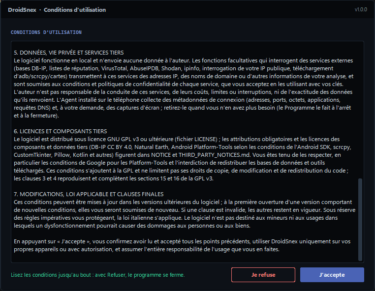

L'acceptation est enregistrée : la fenêtre ne réapparaît que si les conditions changent de version. Vous pouvez relire les conditions à tout moment depuis [Infos et licences](#18-infos-et-licences).

## 3. Réglages

L'onglet **Réglages** regroupe les paramètres et les téléchargements. Chaque téléchargement ne se fait que lorsque vous appuyez sur le bouton et peut être arrêté avec **Interrompre**.

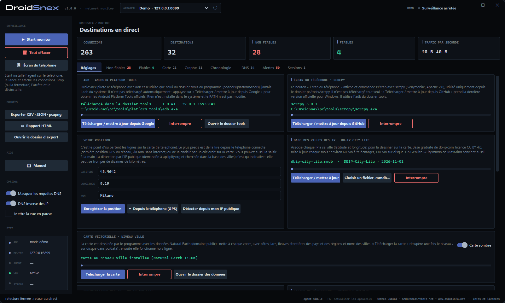

- **ADB · Android Platform Tools** — DroidSnex pilote le téléphone avec adb, pris uniquement dans le dossier `tools` du programme. Appuyez sur **Télécharger / mettre à jour depuis Google** pour les Android Platform Tools officiels ; **Ouvrir le dossier tools** ouvre le dossier.
- **Écran du téléphone · scrcpy** — **Télécharger / mettre à jour depuis GitHub** télécharge scrcpy depuis les versions officielles.
- **Votre position** — le point d'où partent les lignes sur la carte et le pays utilisé par l'échelle de dangerosité. Le plus précis est **⌖ Depuis le téléphone (GPS)** : il lit via adb la dernière position du téléphone connecté et affiche la source, la précision et l'âge. Sinon, faites un clic droit sur la carte › **Définir ma position ici**, ou saisissez LATITUDE, LONGITUDE et NOM et appuyez sur **Enregistrer la position**. **Détecter depuis mon IP publique** n'est qu'indicatif : l'erreur peut atteindre des dizaines de kilomètres.
- **Base des villes des IP · DB-IP City Lite** — associe chaque IP à sa ville pour la placer sur la carte. **Télécharger / mettre à jour**, ou **Choisir un fichier .mmdb…** ; **Ouvrir le dossier des données**.
- **Carte vectorielle · niveau ville** — **Télécharger la carte** installe la carte détaillée (Natural Earth 1:10m, avec côtes, fleuves, frontières et noms des villes) ; sans elle, on voit la version de base incluse. **Carte sombre** change les couleurs de la carte.
- **Organisations des IP · DB-IP ASN Lite** — associe chaque IP à l'organisation qui la gère (Google, Meta, Amazon, un hébergeur inconnu…). C'est la base du Graphe et de la colonne Org / ASN.
- **Listes de réputation · trackers et malwares** — listes de blocage publiques de trackers, malwares, nœuds de sortie **Tor** et indications sur les fournisseurs **VPN**. **Télécharger / mettre à jour les listes**. Les destinations listées reçoivent un badge et une alerte.
- **Détail IP · plages cloud** — **Télécharger / mettre à jour les listes cloud** et l'autorisation du **contact actif** (certificat TLS) du Détail IP.
- **Détail IP · services avec clé API** — clés facultatives pour VirusTotal, AbuseIPDB, Shodan et ipinfo.io. **S'inscrire** ouvre la page du service ; collez la clé et appuyez sur **Enregistrer les clés**. Sans clé, le service reste désactivé. Les clés restent sur le PC, dans le fichier de configuration.
- **Agent Android · APK** — l'APK de l'agent à installer sur le téléphone. Celui **Par défaut** convient en général ; **Parcourir…** pour en choisir un autre, puis **Enregistrer**.
- **Mises à jour** — **Rechercher des mises à jour** vérifie, seulement quand vous appuyez, si une version plus récente existe à l'adresse indiquée et affiche le lien vers sa page. Rien n'est téléchargé ni installé.
- **Langue · Language** — la langue de l'interface ; l'agent sur le téléphone l'utilisera aussi à partir du prochain Start.

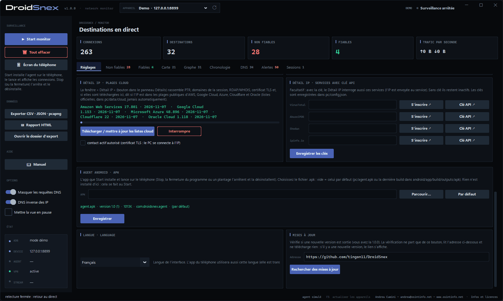

## 4. La fenêtre principale

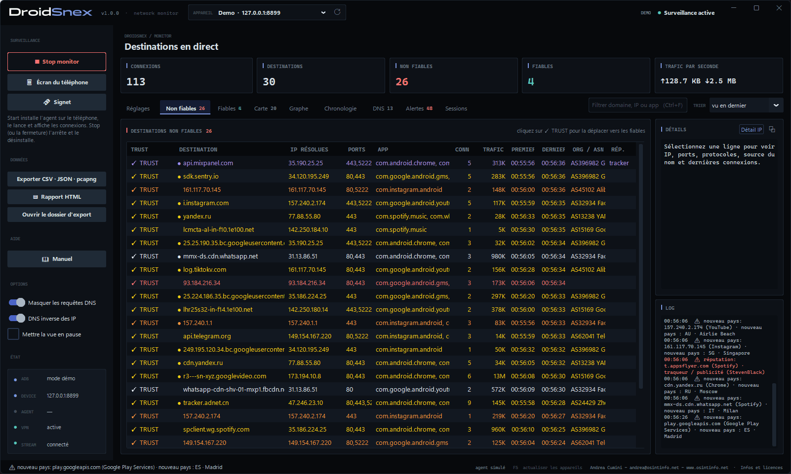

- **En-tête (en haut) :** le logo et la version, le menu **APPAREIL** avec le téléphone connecté (le bouton ↻ ou la touche **F5** actualisent la liste) et, à droite, l'état de la surveillance.
- **Colonne de gauche :** les commandes.
  - *Surveillance :* **Start monitor** (surveillance active, le même bouton devient **Stop monitor**), **Tout effacer** (seulement surveillance arrêtée), **Écran du téléphone**, **Signet** (seulement surveillance active).
  - *Données :* **Exporter CSV · JSON · pcapng**, **Rapport HTML** et **Ouvrir le dossier d'export**.
  - *Aide :* **📖 Manuel** ouvre ce manuel dans la langue de l'interface. Dans la fenêtre du manuel, la case de recherche en haut à gauche (**Ctrl+F**) surligne toutes les occurrences : **Entrée** ou **F3** passe à la suivante, **Maj+Entrée** à la précédente, **Échap** vide la recherche.
  - *Options :* **Masquer les requêtes DNS** (retire des listes les lignes qui ne sont que des requêtes DNS), **DNS inverse des IP** (cherche un nom pour les IP qui n'en ont pas), **Mettre la vue en pause** (fige les listes pour les lire tranquillement ; les données continuent d'arriver).
  - *État :* cinq voyants (ADB, DEVICE, AGENT, VPN, STREAM) : verts quand cette partie fonctionne.
- **Compteurs :** Connexions, Destinations, Non fiables, Fiables, Trafic par seconde.
- **Onglets :** Réglages, Non fiables, Fiables, Carte, Graphe, Chronologie, DNS, Alertes, Sessions. À droite des onglets, dans les listes, la case **Filtrer domaine, IP ou app** (**Ctrl+F**) et le menu **TRIER** (vu en dernier, nb de connexions, vu en premier, destination, trafic).
- **Panneau de droite :** **Détails** de la ligne sélectionnée et, en dessous, le **Log** avec les messages du programme.
- **Barre du bas :** le message d'état, **F5 actualiser les appareils** et le lien **Infos et licences**.

## 5. Démarrer et arrêter la surveillance

1. Branchez le téléphone en USB et déverrouillez-le. Son modèle apparaît dans le menu **APPAREIL** ; si vous en avez plusieurs, choisissez-le dans le menu.
2. Appuyez sur **▶ Start monitor**. DroidSnex installe l'agent sur le téléphone, lui accorde les autorisations nécessaires et lance le VPN local. Si **Demande de connexion** apparaît sur le téléphone, déverrouillez-le et touchez **OK**.
3. Quand les voyants d'*État* sont verts, les connexions commencent à arriver dans les listes. Utilisez le téléphone normalement : chaque app qui se connecte à internet apparaît avec ses destinations.
4. Appuyez sur **■ Stop monitor** pour terminer. L'agent est arrêté et **désinstallé** du téléphone ; la session est enregistrée dans l'onglet [Sessions](#15-sessions-relecture-et-signets).

La fermeture du programme arrête et désinstalle aussi l'agent. Si le câble se débranche, DroidSnex tente de se reconnecter tout seul ; si le PC s'éteint ou si le programme s'interrompt, l'agent s'arrête de lui-même peu après (watchdog).

## 6. Non fiables et Fiables

Chaque destination (un domaine, ou une IP quand le nom est inconnu) se trouve dans l'une des deux listes :

- **Non fiables** — les destinations non fiables. Toute nouvelle destination commence ici.
- **Fiables** — les destinations que vous avez marquées comme fiables.

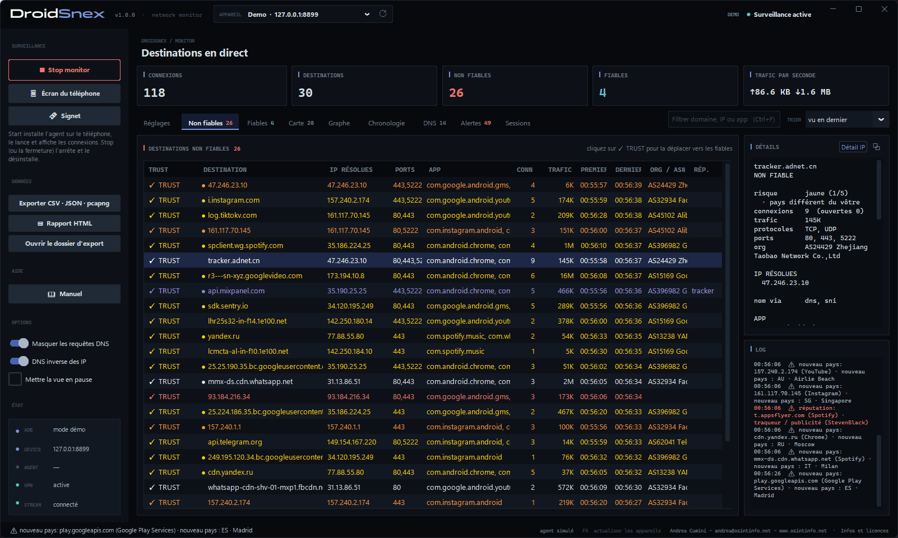

Les colonnes : Destination, IP résolues, Ports, App, Conn (nombre de connexions), Trafic, Premier et Dernier (heures), Org / ASN (l'organisation qui gère l'IP) et Rép. (badge *tracker*, *malware* ou *tor* issu des listes de réputation). Cliquez sur le titre d'une colonne pour trier A-Z, cliquez encore pour Z-A.

- **Faire confiance à une destination :** dans la liste Non fiables, cliquez sur **✓ TRUST** dans la première colonne. La destination passe dans la liste Fiables.
- **Revenir en arrière :** dans la liste Fiables, cliquez sur **✕ UNTRUST**.
- **✕ Retirer toute confiance** (en haut de la liste Fiables) remet toutes les destinations fiables parmi les non fiables, après confirmation. La liste enregistrée est vidée et l'opération est irréversible.

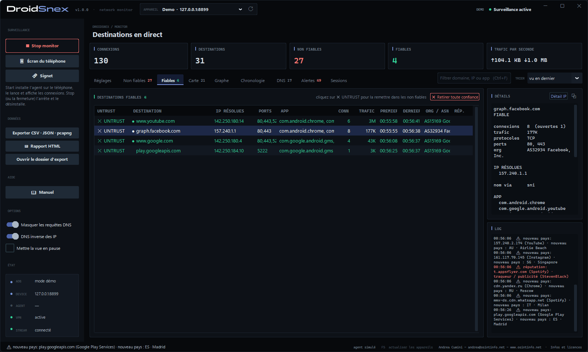

La liste des destinations fiables est enregistrée et vaut aussi pour les sessions suivantes et pour d'autres téléphones.

## 7. L'échelle de dangerosité

Dans la liste Non fiables, chaque ligne a une couleur qui indique à quel point la destination est suspecte. DroidSnex additionne des points pour chaque signal :

| Signal | Points |
|---|---|
| IP seule, aucun nom | +1 |
| organisation inconnue (IP absente de la base ASN) | +1 |
| pays différent du vôtre | +1 |
| DNS chiffré (DoH/DoT) | +1 |
| port inhabituel (ni 80, ni 443, ni 53…) | +2 |
| fournisseur VPN (indicatif) | +3 |
| tracker / publicité en liste | +4 |
| nœud de sortie Tor | +4 |
| malware en liste | +5 |

Les signaux génériques (les cinq premières lignes) atteignent au plus 3 points ; le fuchsia et le violet ne s'obtiennent qu'avec les listes de réputation. La couleur correspond au total, jusqu'à 5 :

**0 blanc · 1 jaune · 2 orange · 3 rouge · 4 fuchsia · 5 violet**

Dans le panneau Détails, la ligne *dangerosité* explique quels signaux ont compté. Pour avoir tous les signaux, il faut la position, la base ASN et les listes de réputation (voir [Réglages](#3-réglages)).

## 8. Détails et Détail IP

Sélectionnez une ligne dans une liste : le panneau **Détails** indique si la destination est FIABLE ou NON FIABLE, le nombre de connexions (et combien sont encore ouvertes), les protocoles, les ports, les IP résolues avec la source du nom (SNI, DNS ou DNS inverse), la dangerosité et les dernières connexions.

Le bouton **Détail IP** en haut du panneau ouvre une fenêtre avec tout ce qu'on peut savoir sur l'IP :

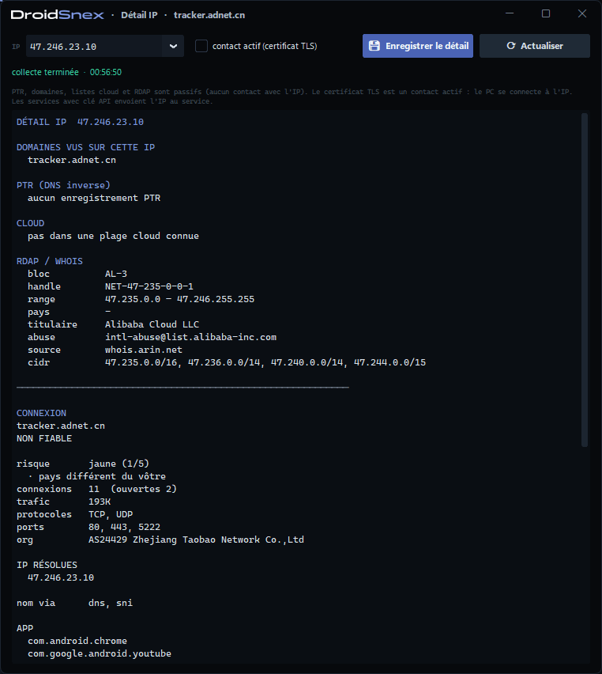

- **DOMAINES VUS SUR CETTE IP** pendant la session ;
- **PTR (DNS inverse)** ;
- **CLOUD** — si l'IP fait partie des plages publiées par AWS, Google Cloud, Azure, Cloudflare et d'autres (listes téléchargées depuis Réglages) ;
- **RDAP / WHOIS** — bloc, pays, titulaire ;
- **CERTIFICAT TLS (contact actif)** — émetteur, validité, noms du certificat ;
- **VIRUSTOTAL, ABUSEIPDB, SHODAN, IPINFO.IO** — seulement si vous avez saisi leurs clés API dans Réglages.

En haut, choisissez l'**IP** (si la destination en a plusieurs). PTR, domaines, listes cloud et RDAP sont passifs : aucun contact avec l'IP. Le certificat TLS est en revanche un contact actif, le PC se connecte à l'IP, et il n'est récupéré que si la case **contact actif (certificat TLS)** est cochée. Les services à clé reçoivent l'IP que vous interrogez.

**Actualiser** relance la collecte. **Enregistrer le détail** enregistre le résultat dans un fichier texte ; le chemin s'affiche dans le Log.

Le Détail IP s'ouvre aussi depuis une ligne de la Carte ou un nœud du Graphe : sélectionnez d'abord la destination, puis appuyez sur le bouton.

## 9. Carte

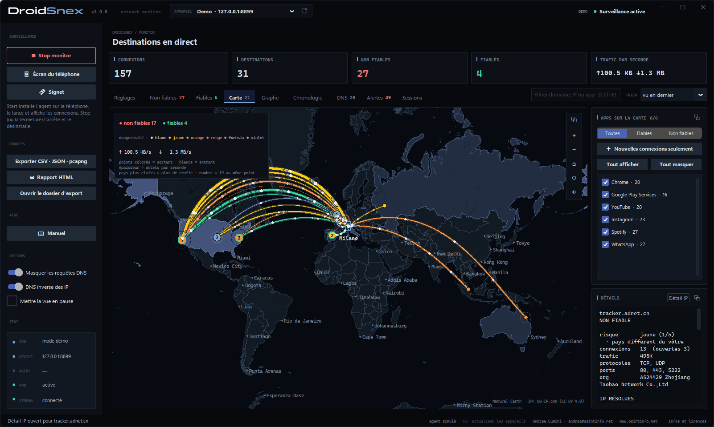

Le téléphone est dessiné à votre position (à régler dans Réglages) ; de là part une ligne vers la ville de chaque destination : **verte** si elle est fiable, de la couleur de l'échelle de dangerosité si elle ne l'est pas. L'épaisseur augmente avec les octets par seconde ; les points colorés qui vont vers la destination sont le trafic sortant, les points blancs qui vont vers le téléphone le trafic entrant.

- **Molette** ou **+ / −** : zoom. **Glisser** : déplacer. **Double-clic** : rapprocher.
- **Clic sur une ligne ou un point** : les détails de la destination dans le panneau Détails.
- **Apps sur la carte** (panneau de droite) : choisissez **Toutes**, **Fiables** ou **Non fiables** et quelles apps afficher, avec **Tout afficher** et **Tout masquer**.
- **✦ Nouvelles connexions seulement** : à partir de ce moment la carte ne montre que les connexions qui naissent ensuite ; appuyez de nouveau pour revenir à toutes.
- De loin, les destinations proches sont regroupées dans une **bulle avec le nombre d'IP** : survolez-la pour la liste, cliquez pour zoomer à cet endroit. À partir du zoom 4, les IP au même point s'ouvrent en points distincts autour de la ville.
- **◐** colore les pays selon le trafic échangé (plus clair = plus d'octets).
- Une nouvelle connexion s'annonce par un éclair du téléphone vers la destination ; les impulsions sur les lignes ont une traînée et augmentent avec le trafic.
- **Clic droit** sur la carte › **Définir ma position ici**.
- **⧉** détache la carte dans une fenêtre séparée (voir [Panneaux détachés](#17-panneaux-détachés)).

S'il manque la position ou la base des villes, la carte l'indique par un message. Les destinations sans position (IP privées ou absentes de la base) sont comptées à part.

## 10. Graphe

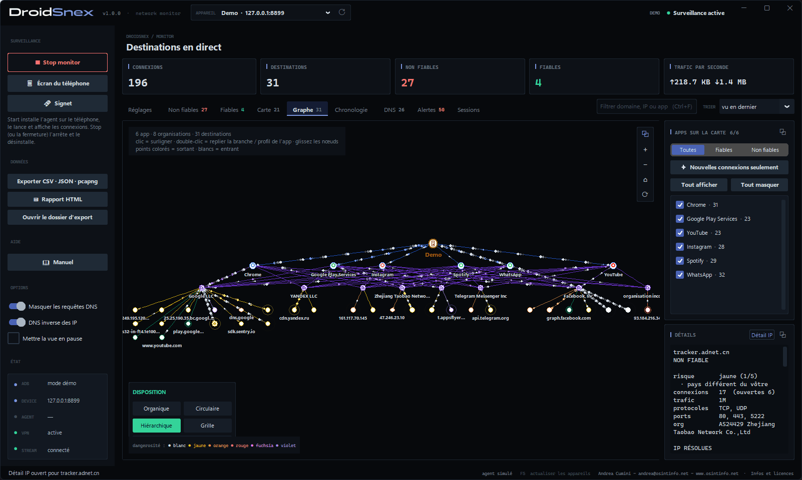

Le graphe montre qui parle avec qui : **téléphone → app → organisation (ASN) → destination**.

- **Clic** sur un nœud : il est mis en évidence avec ses voisins ; les autres s'estompent.
- **Double-clic** sur une app ou une organisation : replie ou déplie la branche. Un double-clic sur l'app (ou sur l'app dans la liste) ouvre le **profil de l'app** : version, app système ou non, dates d'installation et de mise à jour, autorisations (les sensibles en jaune), destinations.
- **Glissez** les nœuds pour les arranger, glissez le fond pour déplacer la vue, **molette** ou **+ / −** pour le zoom, **⌂** pour ajuster le graphe à la fenêtre, **⟳** pour le redisposer.
- **Disposition :** **Hiérarchique** (par défaut : téléphone → app → organisation → destination, de haut en bas), **Organique**, **Circulaire**, **Grille**. **Réduire les croisements** essaie plusieurs dispositions et garde celle où les lignes se croisent le moins.
- Les impulsions du trafic parcourent les liens comme sur la carte (colorées = sortant, claires = entrant) ; les destinations avec des connexions ouvertes ont un anneau qui pulse. Les étiquettes ne se chevauchent pas : survolez un nœud pour lire son nom complet.
- **⧉** détache le graphe dans une fenêtre séparée.

Les organisations nécessitent la base ASN (Réglages).

## 11. Chronologie

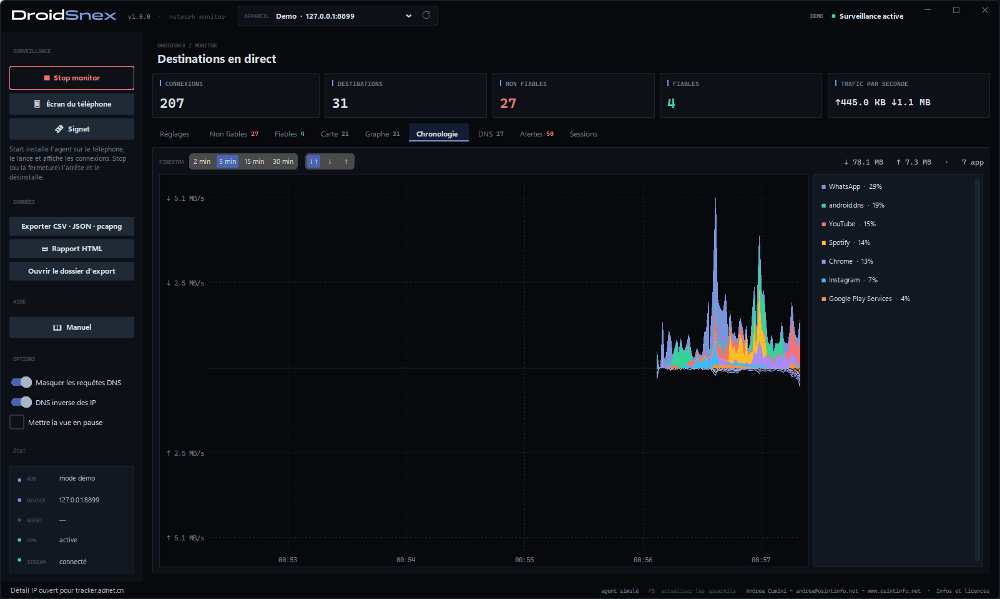

La chronologie montre les octets par seconde de chaque app au fil du temps. Au-dessus de l'axe le trafic entrant (↓, du serveur vers le téléphone), en dessous le trafic sortant (↑) : on voit tout de suite quelle app communique en arrière-plan quand le téléphone ne fait rien et laquelle télécharge.

- Choisissez la fenêtre de temps : **2, 5, 15 ou 30 min**.
- **Clic sur une entrée de la légende** : masque ou affiche cette app.
- **Survolez** le graphique pour lire les valeurs à cet instant.
- Les apps au-delà des dix premières sont regroupées dans *autres*.

## 12. DNS

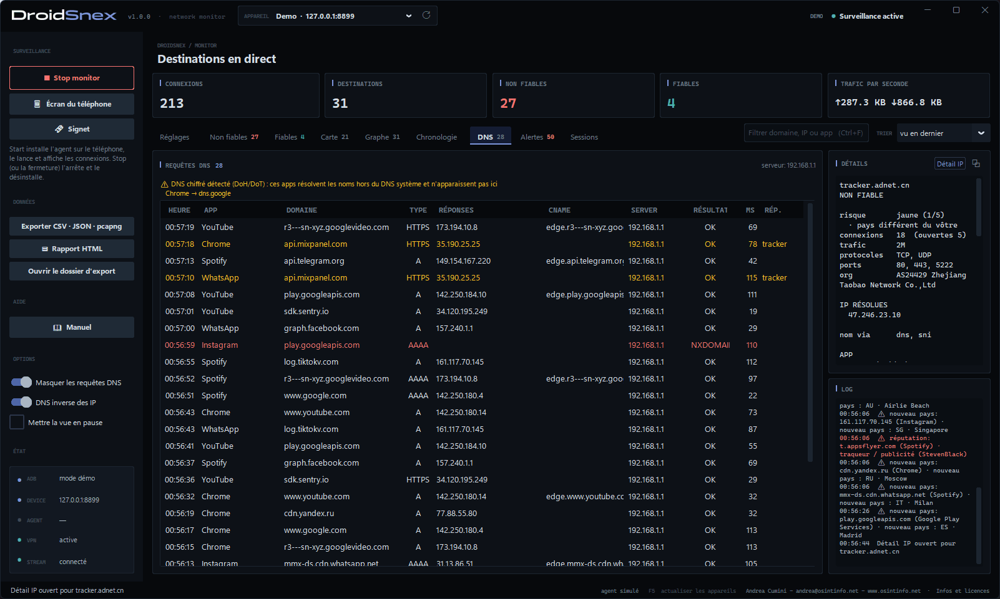

L'onglet **DNS** liste les requêtes DNS du téléphone : Heure, App, Domaine, Type (A, AAAA, HTTPS…), Réponses, Résultat, temps de réponse en ms et Rép. **Vider** efface la liste.

Certaines apps utilisent le **DNS chiffré** (DoH/DoT) : leurs requêtes ne passent pas par le DNS du système et n'apparaissent pas ici. Quand DroidSnex le détecte, il affiche un avertissement et génère une alerte.

## 13. Alertes

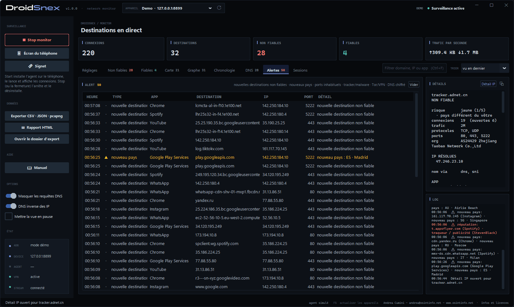

L'onglet **Alertes** rassemble les événements qui méritent l'attention : **nouvelles destinations non fiables · nouveaux pays · ports inhabituels · tracker/malware · Tor/VPN · DNS chiffré**. Chaque ligne indique Heure, niveau, Type, App, Destination, IP, Port et Détail. **Vider** efface la liste.

## 14. Écran du téléphone

Le bouton **📱 Écran du téléphone** affiche l'écran du téléphone sur le PC et permet de le piloter à la souris et au clavier, grâce à scrcpy (à télécharger d'abord depuis Réglages). La fenêtre reste au premier plan ; faites glisser l'en-tête pour la déplacer. Les boutons du haut envoient les touches Android : retour, accueil, apps récentes, marche/arrêt, volume − et +.

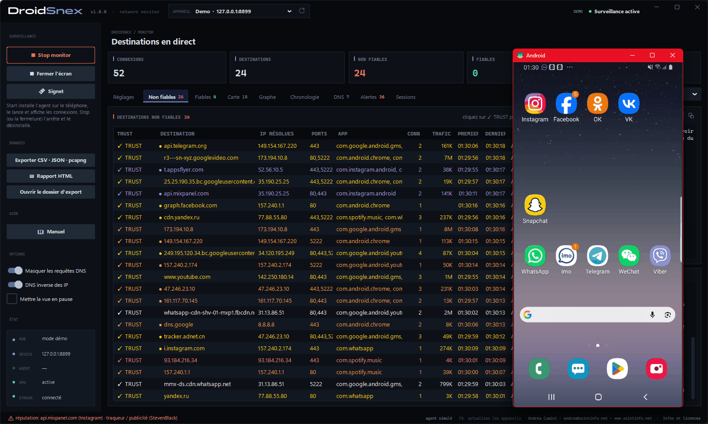

Appuyez de nouveau sur le bouton (**Fermer l'écran**) pour la fermer.

## 15. Sessions, relecture et signets

Chaque surveillance, de Start à Stop, est enregistrée comme **session**, avec tous les événements enregistrés.

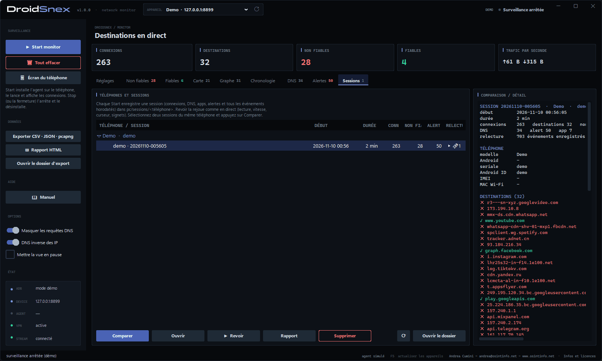

Dans l'onglet **Sessions** :

- **Téléphones et sessions** (à gauche) liste les sessions enregistrées avec téléphone, début, durée, connexions, non fiables et une colonne **Relecture** (▶ si la session peut être revue, 🔖 avec le nombre de signets).
- Sélectionnez une session : **Comparaison / détail** (à droite) affiche téléphone, début, durée, destinations, apps, organisations et signets.
- **Comparer :** sélectionnez deux sessions du même téléphone avec **Ctrl+clic** et appuyez sur Comparer. Vous voyez les destinations communes, nouvelles et disparues, les nouvelles apps, les apps disparues, les nouvelles organisations et les nouveaux pays.
- **Rapport** crée le rapport HTML de la session sélectionnée (voir le [chapitre 16](#16-exporter-les-données-et-tout-effacer)).
- **Ouvrir** ouvre une session depuis un fichier, **Ouvrir le dossier** ouvre le dossier des sessions, **Supprimer les sessions** supprime celles sélectionnées après confirmation (irréversible).

### Relecture

Sélectionnez une session et appuyez sur **▶ Revoir** (surveillance arrêtée). Toutes les vues (listes, carte, graphe, chronologie, DNS, alertes) rejouent la session comme en direct.

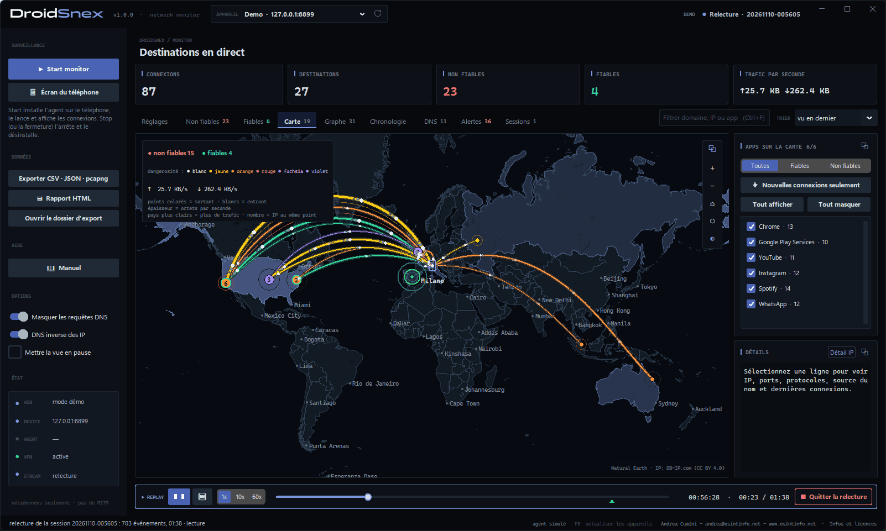

La barre de relecture, en bas :

- **▶ / ❚❚** lecture et pause, **⏮** retour au début ;
- vitesse **1x, 10x, 60x** ;
- le curseur du temps : faites-le glisser pour sauter à un instant ; les signets sont marqués sur le curseur. **Clic droit** sur un signet pour ouvrir sa capture d'écran ;
- **■ Quitter la relecture** revient au mode en direct.

### Signets

Pendant la surveillance, appuyez sur **🔖 Signet** dans la colonne de gauche pour marquer un moment, par exemple « j'ai ouvert Instagram ». Écrivez une note et appuyez sur **Enregistrer le signet**. Le signet est enregistré dans la session avec l'heure et une capture d'écran du téléphone.

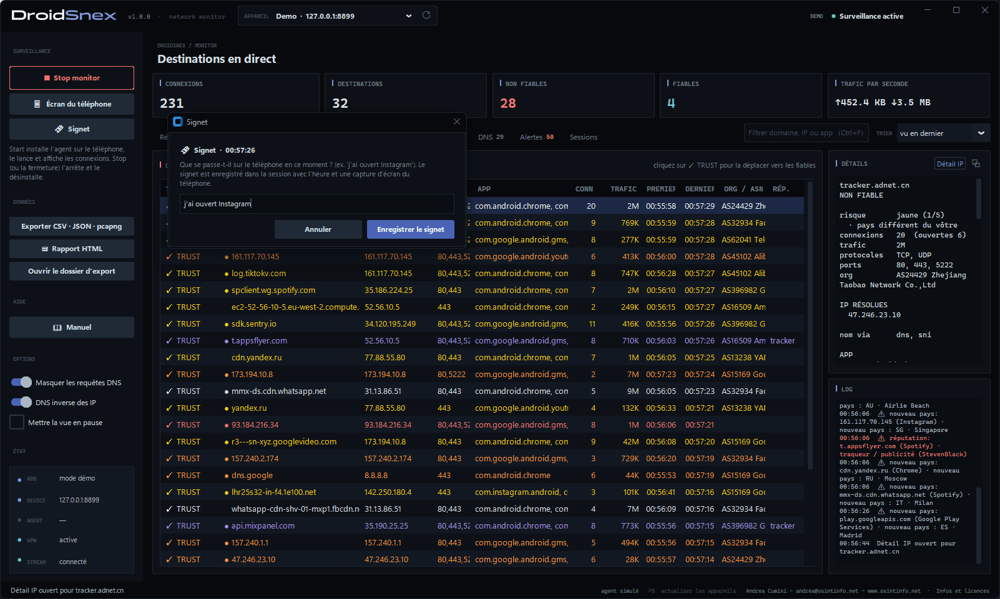

## 16. Exporter les données et Tout effacer

- **Exporter CSV · JSON · pcapng** enregistre les connexions de la session en trois formats : CSV (pour les tableurs), JSON et pcapng (ouvrable avec Wireshark, métadonnées seulement). **Ouvrir le dossier d'export** ouvre le dossier des fichiers.
- **Rapport HTML** crée un seul fichier HTML de la session (celle en cours, celle en relecture ou celle choisie dans l'onglet Sessions) et l'ouvre dans le navigateur : résumé, téléphone, carte, destinations non fiables par dangerosité avec les motifs, destinations fiables, trafic par app et par pays, alertes et signets avec leurs captures. Pour un PDF, utilisez *Imprimer › Enregistrer au format PDF* dans le navigateur.
- **🗑 Tout effacer** apparaît quand la surveillance est arrêtée : après confirmation, il efface connexions, requêtes DNS, alertes, carte, graphe et chronologie de la session en cours. Les sessions enregistrées et la liste des fiables sont conservées.

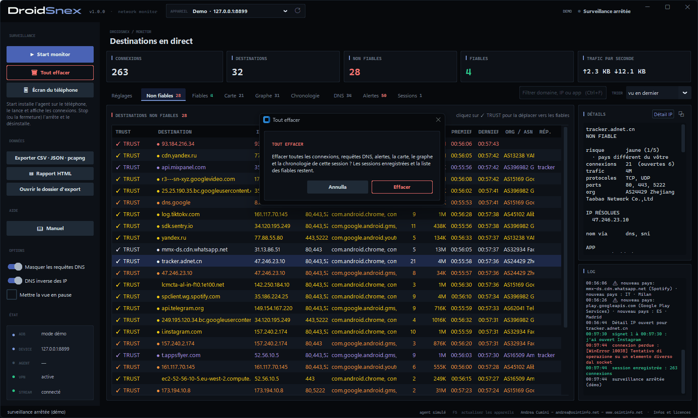

## 17. Panneaux détachés

Carte, Graphe, Détails et Apps sur la carte ont en haut à droite le bouton **⧉** : le panneau se détache dans une fenêtre à part, que vous pouvez déplacer et redimensionner, par exemple sur un second écran. Le panneau continue de se mettre à jour.

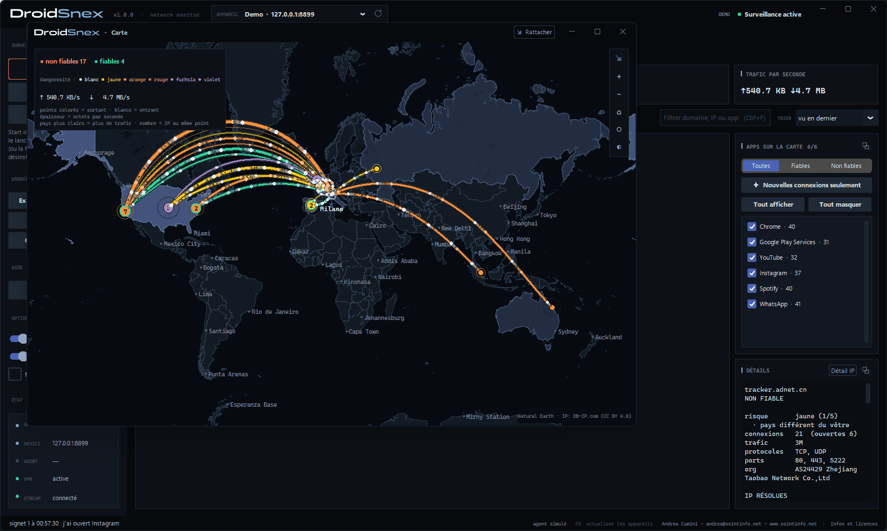

Pour le remettre en place, appuyez sur **⇲ Rattacher** dans l'en-tête de la fenêtre, fermez-la, ou appuyez sur **Rattacher** dans l'onglet vide.

## 18. Infos et licences

Cliquez sur **Infos et licences** dans la barre du bas : la fenêtre affiche la version, l'auteur, la licence du programme, les données et composants tiers avec leurs licences (**Toutes les licences**), et le bouton **Conditions d'utilisation** permet de relire les conditions. DroidSnex est un logiciel libre, sans aucune garantie.

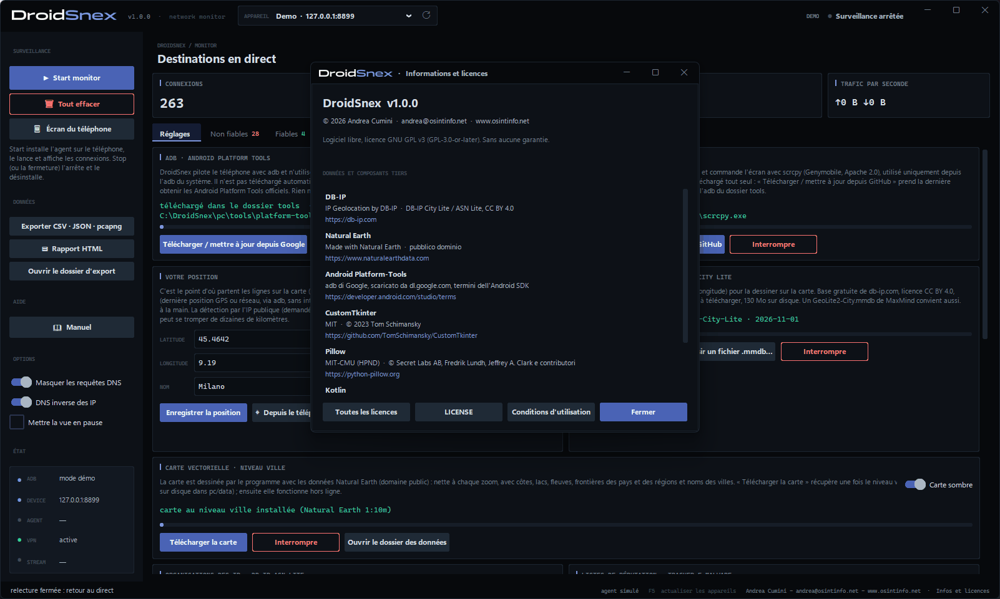

## 19. Problèmes fréquents

| Message | Que faire |
|---|---|
| Aucun appareil connecté | Branchez le téléphone en USB avec le débogage USB activé, puis appuyez sur F5. |
| Appareil non autorisé | Déverrouillez le téléphone et acceptez « Autoriser le débogage USB ? » en cochant « Toujours autoriser cet ordinateur ». |
| adb absent du dossier tools | Réglages › ADB › Télécharger / mettre à jour depuis Google. |
| scrcpy absent du dossier tools | Réglages › Écran du téléphone › Télécharger / mettre à jour depuis GitHub. |
| Le VPN n'est pas actif | Sur le téléphone, touchez OK à la demande de connexion VPN ; si un autre VPN est actif, désactivez-le et appuyez de nouveau sur Start. |
| Base des villes absente | Réglages › Base des villes des IP › Télécharger / mettre à jour. |
| Définissez votre position | Réglages › Votre position › Détecter depuis mon IP publique (ou saisissez-la à la main). |
