# DroidSnex — Manuale utente

DroidSnex mostra, in tempo reale, verso quali server si collega un telefono Android: quale app, quale dominio, quale IP, in che paese, con quanto traffico. Il telefono si collega al PC con il cavo USB; sul telefono gira per il tempo del monitoraggio una piccola app (l'*agent*) che crea una VPN locale e legge solo i metadati delle connessioni. Il contenuto del traffico non viene decifrato (nessun MITM).

## Indice

1. [Prima di iniziare](#1-prima-di-iniziare)
2. [Primo avvio: lingua e termini d'uso](#2-primo-avvio-lingua-e-termini-duso)
3. [Config](#3-config)
4. [La finestra principale](#4-la-finestra-principale)
5. [Avviare e fermare il monitor](#5-avviare-e-fermare-il-monitor)
6. [Untrusted e Trusted](#6-untrusted-e-trusted)
7. [La scala di pericolosità](#7-la-scala-di-pericolosità)
8. [Dettagli e Dettaglio IP](#8-dettagli-e-dettaglio-ip)
9. [Mappa](#9-mappa)
10. [Grafo](#10-grafo)
11. [Timeline](#11-timeline)
12. [DNS](#12-dns)
13. [Alert](#13-alert)
14. [Schermo del telefono](#14-schermo-del-telefono)
15. [Sessioni, replay e segnalibri](#15-sessioni-replay-e-segnalibri)
16. [Esportare i dati e Pulisci tutto](#16-esportare-i-dati-e-pulisci-tutto)
17. [Pannelli staccati](#17-pannelli-staccati)
18. [Info e licenze](#18-info-e-licenze)
19. [Problemi frequenti](#19-problemi-frequenti)

---

## 1. Prima di iniziare

Ti servono:

- un PC Windows con DroidSnex;
- un telefono Android e un cavo USB dati;
- sul telefono, il **Debug USB** attivo: *Impostazioni › Info sul telefono*, tocca sette volte *Numero build* per sbloccare le *Opzioni sviluppatore*, poi in *Opzioni sviluppatore* attiva *Debug USB*.

Al primo collegamento il telefono chiede **"Consentire debug USB?"**: sblocca lo schermo, spunta *Consenti sempre da questo computer* e tocca *OK*.

DroidSnex usa solo gli strumenti contenuti nella propria cartella `tools` (adb e scrcpy) e non installa nulla nel sistema. La prima volta scaricali dal tab **Config** (vedi [capitolo 3](#3-config)).

## 2. Primo avvio: lingua e termini d'uso

Alla prima apertura compare una finestra che non si può chiudere né spostare dietro alle altre.

1. **Scegli la lingua.** I pulsanti mostrano le nove lingue disponibili: italiano, English, Deutsch, Français, Español, Nederlands, Polski, Ελληνικά, Shqip. La lingua vale per tutto il programma e per l'agent sul telefono; si può cambiare più tardi nel tab Config.

   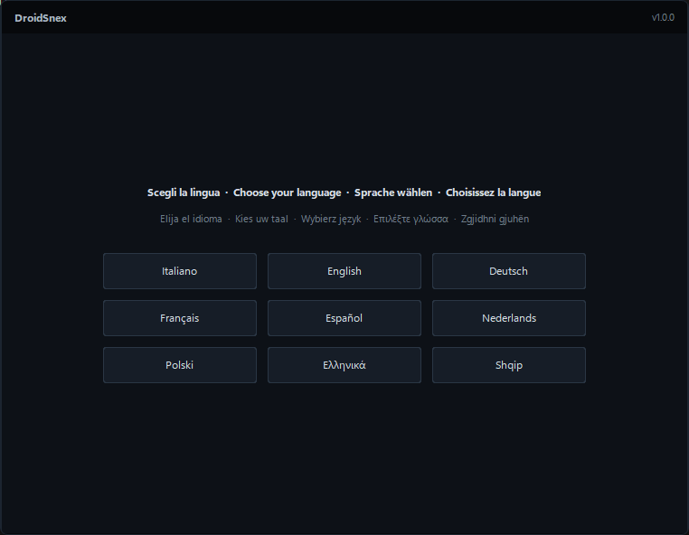

2. **Leggi i termini d'uso.** Il testo è nella lingua scelta. Il pulsante **Accetto** si attiva solo dopo aver fatto scorrere il testo fino in fondo. **Rifiuto** chiude il programma.

   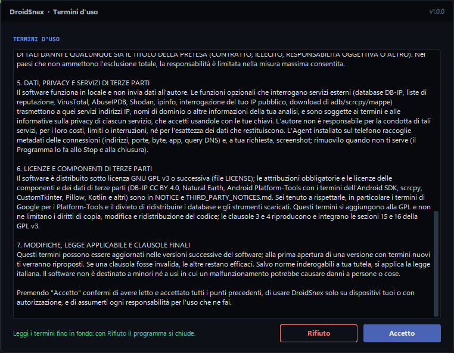

L'accettazione viene salvata: la finestra ricompare solo se i termini cambiano versione. I termini si possono rileggere in qualsiasi momento da [Info e licenze](#18-info-e-licenze).

## 3. Config

Il tab **Config** raccoglie le impostazioni e i download. Ogni download si fa solo quando premi il pulsante e si può interrompere con **Interrompi**.

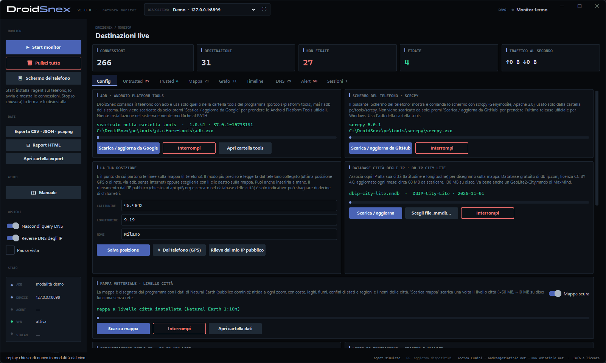

- **ADB · Android Platform Tools** — DroidSnex comanda il telefono con adb, preso solo dalla cartella `tools` del programma. Premi **Scarica / aggiorna da Google** per le Android Platform Tools ufficiali; **Apri cartella tools** apre la cartella.
- **Schermo del telefono · scrcpy** — **Scarica / aggiorna da GitHub** scarica scrcpy dalle release ufficiali.
- **La tua posizione** — il punto da cui partono le linee sulla mappa e il paese usato dalla scala di pericolosità. Il modo più preciso è **⌖ Dal telefono (GPS)**: legge via adb l'ultima posizione del telefono collegato e mostra sorgente, precisione ed età. In alternativa fai clic destro sulla mappa › **Imposta qui la mia posizione**, oppure inserisci LATITUDINE, LONGITUDINE e NOME e premi **Salva posizione**. **Rileva dal mio IP pubblico** è solo indicativo: può sbagliare di decine di chilometri.
- **Database città degli IP · DB-IP City Lite** — associa ogni IP alla sua città per disegnarlo sulla mappa. **Scarica / aggiorna**, oppure **Scegli file .mmdb…**; **Apri cartella dati**.
- **Mappa vettoriale · livello città** — **Scarica mappa** installa la mappa dettagliata (Natural Earth 1:10m, con coste, fiumi, confini e nomi delle città); senza, si vede la versione base inclusa. **Mappa scura** cambia i colori della mappa.
- **Organizzazioni degli IP · DB-IP ASN Lite** — associa ogni IP all'organizzazione che lo gestisce (Google, Meta, Amazon, un hoster sconosciuto…). È la base del Grafo e della colonna Org / ASN.
- **Liste di reputazione · tracker e malware** — blocklist pubbliche di tracker, malware, nodi di uscita **Tor** e indicazioni sui provider **VPN**. **Scarica / aggiorna liste**. Le destinazioni in lista ricevono il badge e un alert.
- **Dettaglio IP · range cloud** — **Scarica / aggiorna liste cloud** e il permesso al **contatto attivo** (certificato TLS) del Dettaglio IP.
- **Dettaglio IP · servizi con chiave API** — chiavi facoltative per VirusTotal, AbuseIPDB, Shodan e ipinfo.io. **Registrati** apre la pagina del servizio; incolla la chiave e premi **Salva chiavi**. Senza chiave il servizio resta disattivo. Le chiavi restano sul PC, nel file di configurazione.
- **Agent Android · APK** — l'APK dell'agent da installare sul telefono. Di solito va bene quello **Predefinito**; **Sfoglia…** per sceglierne un altro, poi **Salva**.
- **Aggiornamenti** — **Controlla aggiornamenti** verifica, solo quando lo premi, se c'è una versione più nuova all'indirizzo indicato e mostra il collegamento alla pagina. Non scarica e non installa niente.
- **Lingua · Language** — la lingua dell'interfaccia; anche l'agent sul telefono userà questa lingua dal prossimo Start.

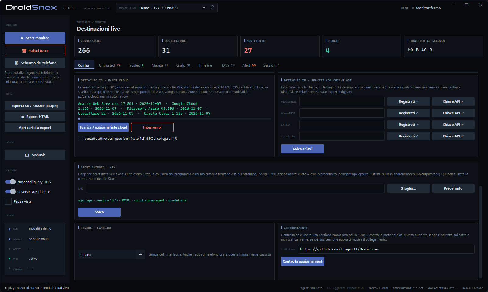

## 4. La finestra principale

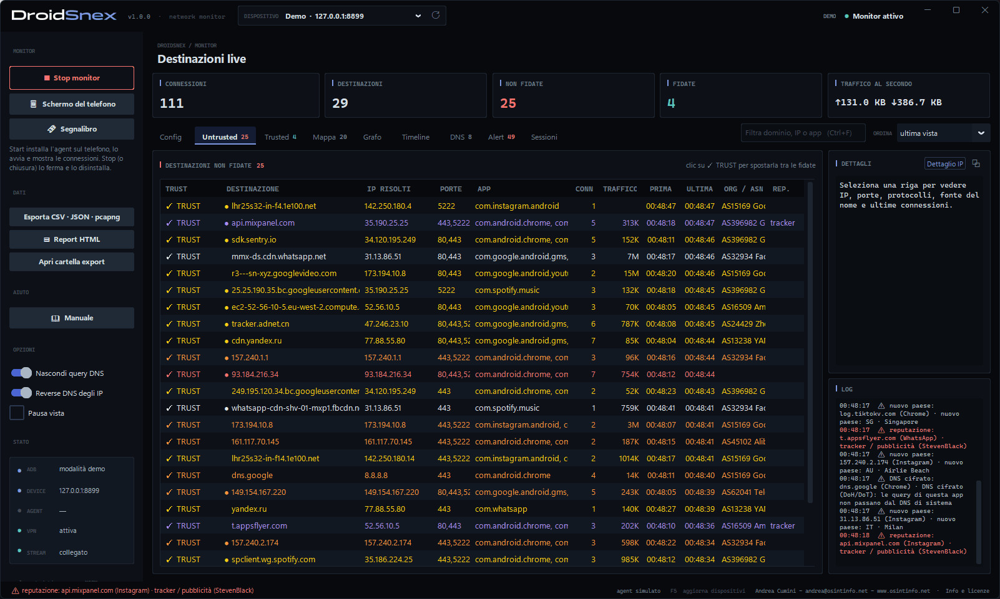

- **Intestazione (in alto):** il logo e la versione, il menu **DISPOSITIVO** con il telefono collegato (il pulsante ↻ o il tasto **F5** aggiornano l'elenco) e, a destra, lo stato del monitor.
- **Colonna sinistra:** i comandi.
  - *Monitor:* **Start monitor** (a monitor attivo lo stesso pulsante diventa **Stop monitor**), **Pulisci tutto** (solo a monitor fermo), **Schermo del telefono**, **Segnalibro** (solo a monitor attivo).
  - *Dati:* **Esporta CSV · JSON · pcapng**, **Report HTML** e **Apri cartella export**.
  - *Aiuto:* **📖 Manuale** apre questo manuale nella lingua dell'interfaccia. Nella finestra del manuale la casella di ricerca in alto a sinistra (**Ctrl+F**) evidenzia tutte le occorrenze: **Invio** o **F3** passa alla successiva, **Maiusc+Invio** alla precedente, **Esc** svuota la ricerca.
  - *Opzioni:* **Nascondi query DNS** (toglie dalle liste le righe che sono solo query DNS), **Reverse DNS degli IP** (cerca un nome per gli IP che non ne hanno uno), **Pausa vista** (congela le liste per leggerle con calma; i dati continuano ad arrivare).
  - *Stato:* cinque spie (ADB, DEVICE, AGENT, VPN, STREAM): verdi quando quella parte funziona.
- **Contatori:** Connessioni, Destinazioni, Non fidate, Fidate, Traffico al secondo.
- **Tab:** Config, Untrusted, Trusted, Mappa, Grafo, Timeline, DNS, Alert, Sessioni. A destra dei tab, nelle liste, la casella **Filtra dominio, IP o app** (**Ctrl+F**) e il menu **ORDINA** (ultima vista, n. connessioni, prima vista, destinazione, traffico).
- **Riquadro destro:** **Dettagli** della riga selezionata e, sotto, il **Log** con i messaggi del programma.
- **Barra in basso:** il messaggio di stato, **F5 aggiorna dispositivi** e il collegamento **Info e licenze**.

## 5. Avviare e fermare il monitor

1. Collega il telefono via USB e sbloccalo. Nel menu **DISPOSITIVO** compare il suo modello; se ne hai più di uno, sceglilo dal menu.
2. Premi **▶ Start monitor**. DroidSnex installa l'agent sul telefono, gli concede i permessi necessari e avvia la VPN locale. Se sul telefono compare **Richiesta di connessione**, sblocca e tocca **OK**.
3. Quando le spie di *Stato* sono verdi, le connessioni cominciano ad arrivare nelle liste. Usa il telefono come sempre: ogni app che si collega a internet compare con le sue destinazioni.
4. Premi **■ Stop monitor** per finire. L'agent viene fermato e **disinstallato** dal telefono; la sessione viene salvata nel tab [Sessioni](#15-sessioni-replay-e-segnalibri).

Anche chiudendo il programma l'agent viene fermato e disinstallato. Se il cavo si stacca, DroidSnex prova a riconnettersi da solo; se il PC si spegne o il programma si interrompe, l'agent si ferma da solo dopo poco (watchdog).

## 6. Untrusted e Trusted

Ogni destinazione (un dominio, o un IP quando il nome non è noto) sta in una delle due liste:

- **Untrusted** — le destinazioni non fidate. Ogni nuova destinazione parte da qui.
- **Trusted** — le destinazioni che hai segnato come fidate.

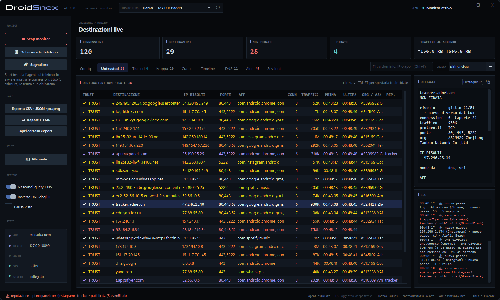

Le colonne: Destinazione, IP risolti, Porte, App, Conn (numero di connessioni), Traffico, Prima e Ultima (orari), Org / ASN (l'organizzazione che gestisce l'IP) e Rep. (badge *tracker*, *malware* o *tor* dalle liste di reputazione). Clic sul titolo di una colonna per ordinare A-Z, un altro clic per Z-A.

- **Fidare una destinazione:** nella lista Untrusted fai clic su **✓ TRUST** nella prima colonna. La destinazione passa nella lista Trusted.
- **Tornare indietro:** nella lista Trusted fai clic su **✕ UNTRUST**.
- **✕ Untrust tutti** (in alto nella lista Trusted) riporta tutte le destinazioni fidate tra le non fidate, dopo una conferma. L'operazione svuota l'elenco salvato e non si può annullare.

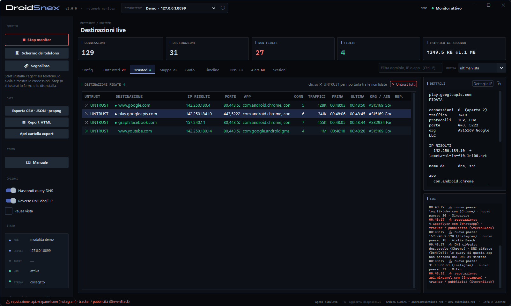

L'elenco delle destinazioni fidate viene salvato e vale anche per le sessioni successive e per altri telefoni.

## 7. La scala di pericolosità

Nella lista Untrusted ogni riga ha un colore che indica quanto la destinazione è sospetta. DroidSnex somma dei punti per ogni segnale:

| Segnale | Punti |
|---|---|
| solo IP, nessun nome | +1 |
| organizzazione sconosciuta (IP non presente nel database ASN) | +1 |
| paese diverso dal tuo | +1 |
| DNS cifrato (DoH/DoT) | +1 |
| porta insolita (non 80, 443, 53…) | +2 |
| provider VPN (indicativo) | +3 |
| tracker / pubblicità in lista | +4 |
| nodo di uscita Tor | +4 |
| malware in lista | +5 |

I segnali generici (le prime cinque righe) arrivano al massimo a 3 punti; il fucsia e il viola si raggiungono solo con le liste di reputazione. Il colore è il totale, fino a 5:

**0 bianco · 1 giallo · 2 arancio · 3 rosso · 4 fucsia · 5 viola**

Nel riquadro Dettagli la riga *pericolosità* spiega quali segnali hanno contribuito. Per avere tutti i segnali servono la posizione, il database ASN e le liste di reputazione (vedi [Config](#3-config)).

## 8. Dettagli e Dettaglio IP

Seleziona una riga in una lista: il riquadro **Dettagli** mostra se la destinazione è FIDATA o NON FIDATA, il numero di connessioni (e quante sono ancora aperte), protocolli, porte, gli IP risolti con la fonte del nome (SNI, DNS o reverse DNS), la pericolosità e le ultime connessioni.

Il pulsante **Dettaglio IP** in alto nel riquadro apre una finestra con tutto ciò che si può sapere sull'IP:

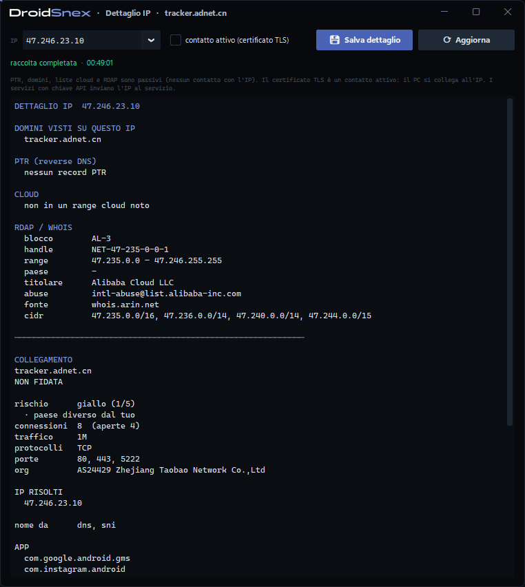

- **DOMINI VISTI SU QUESTO IP** nella sessione;
- **PTR (reverse DNS)**;
- **CLOUD** — se l'IP fa parte dei range pubblicati da AWS, Google Cloud, Azure, Cloudflare e altri (liste scaricate da Config);
- **RDAP / WHOIS** — blocco, paese, titolare;
- **CERTIFICATO TLS (contatto attivo)** — emittente, validità, nomi del certificato;
- **VIRUSTOTAL, ABUSEIPDB, SHODAN, IPINFO.IO** — solo se hai inserito le relative chiavi API in Config.

In alto scegli l'**IP** (se la destinazione ne ha più di uno). PTR, domini, liste cloud e RDAP sono passivi: nessun contatto con l'IP. Il certificato TLS invece è un contatto attivo, il PC si collega all'IP, e si raccoglie solo con la casella **contatto attivo (certificato TLS)** spuntata. I servizi con chiave ricevono l'IP che interroghi.

**Aggiorna** ripete la raccolta. **Salva dettaglio** salva il risultato in un file di testo; il percorso compare nel Log.

Il Dettaglio IP si apre anche da una linea della Mappa o da un nodo del Grafo: seleziona prima la destinazione, poi premi il pulsante.

## 9. Mappa

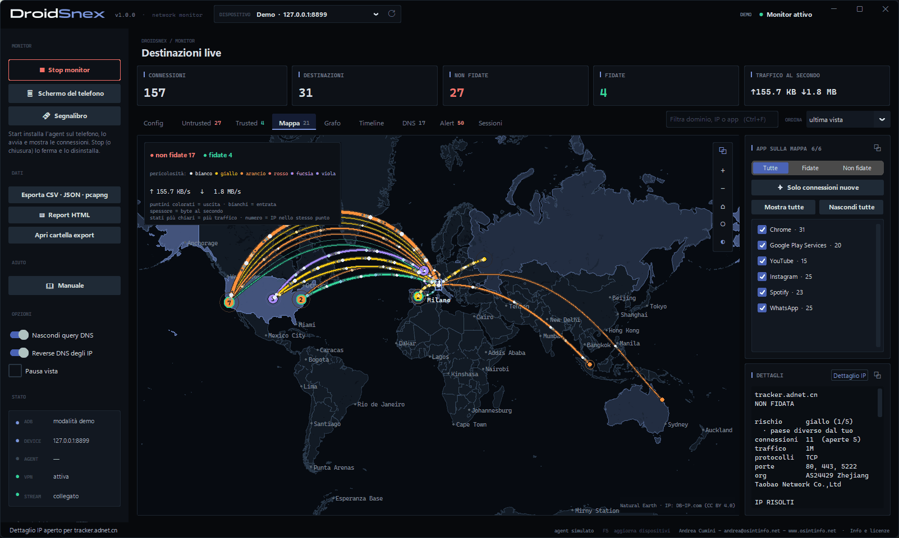

Il telefono è disegnato nella tua posizione (impostala in Config); da lì parte una linea verso la città di ogni destinazione: **verde** se fidata, colorata secondo la scala di pericolosità se non fidata. Lo spessore cresce con i byte al secondo; i puntini colorati che scorrono verso la destinazione sono il traffico in uscita, quelli bianchi verso il telefono il traffico in entrata.

- **Rotella** o **+ / −**: zoom. **Trascina**: sposta. **Doppio clic**: avvicina.
- **Clic su una linea o su un punto**: i dettagli della destinazione nel riquadro Dettagli.
- **App sulla mappa** (riquadro a destra): scegli **Tutte**, **Fidate** o **Non fidate** e quali app mostrare, con **Mostra tutte** e **Nascondi tutte**.
- **✦ Solo connessioni nuove**: da quel momento la mappa mostra solo le connessioni che nascono dopo; premi di nuovo per tornare a tutte.
- Da lontano le destinazioni vicine sono raggruppate in una **pallina con il numero di IP**: passaci sopra per l'elenco, clic per ingrandire lì. Dallo zoom 4 gli IP nello stesso punto si aprono in puntini distinti attorno alla città.
- **◐** colora gli stati in base al traffico scambiato (più chiaro = più byte).
- Una connessione nuova si annuncia con un lampo dal telefono alla destinazione; gli impulsi sulle linee hanno una scia e aumentano con il traffico.
- **Clic destro** sulla mappa › **Imposta qui la mia posizione**.
- **⧉** stacca la mappa in una finestra separata (vedi [Pannelli staccati](#17-pannelli-staccati)).

Se mancano la posizione o il database delle città, la mappa lo segnala con un messaggio. Le destinazioni senza posizione (IP privati o non presenti nel database) vengono contate a parte.

## 10. Grafo

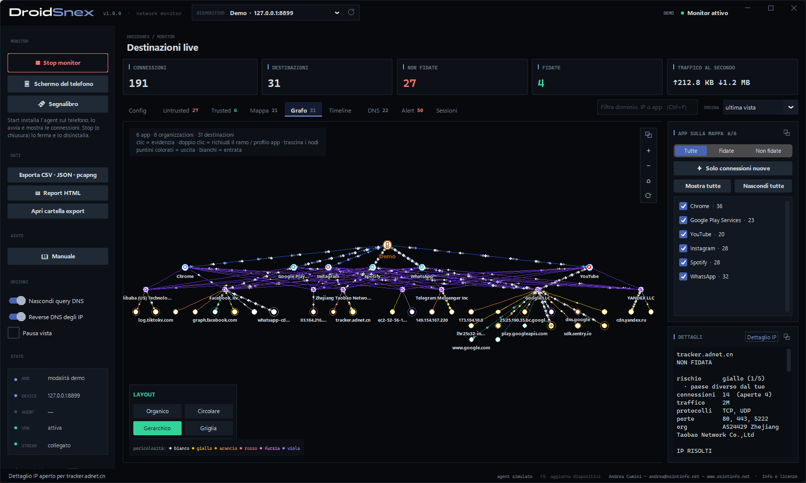

Il grafo mostra chi parla con chi: **telefono → app → organizzazione (ASN) → destinazione**.

- **Clic** su un nodo: lo evidenzia insieme ai vicini; gli altri si attenuano.
- **Doppio clic** su un'app o su un'organizzazione: richiude o riapre il ramo. Doppio clic sull'app (o sull'app nell'elenco) apre il **profilo dell'app**: versione, se è di sistema, data di installazione e aggiornamento, permessi (in giallo i sensibili), destinazioni.
- **Trascina** i nodi per sistemarli, trascina lo sfondo per spostare la vista, **rotella** o **+ / −** per lo zoom, **⌂** per adattare il grafo alla finestra, **⟳** per ridisporlo.
- **Layout:** **Gerarchico** (predefinito: telefono → app → organizzazione → destinazione, dall'alto in basso), **Organico**, **Circolare**, **Griglia**. **Riduci incroci** prova diverse disposizioni e tiene quella con meno linee che si incrociano.
- Sui collegamenti scorrono gli impulsi del traffico come sulla mappa (colorati = uscita, chiari = entrata); le destinazioni con connessioni aperte hanno un anello che pulsa. Le etichette non si sovrappongono: passa il mouse su un nodo per leggerne il nome completo.
- **⧉** stacca il grafo in una finestra separata.

Per vedere le organizzazioni serve il database ASN (Config).

## 11. Timeline

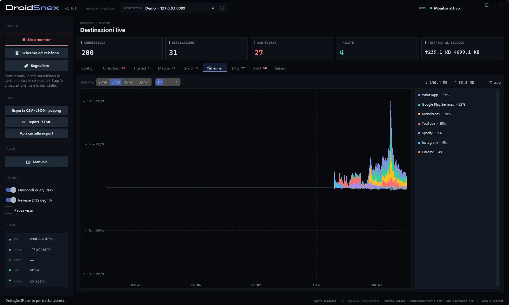

La timeline mostra i byte al secondo di ogni app nel tempo. Sopra l'asse il traffico in entrata (↓, dal server al telefono), sotto quello in uscita (↑): si vede subito quale app parla in background a telefono fermo e quale scarica.

- Scegli la finestra di tempo: **2, 5, 15 o 30 min**.
- **Clic su una voce della legenda** nasconde o mostra quell'app.
- **Passa il mouse** sul grafico per leggere i valori di quell'istante.
- Le app oltre le prime dieci sono raccolte in *altre*.

## 12. DNS

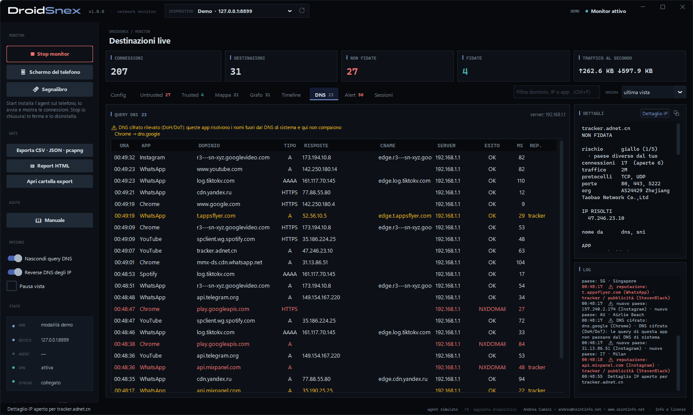

Il tab **DNS** elenca le query DNS del telefono: Ora, App, Dominio, Tipo (A, AAAA, HTTPS…), Risposte, Esito, tempo di risposta in ms e Rep. **Svuota** cancella l'elenco.

Alcune app usano il **DNS cifrato** (DoH/DoT): le loro query non passano dal DNS di sistema e qui non compaiono. Quando DroidSnex se ne accorge mostra un avviso e genera un alert.

## 13. Alert

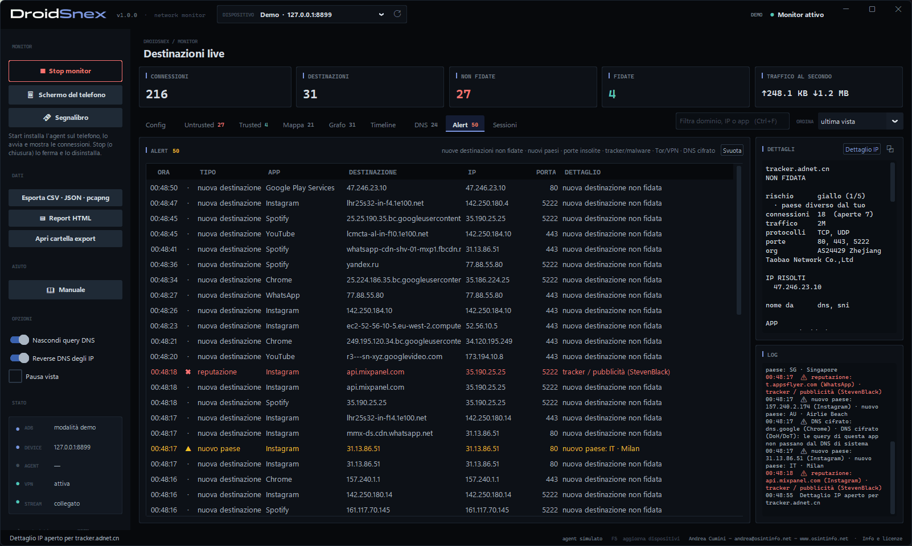

Il tab **Alert** raccoglie gli eventi che meritano attenzione: **nuove destinazioni non fidate · nuovi paesi · porte insolite · tracker/malware · Tor/VPN · DNS cifrato**. Ogni riga riporta Ora, livello, Tipo, App, Destinazione, IP, Porta e Dettaglio. **Svuota** cancella l'elenco.

## 14. Schermo del telefono

Il pulsante **📱 Schermo del telefono** mostra lo schermo del telefono sul PC e permette di comandarlo con mouse e tastiera, usando scrcpy (scaricalo prima da Config). La finestra resta in primo piano; trascina l'intestazione per spostarla. I pulsanti in alto inviano i tasti Android: indietro, home, app recenti, accensione, volume − e +.

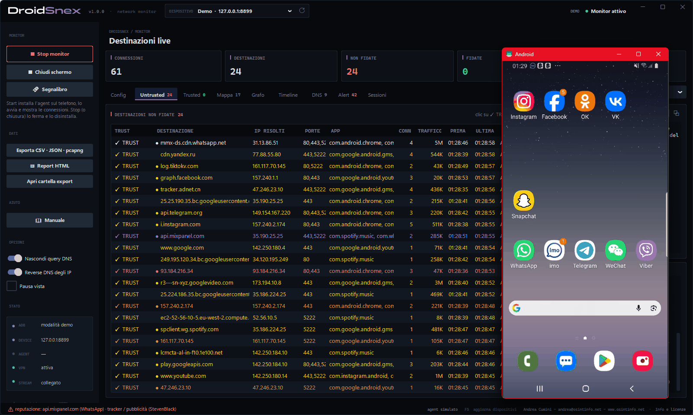

Premi di nuovo il pulsante (**Chiudi schermo**) per chiuderla.

## 15. Sessioni, replay e segnalibri

Ogni monitoraggio, da Start a Stop, viene salvato come **sessione**, con tutti gli eventi registrati.

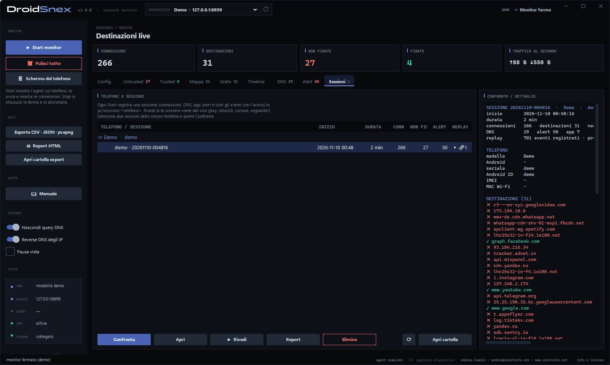

Nel tab **Sessioni**:

- **Telefoni e sessioni** (a sinistra) elenca le sessioni salvate con telefono, inizio, durata, connessioni, non fidate e una colonna **Replay** (▶ se la sessione si può rivedere, 🔖 con il numero di segnalibri).
- Seleziona una sessione: in **Confronto / dettaglio** (a destra) compaiono telefono, inizio, durata, destinazioni, app, organizzazioni e i segnalibri.
- **Confronta:** seleziona due sessioni dello stesso telefono con **Ctrl+clic** e premi Confronta. Vedi le destinazioni in comune, nuove e scomparse, le nuove app, le app scomparse, le nuove organizzazioni e i nuovi paesi.
- **Report** crea il report HTML della sessione selezionata (vedi [capitolo 16](#16-esportare-i-dati-e-pulisci-tutto)).
- **Apri** apre una sessione da file, **Apri cartella** apre la cartella delle sessioni, **Elimina sessioni** cancella quelle selezionate dopo una conferma (non si può annullare).

### Replay

Seleziona una sessione e premi **▶ Rivedi** (a monitor fermo). Tutte le viste (liste, mappa, grafo, timeline, DNS, alert) ripercorrono la sessione come se fosse dal vivo.

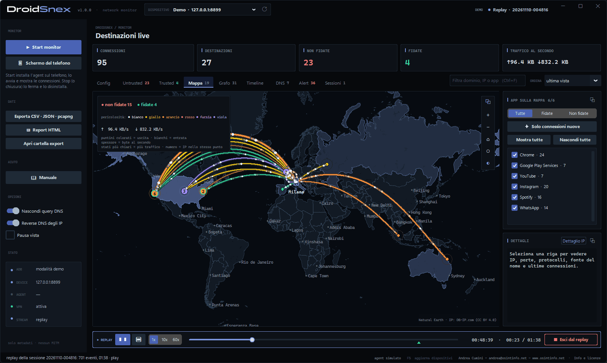

La barra del replay, in basso:

- **▶ / ❚❚** play e pausa, **⏮** torna all'inizio;
- velocità **1x, 10x, 60x**;
- il cursore del tempo: trascinalo per saltare a un istante; i segnalibri sono segnati sul cursore. **Clic con il tasto destro** su un segnalibro apre il suo screenshot;
- **■ Esci dal replay** torna alla modalità dal vivo.

### Segnalibri

Durante il monitor premi **🔖 Segnalibro** nella colonna sinistra per segnare un momento, per esempio "ho aperto Instagram". Scrivi una nota e premi **Salva segnalibro**. Il segnalibro viene salvato nella sessione con l'orario e uno screenshot del telefono.

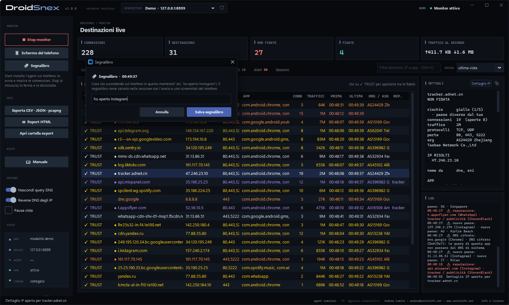

## 16. Esportare i dati e Pulisci tutto

- **Esporta CSV · JSON · pcapng** salva le connessioni della sessione in tre formati: CSV (per i fogli di calcolo), JSON e pcapng (apribile con Wireshark, con i soli metadati). **Apri cartella export** apre la cartella dei file.
- **Report HTML** crea un unico file HTML della sessione (quella in corso, quella in replay o quella scelta nel tab Sessioni) e lo apre nel browser: riepilogo, telefono, mappa, destinazioni non fidate in ordine di pericolosità con i motivi, destinazioni fidate, traffico per app e per stato, alert e segnalibri con gli screenshot. Per un PDF usa *Stampa › Salva come PDF* nel browser.
- **🗑 Pulisci tutto** compare a monitor fermo: cancella connessioni, query DNS, alert, mappa, grafo e timeline della sessione corrente, dopo una conferma. Le sessioni salvate e l'elenco delle fidate restano.

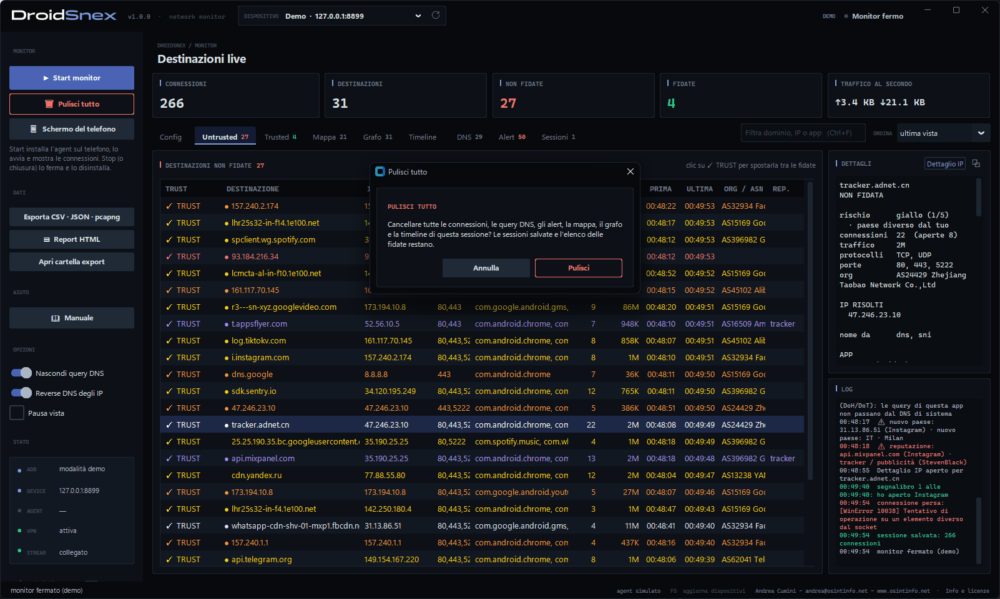

## 17. Pannelli staccati

Mappa, Grafo, Dettagli e App sulla mappa hanno in alto a destra il pulsante **⧉**: il pannello si stacca in una finestra a parte, che puoi spostare e ridimensionare, per esempio su un secondo monitor. Il pannello continua ad aggiornarsi.

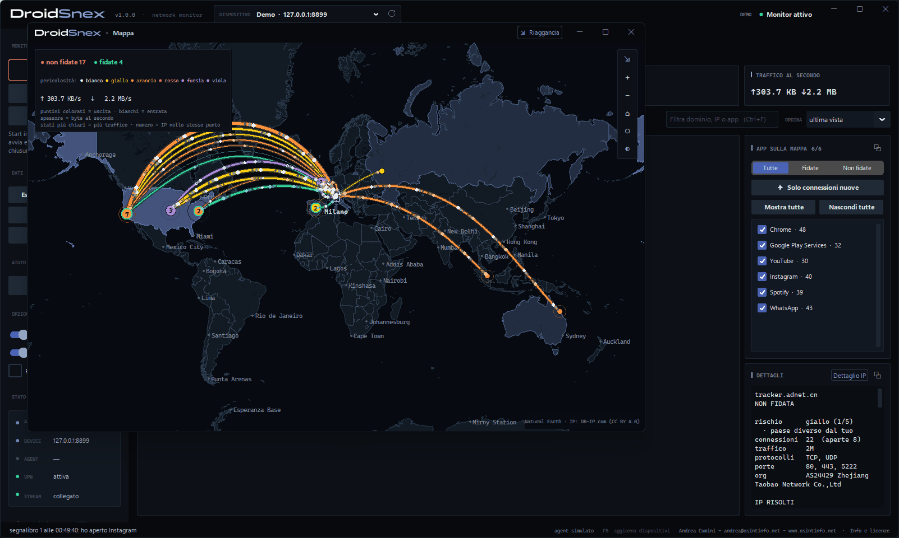

Per rimetterlo al suo posto premi **⇲ Riaggancia** nell'intestazione della finestra, chiudila, oppure premi **Riaggancia** nel tab vuoto.

## 18. Info e licenze

Clic su **Info e licenze** nella barra in basso: la finestra mostra versione, autore, licenza del programma, i dati e i componenti di terze parti con le loro licenze (**Tutte le licenze**) e, con il pulsante **Termini d'uso**, permette di rileggere i termini. DroidSnex è software libero, senza alcuna garanzia.

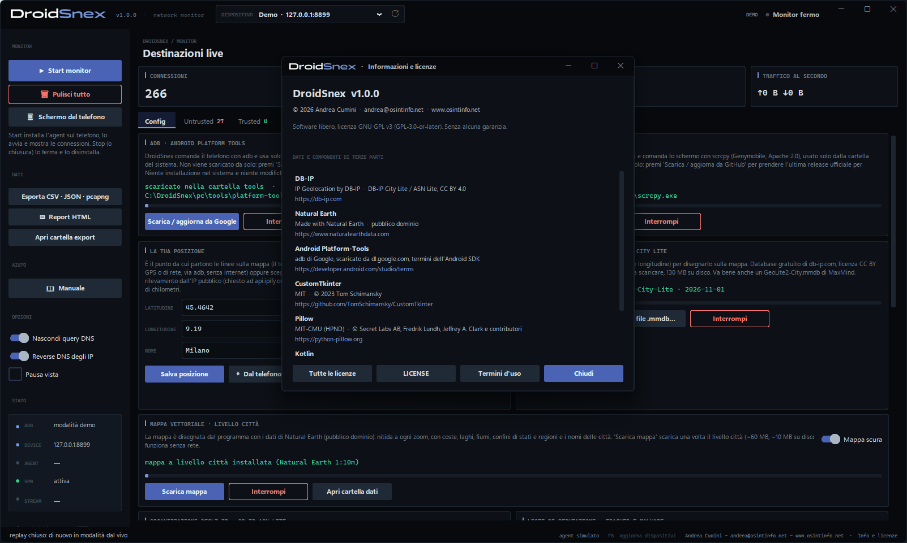

## 19. Problemi frequenti

| Messaggio | Cosa fare |
|---|---|
| Nessun device collegato | Collega il telefono via USB con il Debug USB attivo, poi premi F5. |
| Device non autorizzato | Sblocca il telefono e accetta "Consentire debug USB?" spuntando "Consenti sempre da questo computer". |
| adb non presente nella cartella tools | Config › ADB › Scarica / aggiorna da Google. |
| scrcpy non presente nella cartella tools | Config › Schermo del telefono › Scarica / aggiorna da GitHub. |
| La VPN non risulta attiva | Sul telefono tocca OK alla richiesta di connessione VPN; se un'altra VPN è attiva, disattivala e premi di nuovo Start. |
| Database delle città assente | Config › Database città degli IP › Scarica / aggiorna. |
| Imposta la tua posizione | Config › La tua posizione › Rileva dal mio IP pubblico (o inseriscila a mano). |
