# DroidSnex — Gebruikershandleiding

DroidSnex laat in realtime zien met welke servers een Android-telefoon verbinding maakt: welke app, welk domein, welk IP-adres, in welk land en met hoeveel verkeer. De telefoon wordt met een USB-kabel op de pc aangesloten; tijdens het monitoren draait er op de telefoon een kleine app (de *agent*) die een lokale VPN aanmaakt en alleen de metadata van de verbindingen leest. De inhoud van het verkeer wordt nooit ontsleuteld (geen MITM).

## Inhoud

1. [Voordat je begint](#1-voordat-je-begint)
2. [Eerste start: taal en gebruiksvoorwaarden](#2-eerste-start-taal-en-gebruiksvoorwaarden)
3. [Instellingen](#3-instellingen)
4. [Het hoofdvenster](#4-het-hoofdvenster)
5. [De monitor starten en stoppen](#5-de-monitor-starten-en-stoppen)
6. [Niet vertrouwd en Vertrouwd](#6-niet-vertrouwd-en-vertrouwd)
7. [De gevarenschaal](#7-de-gevarenschaal)
8. [Details en IP-detail](#8-details-en-ip-detail)
9. [Kaart](#9-kaart)
10. [Graaf](#10-graaf)
11. [Tijdlijn](#11-tijdlijn)
12. [DNS](#12-dns)
13. [Meldingen](#13-meldingen)
14. [Telefoonscherm](#14-telefoonscherm)
15. [Sessies, replay en bladwijzers](#15-sessies-replay-en-bladwijzers)
16. [Gegevens exporteren en Alles wissen](#16-gegevens-exporteren-en-alles-wissen)
17. [Losgemaakte panelen](#17-losgemaakte-panelen)
18. [Info en licenties](#18-info-en-licenties)
19. [Veelvoorkomende problemen](#19-veelvoorkomende-problemen)

---

## 1. Voordat je begint

Je hebt nodig:

- een Windows-pc met DroidSnex;
- een Android-telefoon en een USB-datakabel;
- **USB-foutopsporing** ingeschakeld op de telefoon: *Instellingen › Over de telefoon*, tik zeven keer op *Buildnummer* om de *Ontwikkelaarsopties* te ontgrendelen en zet daarna in *Ontwikkelaarsopties* *USB-foutopsporing* aan.

Bij de eerste aansluiting vraagt de telefoon **"USB-foutopsporing toestaan?"**: ontgrendel het scherm, vink *Altijd toestaan vanaf deze computer* aan en tik op *OK*.

DroidSnex gebruikt alleen de hulpmiddelen in de eigen map `tools` (adb en scrcpy) en installeert niets in het systeem. Download ze de eerste keer via het tabblad **Instellingen** (zie [hoofdstuk 3](#3-instellingen)).

## 2. Eerste start: taal en gebruiksvoorwaarden

Bij de eerste start verschijnt een venster dat je niet kunt sluiten of achter andere vensters kunt zetten.

1. **Kies de taal.** De knoppen tonen de negen beschikbare talen: Italiano, English, Deutsch, Français, Español, Nederlands, Polski, Ελληνικά, Shqip. De taal geldt voor het hele programma en voor de agent op de telefoon; je kunt hem later wijzigen op het tabblad Instellingen.

   

2. **Lees de gebruiksvoorwaarden.** De tekst staat in de gekozen taal. De knop **Ik accepteer** wordt pas actief als je de tekst tot het einde hebt gescrold. **Ik weiger** sluit het programma.

   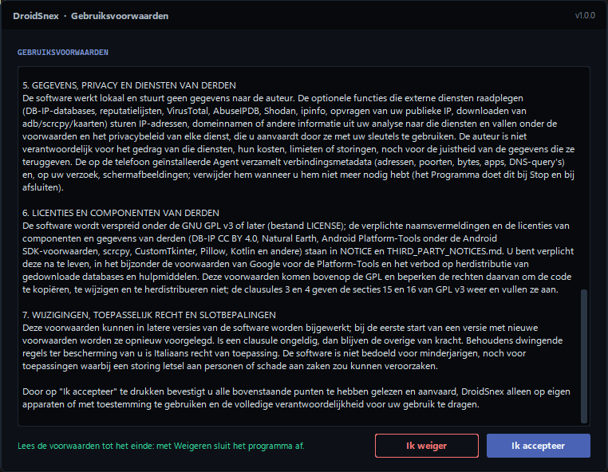

De acceptatie wordt opgeslagen: het venster verschijnt alleen opnieuw als de voorwaarden een nieuwe versie krijgen. Je kunt de voorwaarden altijd opnieuw lezen via [Info en licenties](#18-info-en-licenties).

## 3. Instellingen

Het tabblad **Instellingen** bevat de instellingen en downloads. Elke download gebeurt alleen als je op de knop drukt en kan worden gestopt met **Afbreken**.

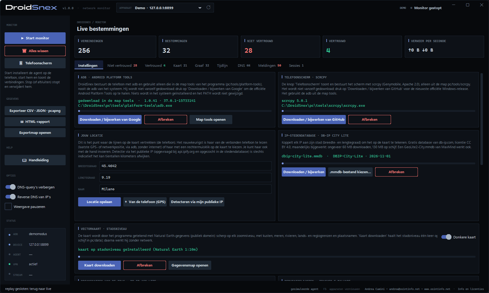

- **ADB · Android Platform Tools** — DroidSnex bestuurt de telefoon met adb, uitsluitend uit de map `tools` van het programma. Druk op **Downloaden / bijwerken van Google** voor de officiële Android Platform Tools; **Map tools openen** opent de map.
- **Telefoonscherm · scrcpy** — **Downloaden / bijwerken van GitHub** downloadt scrcpy uit de officiële releases.
- **Jouw locatie** — het punt waar de lijnen op de kaart beginnen en het land dat de gevarenschaal gebruikt. Het nauwkeurigst is **⌖ Van de telefoon (GPS)**: dit leest via adb de laatste positie van de aangesloten telefoon en toont bron, nauwkeurigheid en ouderdom. Anders rechtsklik op de kaart › **Mijn positie hier instellen**, of vul BREEDTEGRAAD, LENGTEGRAAD en NAAM in en druk op **Locatie opslaan**. **Detecteren via mijn publieke IP** is slechts indicatief: het kan tientallen kilometers afwijken.
- **IP-stedendatabase · DB-IP City Lite** — koppelt elk IP-adres aan zijn stad om het op de kaart te tekenen. **Downloaden / bijwerken**, of **.mmdb-bestand kiezen…**; **Gegevensmap openen**.
- **Vectorkaart · stadsniveau** — **Kaart downloaden** installeert de gedetailleerde kaart (Natural Earth 1:10m, met kusten, rivieren, grenzen en plaatsnamen); zonder deze zie je de meegeleverde basisversie. **Donkere kaart** verandert de kleuren van de kaart.
- **Organisaties van de IP's · DB-IP ASN Lite** — koppelt elk IP-adres aan de organisatie die het beheert (Google, Meta, Amazon, een onbekende hoster…). Dit is de basis van de Graaf en de kolom Org / ASN.
- **Reputatielijsten · trackers en malware** — openbare blokkeerlijsten met trackers, malware, **Tor**-exitnodes en aanwijzingen voor **VPN**-aanbieders. **Lijsten downloaden / bijwerken**. Bestemmingen op een lijst krijgen een label en een melding.
- **IP-detail · cloudbereiken** — **Cloudlijsten downloaden / bijwerken** en de toestemming voor het **actieve contact** (TLS-certificaat) van het IP-detail.
- **IP-detail · diensten met API-sleutel** — optionele sleutels voor VirusTotal, AbuseIPDB, Shodan en ipinfo.io. **Registreren** opent de pagina van de dienst; plak de sleutel en druk op **Sleutels opslaan**. Zonder sleutel blijft de dienst uit. De sleutels blijven op de pc, in het configuratiebestand.
- **Android-agent · APK** — de APK van de agent die op de telefoon wordt geïnstalleerd. Meestal volstaat de **Standaard**; met **Bladeren…** kies je een andere, daarna **Opslaan**.
- **Updates** — **Controleren op updates** kijkt, alleen als je erop drukt, of er op het opgegeven adres een nieuwere versie is en toont de link naar de pagina. Er wordt niets gedownload of geïnstalleerd.
- **Taal · Language** — de taal van de interface; ook de agent op de telefoon gebruikt deze taal vanaf de volgende Start.

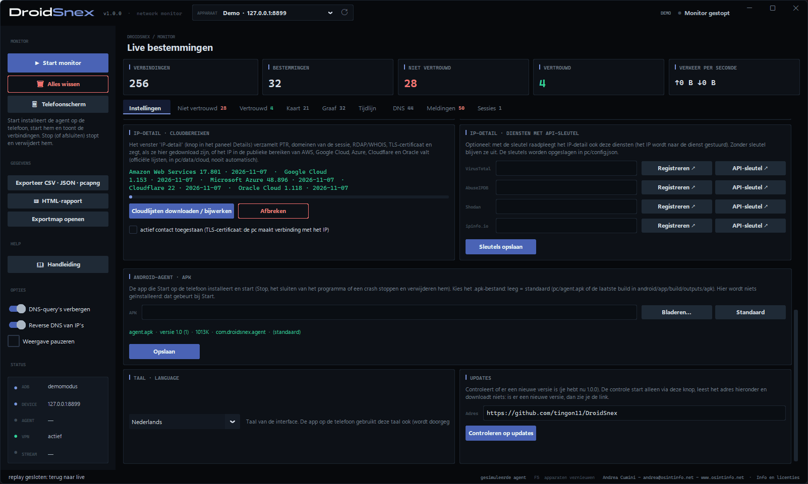

## 4. Het hoofdvenster

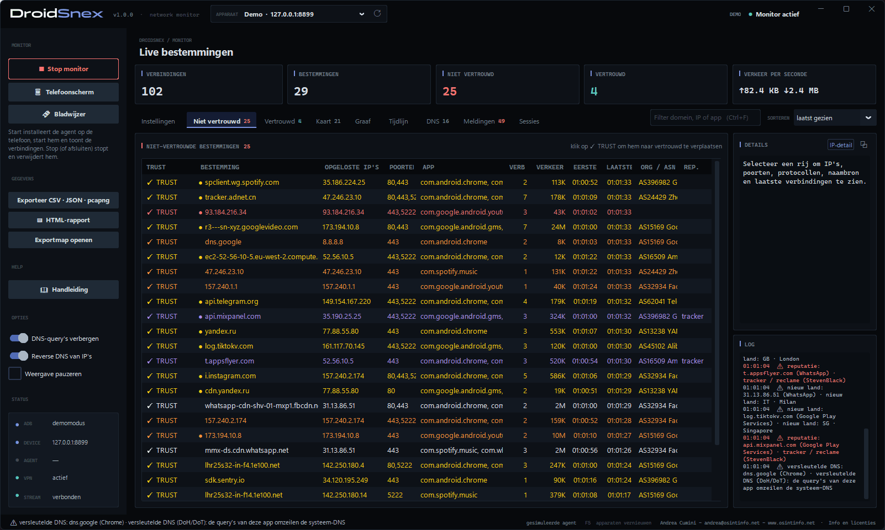

- **Kopregel (boven):** logo en versie, het menu **APPARAAT** met de aangesloten telefoon (de knop ↻ of de toets **F5** vernieuwt de lijst) en rechts de status van de monitor.
- **Linkerkolom:** de opdrachten.
  - *Monitor:* **Start monitor** (bij een actieve monitor wordt dezelfde knop **Stop monitor**), **Alles wissen** (alleen als de monitor stilstaat), **Telefoonscherm**, **Bladwijzer** (alleen als de monitor actief is).
  - *Gegevens:* **Exporteer CSV · JSON · pcapng**, **HTML-rapport** en **Exportmap openen**.
  - *Help:* **📖 Handleiding** opent deze handleiding in de taal van de interface. In het handleidingvenster markeert het zoekvak linksboven (**Ctrl+F**) alle treffers: **Enter** of **F3** gaat naar de volgende, **Shift+Enter** naar de vorige, **Esc** wist de zoekopdracht.
  - *Opties:* **DNS-query's verbergen** (haalt rijen die alleen DNS-query's zijn uit de lijsten), **Reverse DNS van IP's** (zoekt een naam voor IP-adressen zonder naam), **Weergave pauzeren** (bevriest de lijsten zodat je ze rustig kunt lezen; de gegevens blijven binnenkomen).
  - *Status:* vijf lampjes (ADB, DEVICE, AGENT, VPN, STREAM): groen als dat onderdeel werkt.
- **Tellers:** Verbindingen, Bestemmingen, Niet vertrouwd, Vertrouwd, Verkeer per seconde.
- **Tabbladen:** Instellingen, Niet vertrouwd, Vertrouwd, Kaart, Graaf, Tijdlijn, DNS, Meldingen, Sessies. Rechts van de tabbladen, bij de lijsten, het vak **Filter domein, IP of app** (**Ctrl+F**) en het menu **SORTEREN** (laatst gezien, aantal verbindingen, eerst gezien, bestemming, verkeer).
- **Rechterpaneel:** **Details** van de geselecteerde rij en daaronder het **Log** met de meldingen van het programma.
- **Onderbalk:** de statusmelding, **F5 apparaten vernieuwen** en de link **Info en licenties**.

## 5. De monitor starten en stoppen

1. Sluit de telefoon via USB aan en ontgrendel hem. In het menu **APPARAAT** verschijnt het model; heb je er meer dan één, kies hem dan in het menu.
2. Druk op **▶ Start monitor**. DroidSnex installeert de agent op de telefoon, geeft hem de nodige machtigingen en start de lokale VPN. Verschijnt op de telefoon **Verbindingsverzoek**, ontgrendel dan en tik op **OK**.
3. Zodra de *Status*-lampjes groen zijn, komen de verbindingen in de lijsten binnen. Gebruik de telefoon zoals altijd: elke app die verbinding maakt met internet verschijnt met zijn bestemmingen.
4. Druk op **■ Stop monitor** om te stoppen. De agent wordt gestopt en van de telefoon **verwijderd**; de sessie wordt opgeslagen op het tabblad [Sessies](#15-sessies-replay-en-bladwijzers).

Ook bij het sluiten van het programma wordt de agent gestopt en verwijderd. Raakt de kabel los, dan probeert DroidSnex zelf opnieuw verbinding te maken; gaat de pc uit of stopt het programma onverwacht, dan stopt de agent kort daarna vanzelf (watchdog).

## 6. Niet vertrouwd en Vertrouwd

Elke bestemming (een domein, of een IP-adres als de naam onbekend is) staat in een van de twee lijsten:

- **Niet vertrouwd** — de niet-vertrouwde bestemmingen. Elke nieuwe bestemming begint hier.
- **Vertrouwd** — de bestemmingen die je als vertrouwd hebt gemarkeerd.

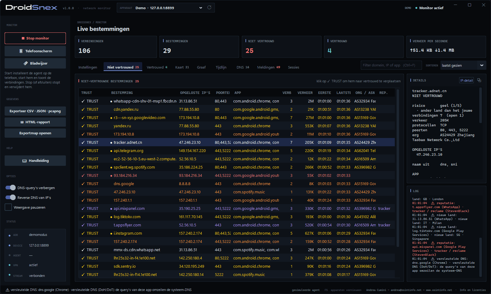

De kolommen: Bestemming, Opgeloste IP's, Poorten, App, Verb (aantal verbindingen), Verkeer, Eerste en Laatste (tijden), Org / ASN (de organisatie die het IP-adres beheert) en Rep. (label *tracker*, *malware* of *tor* uit de reputatielijsten). Klik op een kolomtitel om A-Z te sorteren, nogmaals voor Z-A.

- **Een bestemming vertrouwen:** klik in de lijst Niet vertrouwd op **✓ TRUST** in de eerste kolom. De bestemming gaat naar de lijst Vertrouwd.
- **Terugdraaien:** klik in de lijst Vertrouwd op **✕ UNTRUST**.
- **✕ Alles wantrouwen** (boven in de lijst Vertrouwd) zet na een bevestiging alle vertrouwde bestemmingen terug bij de niet-vertrouwde. De opgeslagen lijst wordt geleegd; dit kan niet ongedaan worden gemaakt.

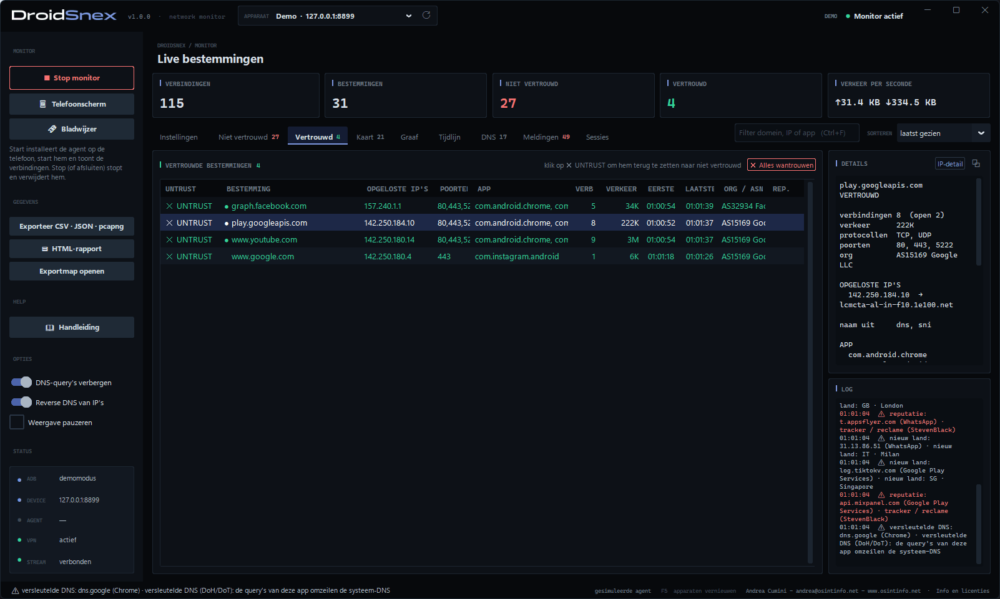

De lijst met vertrouwde bestemmingen wordt opgeslagen en geldt ook voor latere sessies en voor andere telefoons.

## 7. De gevarenschaal

In de lijst Niet vertrouwd heeft elke rij een kleur die aangeeft hoe verdacht de bestemming is. DroidSnex telt punten op voor elk signaal:

| Signaal | Punten |
|---|---|
| alleen IP, geen naam | +1 |
| onbekende organisatie (IP niet in de ASN-database) | +1 |
| ander land dan het jouwe | +1 |
| versleutelde DNS (DoH/DoT) | +1 |
| ongewone poort (niet 80, 443, 53…) | +2 |
| VPN-aanbieder (indicatief) | +3 |
| tracker / advertenties in lijst | +4 |
| Tor-exitnode | +4 |
| malware in lijst | +5 |

De algemene signalen (de eerste vijf rijen) komen samen hooguit op 3 punten; fuchsia en paars worden alleen bereikt via de reputatielijsten. De kleur is het totaal, tot 5:

**0 wit · 1 geel · 2 oranje · 3 rood · 4 fuchsia · 5 paars**

In het paneel Details legt de regel *gevaar* uit welke signalen hebben meegeteld. Voor alle signalen heb je je locatie, de ASN-database en de reputatielijsten nodig (zie [Instellingen](#3-instellingen)).

## 8. Details en IP-detail

Selecteer een rij in een lijst: het paneel **Details** toont of de bestemming VERTROUWD of NIET VERTROUWD is, het aantal verbindingen (en hoeveel er nog open zijn), protocollen, poorten, de opgeloste IP-adressen met de bron van de naam (SNI, DNS of reverse DNS), het gevaar en de laatste verbindingen.

De knop **IP-detail** boven in het paneel opent een venster met alles wat er over het IP-adres te weten valt:

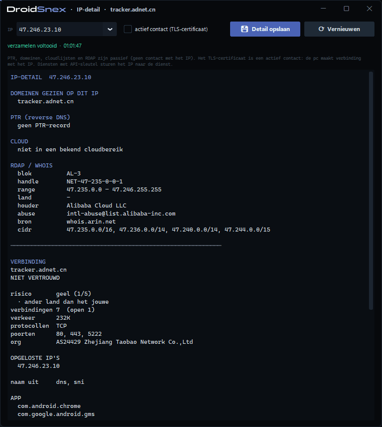

- **DOMEINEN GEZIEN OP DIT IP** in de sessie;
- **PTR (reverse DNS)**;
- **CLOUD** — of het IP-adres binnen de bereiken valt die AWS, Google Cloud, Azure, Cloudflare en anderen publiceren (lijsten gedownload via Instellingen);
- **RDAP / WHOIS** — blok, land, houder;
- **TLS-CERTIFICAAT (actief contact)** — uitgever, geldigheid, namen in het certificaat;
- **VIRUSTOTAL, ABUSEIPDB, SHODAN, IPINFO.IO** — alleen als je hun API-sleutels in Instellingen hebt ingevoerd.

Kies bovenaan het **IP** (als de bestemming er meer dan één heeft). PTR, domeinen, cloudlijsten en RDAP zijn passief: geen contact met het IP-adres. Het TLS-certificaat is wel een actief contact, de pc maakt verbinding met het IP-adres, en wordt alleen opgehaald als het vakje **actief contact (TLS-certificaat)** is aangevinkt. Diensten met een sleutel ontvangen het IP-adres dat je opvraagt.

**Vernieuwen** haalt alles opnieuw op. **Detail opslaan** slaat het resultaat op in een tekstbestand; het pad verschijnt in het Log.

Het IP-detail kun je ook openen vanaf een lijn op de Kaart of een knoop in de Graaf: selecteer eerst de bestemming en druk dan op de knop.

## 9. Kaart

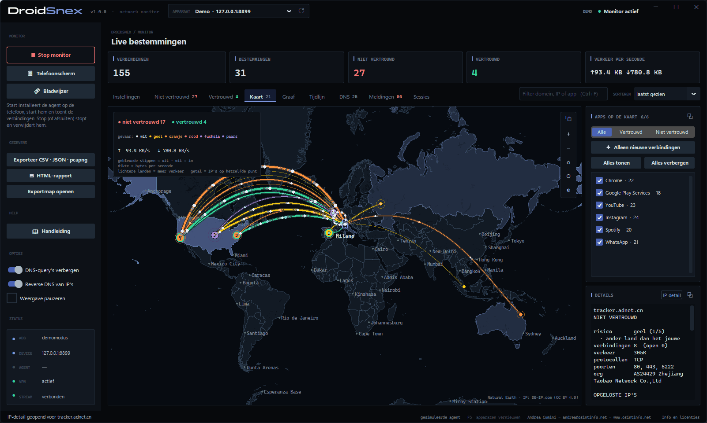

De telefoon wordt op jouw locatie getekend (stel die in bij Instellingen); vandaar loopt een lijn naar de stad van elke bestemming: **groen** als hij vertrouwd is, in de kleur van de gevarenschaal als hij niet vertrouwd is. De dikte groeit met de bytes per seconde; gekleurde stipjes richting bestemming zijn uitgaand verkeer, witte stipjes richting telefoon inkomend verkeer.

- **Muiswiel** of **+ / −**: zoomen. **Slepen**: verschuiven. **Dubbelklik**: inzoomen.
- **Klik op een lijn of een punt**: de details van de bestemming in het paneel Details.
- **Apps op de kaart** (paneel rechts): kies **Alle**, **Vertrouwd** of **Niet vertrouwd** en welke apps je wilt zien, met **Alles tonen** en **Alles verbergen**.
- **✦ Alleen nieuwe verbindingen**: vanaf dat moment toont de kaart alleen verbindingen die daarna ontstaan; druk opnieuw om weer alles te zien.
- Uitgezoomd worden nabije bestemmingen gegroepeerd in een **bolletje met het aantal IP's**: beweeg erover voor de lijst, klik om daar in te zoomen. Vanaf zoom 4 gaan IP's op hetzelfde punt uiteen in aparte stippen rond de stad.
- **◐** kleurt de landen naar het uitgewisselde verkeer (lichter = meer bytes).
- Een nieuwe verbinding wordt aangekondigd met een flits van de telefoon naar de bestemming; de pulsen op de lijnen hebben een spoor en nemen toe met het verkeer.
- **Rechtsklik** op de kaart › **Mijn positie hier instellen**.
- **⧉** maakt de kaart los in een apart venster (zie [Losgemaakte panelen](#17-losgemaakte-panelen)).

Ontbreekt de locatie of de stedendatabase, dan meldt de kaart dat. Bestemmingen zonder locatie (privé-IP's of IP's die niet in de database staan) worden apart geteld.

## 10. Graaf

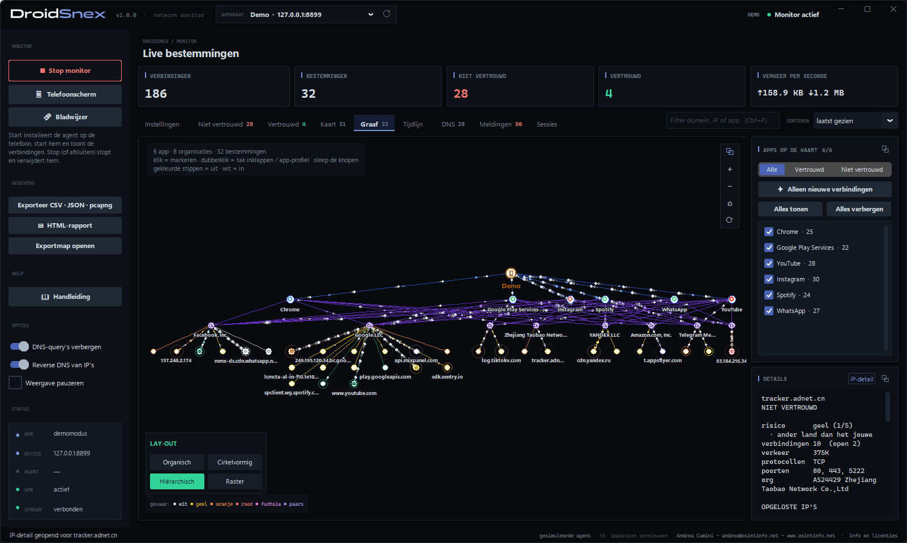

De graaf toont wie met wie praat: **telefoon → app → organisatie (ASN) → bestemming**.

- **Klik** op een knoop: hij wordt samen met zijn buren gemarkeerd; de andere vervagen.
- **Dubbelklik** op een app of organisatie: klapt de tak in of uit. Dubbelklikken op de app (of op de app in de lijst) opent het **app-profiel**: versie, of het een systeemapp is, installatie- en updatedatum, machtigingen (gevoelige in geel), bestemmingen.
- **Sleep** de knopen om ze te schikken, sleep de achtergrond om het beeld te verschuiven, **muiswiel** of **+ / −** om te zoomen, **⌂** om de graaf in het venster te passen, **⟳** om hem opnieuw te schikken.
- **Lay-out:** **Hiërarchisch** (standaard: telefoon → app → organisatie → bestemming, van boven naar beneden), **Organisch**, **Cirkelvormig**, **Raster**. **Kruisingen verminderen** probeert verschillende schikkingen en houdt de schikking met de minste kruisende lijnen.
- Over de verbindingen lopen verkeerspulsen zoals op de kaart (gekleurd = uit, licht = in); bestemmingen met open verbindingen hebben een kloppende ring. Labels overlappen niet: beweeg met de muis over een knoop om de volledige naam te lezen.
- **⧉** maakt de graaf los in een apart venster.

Voor de organisaties is de ASN-database nodig (Instellingen).

## 11. Tijdlijn

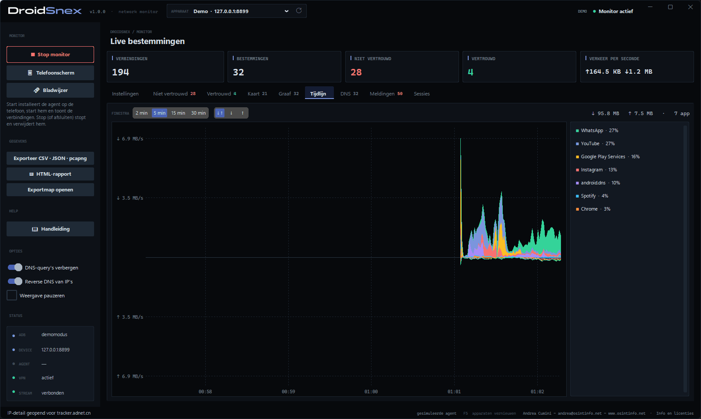

De tijdlijn toont de bytes per seconde van elke app in de tijd. Boven de as het inkomende verkeer (↓, van de server naar de telefoon), eronder het uitgaande (↑): je ziet meteen welke app op de achtergrond praat terwijl de telefoon niets doet en welke iets downloadt.

- Kies het tijdvenster: **2, 5, 15 of 30 min**.
- **Klik op een item in de legenda** om die app te verbergen of te tonen.
- **Beweeg met de muis** over de grafiek om de waarden op dat moment te lezen.
- Apps buiten de eerste tien worden samengevoegd onder *overige*.

## 12. DNS

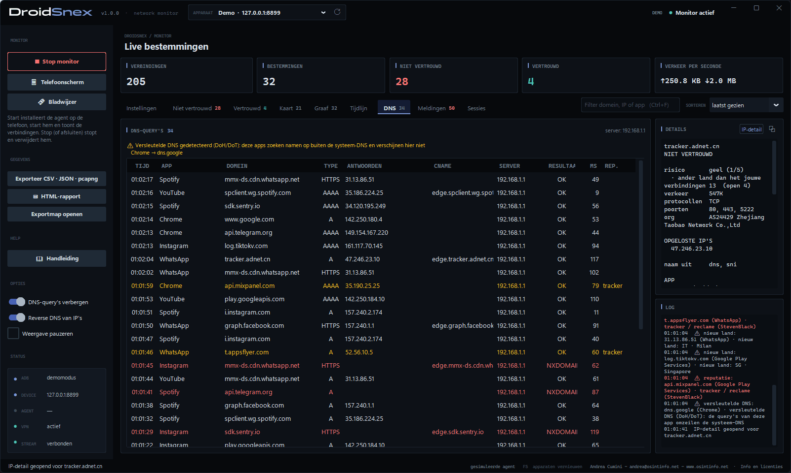

Het tabblad **DNS** toont de DNS-query's van de telefoon: Tijd, App, Domein, Type (A, AAAA, HTTPS…), Antwoorden, Resultaat, antwoordtijd in ms en Rep. **Leegmaken** wist de lijst.

Sommige apps gebruiken **versleutelde DNS** (DoH/DoT): hun query's gaan niet via de systeem-DNS en verschijnen hier niet. Als DroidSnex dat merkt, toont het een waarschuwing en maakt het een melding aan.

## 13. Meldingen

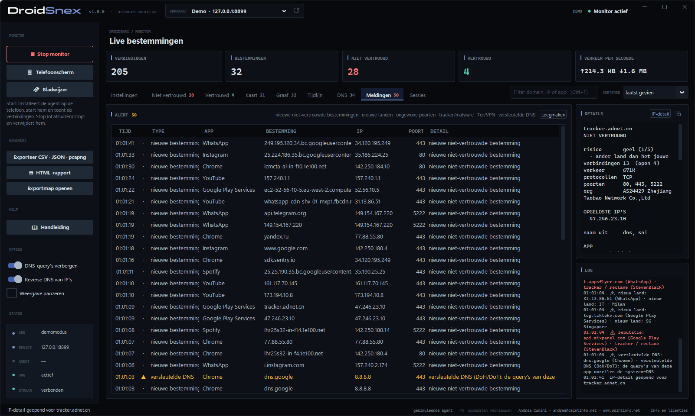

Het tabblad **Meldingen** verzamelt gebeurtenissen die aandacht verdienen: **nieuwe niet-vertrouwde bestemmingen · nieuwe landen · ongewone poorten · tracker/malware · Tor/VPN · versleutelde DNS**. Elke rij toont Tijd, niveau, Type, App, Bestemming, IP, Poort en Detail. **Leegmaken** wist de lijst.

## 14. Telefoonscherm

De knop **📱 Telefoonscherm** toont het scherm van de telefoon op de pc en laat je het met muis en toetsenbord bedienen, via scrcpy (download het eerst via Instellingen). Het venster blijft op de voorgrond; sleep de kopregel om het te verplaatsen. De knoppen bovenaan sturen Android-toetsen: terug, home, recente apps, aan/uit, volume − en +.

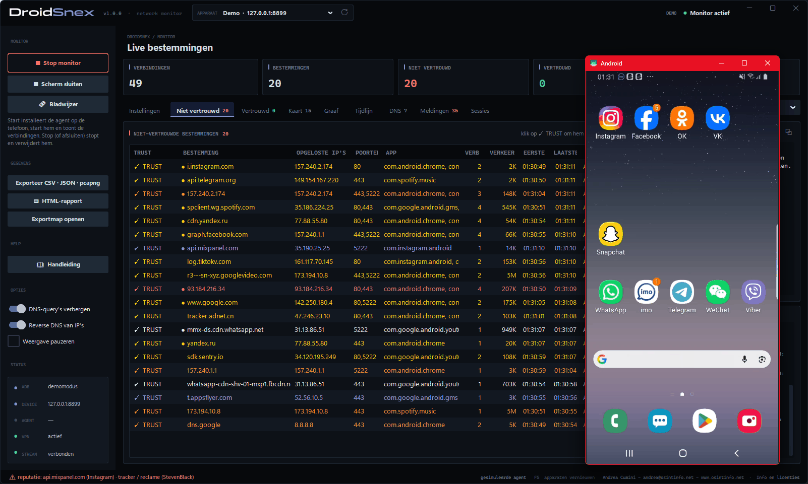

Druk nogmaals op de knop (**Scherm sluiten**) om het te sluiten.

## 15. Sessies, replay en bladwijzers

Elke monitoring, van Start tot Stop, wordt opgeslagen als **sessie**, met alle vastgelegde gebeurtenissen.

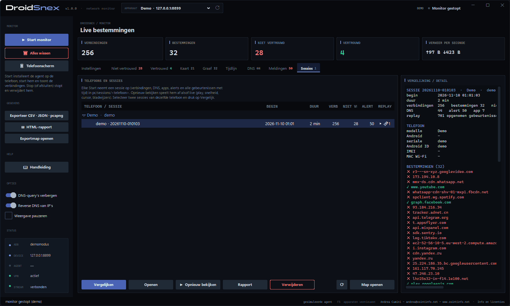

Op het tabblad **Sessies**:

- **Telefoons en sessies** (links) toont de opgeslagen sessies met telefoon, begin, duur, verbindingen, niet-vertrouwde bestemmingen en een kolom **Replay** (▶ als de sessie opnieuw bekeken kan worden, 🔖 met het aantal bladwijzers).
- Selecteer een sessie: onder **Vergelijking / detail** (rechts) verschijnen telefoon, begin, duur, bestemmingen, apps, organisaties en de bladwijzers.
- **Vergelijken:** selecteer met **Ctrl+klik** twee sessies van dezelfde telefoon en druk op Vergelijken. Je ziet gemeenschappelijke, nieuwe en verdwenen bestemmingen, nieuwe apps, verdwenen apps, nieuwe organisaties en nieuwe landen.
- **Rapport** maakt het HTML-rapport van de geselecteerde sessie (zie [hoofdstuk 16](#16-gegevens-exporteren-en-alles-wissen)).
- **Openen** opent een sessie uit een bestand, **Map openen** opent de map met sessies, **Sessies verwijderen** verwijdert de geselecteerde na een bevestiging (kan niet ongedaan worden gemaakt).

### Replay

Selecteer een sessie en druk op **▶ Opnieuw bekijken** (met de monitor gestopt). Alle weergaven (lijsten, kaart, graaf, tijdlijn, DNS, meldingen) doorlopen de sessie opnieuw alsof die live is.

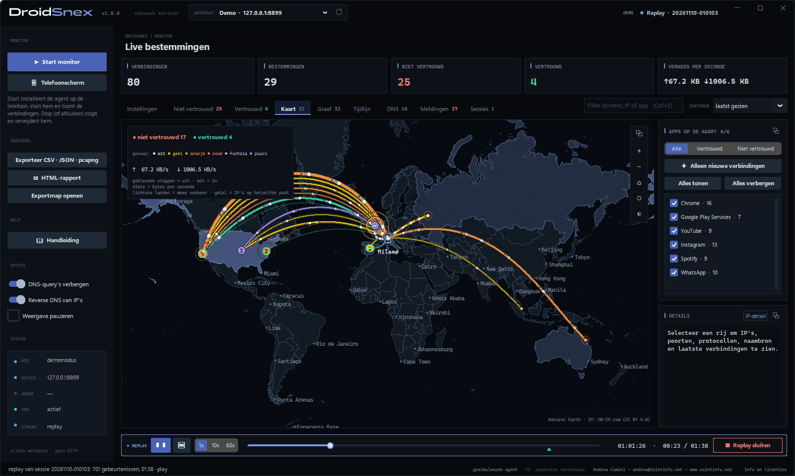

De replaybalk onderaan:

- **▶ / ❚❚** afspelen en pauzeren, **⏮** terug naar het begin;
- snelheid **1x, 10x, 60x**;
- de tijdschuif: sleep hem om naar een moment te springen; bladwijzers staan op de schuif aangegeven. **Klik met de rechtermuisknop** op een bladwijzer om de schermafbeelding te openen;
- **■ Replay sluiten** gaat terug naar de live-modus.

### Bladwijzers

Druk tijdens het monitoren op **🔖 Bladwijzer** in de linkerkolom om een moment te markeren, bijvoorbeeld "Instagram geopend". Typ een notitie en druk op **Bladwijzer opslaan**. De bladwijzer wordt in de sessie opgeslagen met de tijd en een schermafbeelding van de telefoon.

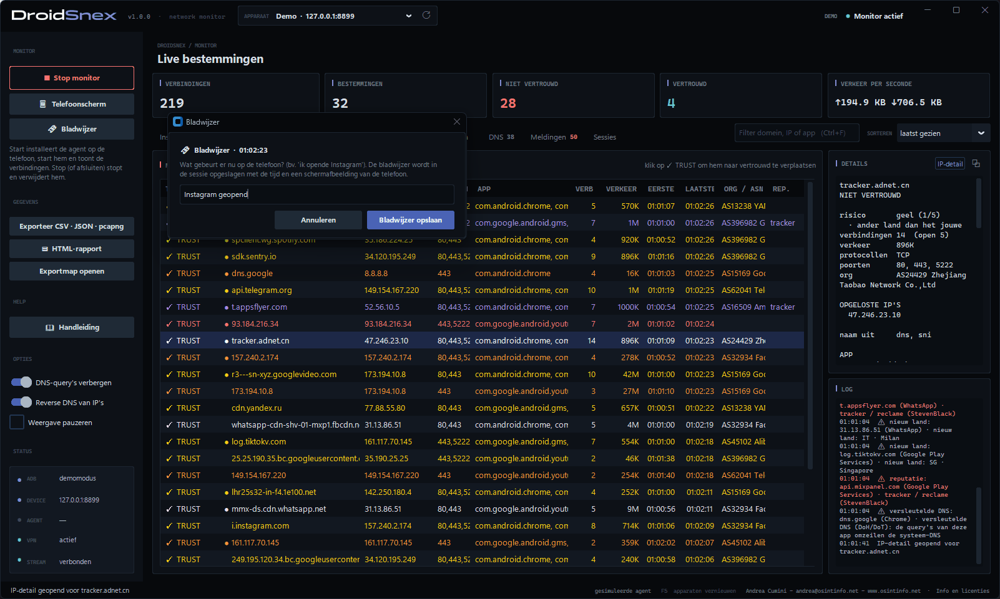

## 16. Gegevens exporteren en Alles wissen

- **Exporteer CSV · JSON · pcapng** slaat de verbindingen van de sessie op in drie formaten: CSV (voor spreadsheets), JSON en pcapng (te openen met Wireshark, alleen metadata). **Exportmap openen** opent de map met de bestanden.
- **HTML-rapport** maakt één HTML-bestand van de sessie (de huidige, de afgespeelde of die gekozen op het tabblad Sessies) en opent het in de browser: samenvatting, telefoon, kaart, niet-vertrouwde bestemmingen op gevaar met de redenen, vertrouwde bestemmingen, verkeer per app en per land, meldingen en bladwijzers met de schermafbeeldingen. Voor een pdf gebruik je *Afdrukken › Opslaan als PDF* in de browser.
- **🗑 Alles wissen** verschijnt als de monitor stilstaat: na een bevestiging worden verbindingen, DNS-query's, meldingen, kaart, graaf en tijdlijn van de huidige sessie gewist. Opgeslagen sessies en de lijst met vertrouwde bestemmingen blijven bewaard.

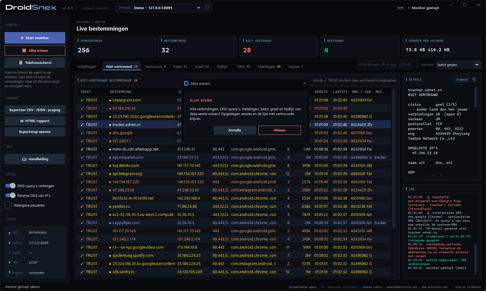

## 17. Losgemaakte panelen

Kaart, Graaf, Details en Apps op de kaart hebben rechtsboven de knop **⧉**: het paneel wordt losgemaakt in een apart venster dat je kunt verplaatsen en van grootte kunt veranderen, bijvoorbeeld op een tweede monitor. Het paneel blijft bijwerken.

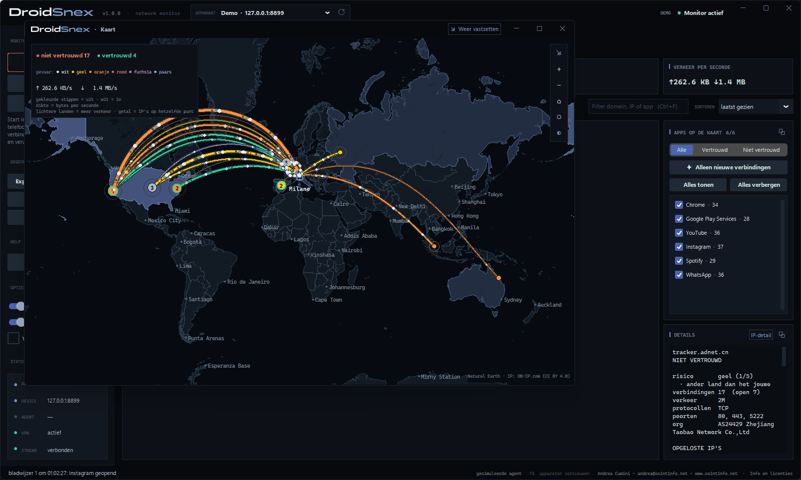

Om het terug te zetten druk je op **⇲ Weer vastzetten** in de kopregel van het venster, sluit je het venster of druk je op **Weer vastzetten** in het lege tabblad.

## 18. Info en licenties

Klik in de onderbalk op **Info en licenties**: het venster toont versie, auteur, licentie van het programma en de gegevens en componenten van derden met hun licenties (**Alle licenties**); met de knop **Gebruiksvoorwaarden** lees je de voorwaarden opnieuw. DroidSnex is vrije software, zonder enige garantie.

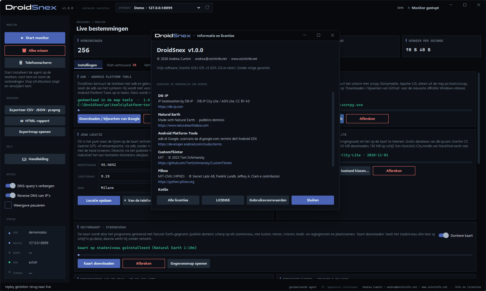

## 19. Veelvoorkomende problemen

| Melding | Wat te doen |
|---|---|
| Geen apparaat aangesloten | Sluit de telefoon via USB aan met USB-foutopsporing aan en druk op F5. |
| Apparaat niet geautoriseerd | Ontgrendel de telefoon en accepteer "USB-foutopsporing toestaan?" met een vinkje bij "Altijd toestaan vanaf deze computer". |
| adb staat niet in de map tools | Instellingen › ADB › Downloaden / bijwerken van Google. |
| scrcpy staat niet in de map tools | Instellingen › Telefoonscherm › Downloaden / bijwerken van GitHub. |
| De VPN is niet actief | Tik op de telefoon op OK bij het VPN-verbindingsverzoek; is er een andere VPN actief, zet die dan uit en druk opnieuw op Start. |
| Stedendatabase ontbreekt | Instellingen › IP-stedendatabase › Downloaden / bijwerken. |
| Stel je locatie in | Instellingen › Jouw locatie › Detecteren via mijn publieke IP (of vul hem met de hand in). |
