# DroidSnex — Podręcznik użytkownika

DroidSnex pokazuje w czasie rzeczywistym, z jakimi serwerami łączy się telefon z Androidem: która aplikacja, jaka domena, jaki adres IP, w jakim kraju i z jakim ruchem. Telefon podłącza się do komputera kablem USB; na czas monitorowania na telefonie działa mała aplikacja (*agent*), która tworzy lokalny VPN i odczytuje tylko metadane połączeń. Treść ruchu nigdy nie jest odszyfrowywana (bez MITM).

## Spis treści

1. [Zanim zaczniesz](#1-zanim-zaczniesz)
2. [Pierwsze uruchomienie: język i warunki użytkowania](#2-pierwsze-uruchomienie-język-i-warunki-użytkowania)
3. [Ustawienia](#3-ustawienia)
4. [Okno główne](#4-okno-główne)
5. [Uruchamianie i zatrzymywanie monitora](#5-uruchamianie-i-zatrzymywanie-monitora)
6. [Niezaufane i Zaufane](#6-niezaufane-i-zaufane)
7. [Skala zagrożenia](#7-skala-zagrożenia)
8. [Szczegóły i Szczegóły IP](#8-szczegóły-i-szczegóły-ip)
9. [Mapa](#9-mapa)
10. [Graf](#10-graf)
11. [Oś czasu](#11-oś-czasu)
12. [DNS](#12-dns)
13. [Alerty](#13-alerty)
14. [Ekran telefonu](#14-ekran-telefonu)
15. [Sesje, odtwarzanie i zakładki](#15-sesje-odtwarzanie-i-zakładki)
16. [Eksport danych i Wyczyść wszystko](#16-eksport-danych-i-wyczyść-wszystko)
17. [Odłączone panele](#17-odłączone-panele)
18. [Informacje i licencje](#18-informacje-i-licencje)
19. [Częste problemy](#19-częste-problemy)

---

## 1. Zanim zaczniesz

Potrzebujesz:

- komputera z Windows i programem DroidSnex;
- telefonu z Androidem i kabla USB do transmisji danych;
- włączonego na telefonie **debugowania USB**: *Ustawienia › Informacje o telefonie*, stuknij siedem razy *Numer kompilacji*, aby odblokować *Opcje programisty*, a następnie w *Opcjach programisty* włącz *Debugowanie USB*.

Przy pierwszym podłączeniu telefon zapyta **„Zezwolić na debugowanie USB?”**: odblokuj ekran, zaznacz *Zawsze zezwalaj z tego komputera* i stuknij *OK*.

DroidSnex używa tylko narzędzi z własnego folderu `tools` (adb i scrcpy) i niczego nie instaluje w systemie. Za pierwszym razem pobierz je w karcie **Ustawienia** (zobacz [rozdział 3](#3-ustawienia)).

## 2. Pierwsze uruchomienie: język i warunki użytkowania

Przy pierwszym uruchomieniu pojawia się okno, którego nie można zamknąć ani schować za innymi oknami.

1. **Wybierz język.** Przyciski pokazują dziewięć dostępnych języków: Italiano, English, Deutsch, Français, Español, Nederlands, Polski, Ελληνικά, Shqip. Język obowiązuje w całym programie i w agencie na telefonie; można go później zmienić w karcie Ustawienia.

   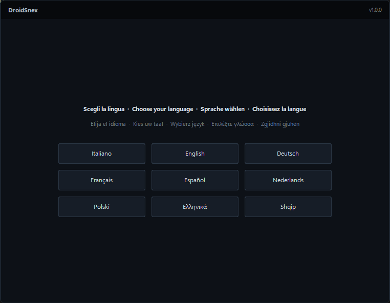

2. **Przeczytaj warunki użytkowania.** Tekst jest w wybranym języku. Przycisk **Akceptuję** staje się aktywny dopiero po przewinięciu tekstu do końca. **Odrzucam** zamyka program.

   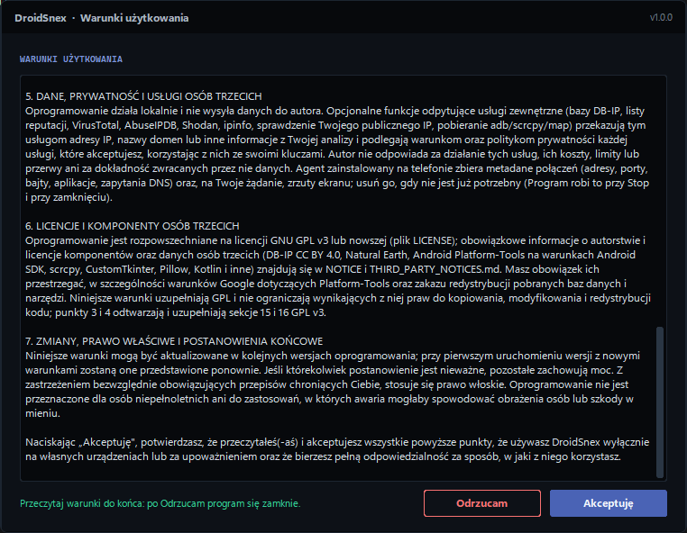

Akceptacja zostaje zapisana: okno pojawi się ponownie tylko wtedy, gdy zmieni się wersja warunków. Warunki można w każdej chwili przeczytać ponownie w oknie [Informacje i licencje](#18-informacje-i-licencje).

## 3. Ustawienia

Karta **Ustawienia** zbiera ustawienia i pobierania. Każde pobieranie odbywa się tylko po naciśnięciu przycisku i można je przerwać przyciskiem **Przerwij**.

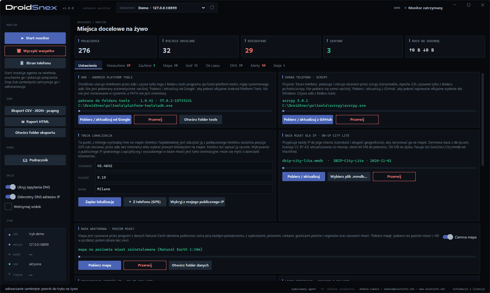

- **ADB · Android Platform Tools** — DroidSnex steruje telefonem przez adb, wyłącznie z folderu `tools` programu. Naciśnij **Pobierz / aktualizuj od Google**, aby pobrać oficjalne Android Platform Tools; **Otwórz folder tools** otwiera folder.
- **Ekran telefonu · scrcpy** — **Pobierz / aktualizuj z GitHub** pobiera scrcpy z oficjalnych wydań.
- **Twoja lokalizacja** — punkt, z którego wychodzą linie na mapie, i kraj używany przez skalę zagrożenia. Najdokładniejszy jest przycisk **⌖ Z telefonu (GPS)**: odczytuje przez adb ostatnią pozycję podłączonego telefonu i pokazuje źródło, dokładność i wiek. Możesz też kliknąć prawym przyciskiem na mapie › **Ustaw tutaj moją pozycję** albo wpisać SZEROKOŚĆ, DŁUGOŚĆ i NAZWA i nacisnąć **Zapisz lokalizację**. **Wykryj z mojego publicznego IP** jest tylko orientacyjne: może się mylić o dziesiątki kilometrów.
- **Baza miast dla IP · DB-IP City Lite** — przypisuje każdy adres IP do miasta, aby narysować go na mapie. **Pobierz / aktualizuj** albo **Wybierz plik .mmdb…**; **Otwórz folder danych**.
- **Mapa wektorowa · poziom miast** — **Pobierz mapę** instaluje szczegółową mapę (Natural Earth 1:10m, z wybrzeżami, rzekami, granicami i nazwami miast); bez niej widać dołączoną wersję podstawową. **Ciemna mapa** zmienia kolory mapy.
- **Organizacje adresów IP · DB-IP ASN Lite** — przypisuje każdy adres IP do zarządzającej nim organizacji (Google, Meta, Amazon, nieznany hosting…). To podstawa Grafu i kolumny Org / ASN.
- **Listy reputacji · trackery i malware** — publiczne listy blokowania trackerów, malware, węzłów wyjściowych **Tor** i wskazówki o dostawcach **VPN**. **Pobierz / aktualizuj listy**. Miejsca docelowe z list otrzymują oznaczenie i alert.
- **Szczegóły IP · zakresy chmury** — **Pobierz / aktualizuj listy chmury** i zgoda na **kontakt aktywny** (certyfikat TLS) w Szczegółach IP.
- **Szczegóły IP · usługi z kluczem API** — opcjonalne klucze do VirusTotal, AbuseIPDB, Shodan i ipinfo.io. **Zarejestruj się** otwiera stronę usługi; wklej klucz i naciśnij **Zapisz klucze**. Bez klucza usługa pozostaje wyłączona. Klucze pozostają na komputerze, w pliku konfiguracji.
- **Agent Android · APK** — plik APK agenta instalowany na telefonie. Zwykle wystarcza **Domyślny**; **Przeglądaj…**, aby wybrać inny, a potem **Zapisz**.
- **Aktualizacje** — **Sprawdź aktualizacje** sprawdza, tylko po naciśnięciu, czy pod podanym adresem jest nowsza wersja, i pokazuje odnośnik do jej strony. Niczego nie pobiera ani nie instaluje.
- **Język · Language** — język interfejsu; agent na telefonie również będzie go używał od następnego Startu.

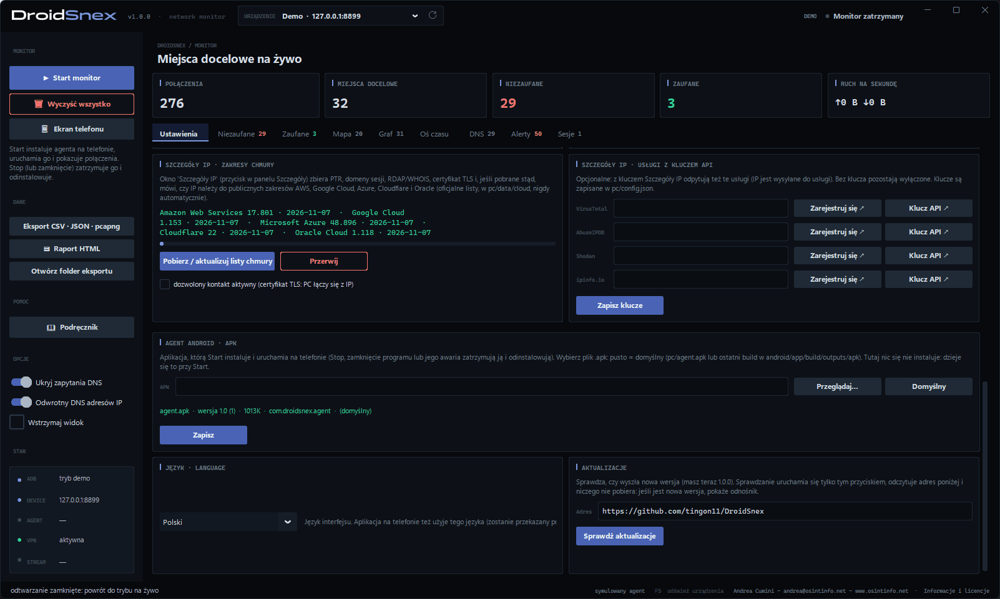

## 4. Okno główne

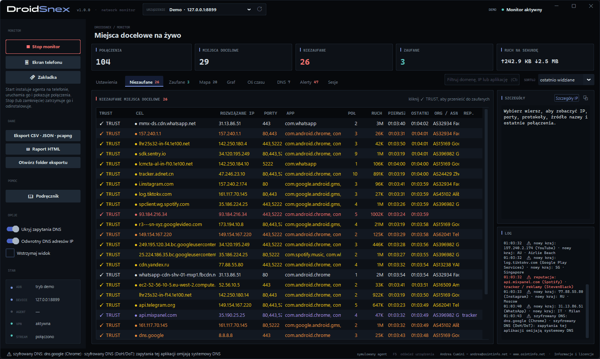

- **Nagłówek (u góry):** logo i wersja, menu **URZĄDZENIE** z podłączonym telefonem (przycisk ↻ lub klawisz **F5** odświeża listę) oraz, po prawej, stan monitora.
- **Lewa kolumna:** polecenia.
  - *Monitor:* **Start monitor** (przy działającym monitorze ten sam przycisk zmienia się w **Stop monitor**), **Wyczyść wszystko** (tylko przy zatrzymanym monitorze), **Ekran telefonu**, **Zakładka** (tylko przy działającym monitorze).
  - *Dane:* **Eksport CSV · JSON · pcapng**, **Raport HTML** i **Otwórz folder eksportu**.
  - *Pomoc:* **📖 Podręcznik** otwiera ten podręcznik w języku interfejsu. W oknie podręcznika pole wyszukiwania w lewym górnym rogu (**Ctrl+F**) wyróżnia wszystkie wystąpienia: **Enter** lub **F3** przechodzi do następnego, **Shift+Enter** do poprzedniego, **Esc** czyści wyszukiwanie.
  - *Opcje:* **Ukryj zapytania DNS** (usuwa z list wiersze, które są tylko zapytaniami DNS), **Odwrotny DNS adresów IP** (szuka nazwy dla adresów IP bez nazwy), **Wstrzymaj widok** (zamraża listy, aby można je było spokojnie przeczytać; dane nadal napływają).
  - *Stan:* pięć kontrolek (ADB, DEVICE, AGENT, VPN, STREAM): zielone, gdy dana część działa.
- **Liczniki:** Połączenia, Miejsca docelowe, Niezaufane, Zaufane, Ruch na sekundę.
- **Karty:** Ustawienia, Niezaufane, Zaufane, Mapa, Graf, Oś czasu, DNS, Alerty, Sesje. Na prawo od kart, przy listach, pole **Filtruj domenę, IP lub aplikację** (**Ctrl+F**) i menu **SORTUJ** (ostatnio widziane, liczba połączeń, pierwsze wystąpienie, miejsce docelowe, ruch).
- **Prawy panel:** **Szczegóły** zaznaczonego wiersza, a pod nimi **Log** z komunikatami programu.
- **Dolny pasek:** komunikat stanu, **F5 odśwież urządzenia** i odnośnik **Informacje i licencje**.

## 5. Uruchamianie i zatrzymywanie monitora

1. Podłącz telefon przez USB i odblokuj go. W menu **URZĄDZENIE** pojawi się jego model; jeśli masz kilka telefonów, wybierz go z menu.
2. Naciśnij **▶ Start monitor**. DroidSnex instaluje agenta na telefonie, nadaje mu potrzebne uprawnienia i uruchamia lokalny VPN. Jeśli na telefonie pojawi się **Prośba o połączenie**, odblokuj go i stuknij **OK**.
3. Gdy kontrolki *Stanu* są zielone, połączenia zaczynają pojawiać się na listach. Używaj telefonu jak zwykle: każda aplikacja, która łączy się z internetem, pojawi się ze swoimi miejscami docelowymi.
4. Naciśnij **■ Stop monitor**, aby zakończyć. Agent zostaje zatrzymany i **odinstalowany** z telefonu; sesja zostaje zapisana w karcie [Sesje](#15-sesje-odtwarzanie-i-zakładki).

Zamknięcie programu również zatrzymuje i odinstalowuje agenta. Jeśli kabel się odłączy, DroidSnex sam próbuje połączyć się ponownie; jeśli komputer się wyłączy lub program przerwie działanie, agent wkrótce zatrzyma się sam (watchdog).

## 6. Niezaufane i Zaufane

Każde miejsce docelowe (domena albo adres IP, gdy nazwa jest nieznana) znajduje się na jednej z dwóch list:

- **Niezaufane** — miejsca docelowe bez zaufania. Każde nowe miejsce docelowe zaczyna tutaj.
- **Zaufane** — miejsca docelowe oznaczone przez ciebie jako zaufane.

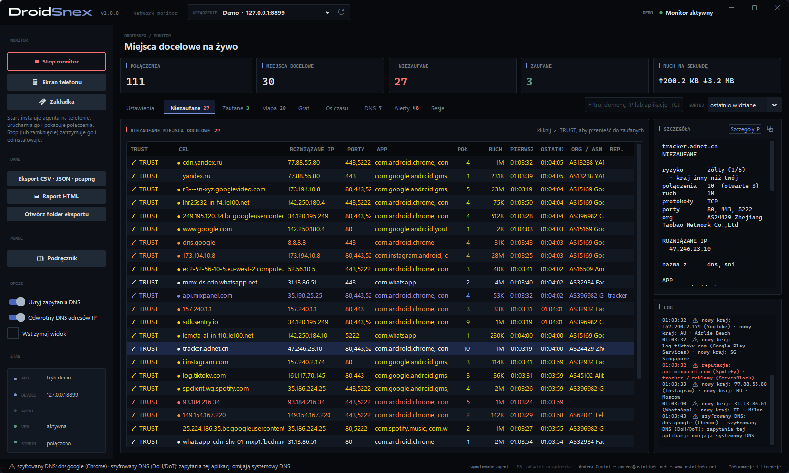

Kolumny: Cel, Rozwiązane IP, Porty, App, Poł (liczba połączeń), Ruch, Pierwsze i Ostatnie (godziny), Org / ASN (organizacja zarządzająca adresem IP) i Rep. (oznaczenie *tracker*, *malware* lub *tor* z list reputacji). Kliknij tytuł kolumny, aby sortować A-Z, kliknij ponownie, aby sortować Z-A.

- **Zaufanie miejscu docelowemu:** na liście Niezaufane kliknij **✓ TRUST** w pierwszej kolumnie. Miejsce docelowe przechodzi na listę Zaufane.
- **Cofnięcie:** na liście Zaufane kliknij **✕ UNTRUST**.
- **✕ Cofnij zaufanie wszystkim** (u góry listy Zaufane) przenosi po potwierdzeniu wszystkie zaufane miejsca docelowe z powrotem do niezaufanych. Zapisana lista zostaje opróżniona i nie można tego cofnąć.

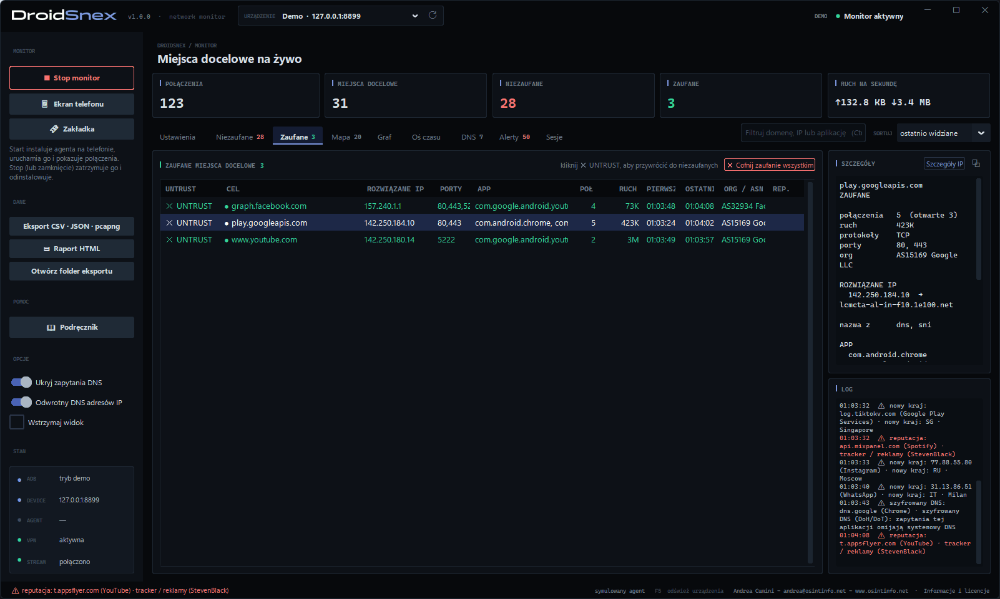

Lista zaufanych miejsc docelowych jest zapisywana i obowiązuje także w kolejnych sesjach i dla innych telefonów.

## 7. Skala zagrożenia

Na liście Niezaufane każdy wiersz ma kolor, który pokazuje, jak podejrzane jest miejsce docelowe. DroidSnex sumuje punkty za każdy sygnał:

| Sygnał | Punkty |
|---|---|
| tylko IP, bez nazwy | +1 |
| nieznana organizacja (IP nieobecny w bazie ASN) | +1 |
| kraj inny niż twój | +1 |
| szyfrowany DNS (DoH/DoT) | +1 |
| nietypowy port (nie 80, 443, 53…) | +2 |
| dostawca VPN (orientacyjnie) | +3 |
| tracker / reklama z listy | +4 |
| węzeł wyjściowy Tor | +4 |
| malware z listy | +5 |

Sygnały ogólne (pierwsze pięć wierszy) dają łącznie najwyżej 3 punkty; fuksję i fiolet można osiągnąć tylko dzięki listom reputacji. Kolor to suma, maksymalnie 5:

**0 biały · 1 żółty · 2 pomarańczowy · 3 czerwony · 4 fuksja · 5 fioletowy**

W panelu Szczegóły wiersz *zagrożenie* wyjaśnia, które sygnały zostały policzone. Aby mieć wszystkie sygnały, potrzebne są lokalizacja, baza ASN i listy reputacji (zobacz [Ustawienia](#3-ustawienia)).

## 8. Szczegóły i Szczegóły IP

Zaznacz wiersz na liście: panel **Szczegóły** pokazuje, czy miejsce docelowe jest ZAUFANE czy NIEZAUFANE, liczbę połączeń (i ile jest jeszcze otwartych), protokoły, porty, rozwiązane adresy IP ze źródłem nazwy (SNI, DNS lub odwrotny DNS), zagrożenie i ostatnie połączenia.

Przycisk **Szczegóły IP** u góry panelu otwiera okno ze wszystkim, czego można się dowiedzieć o adresie IP:

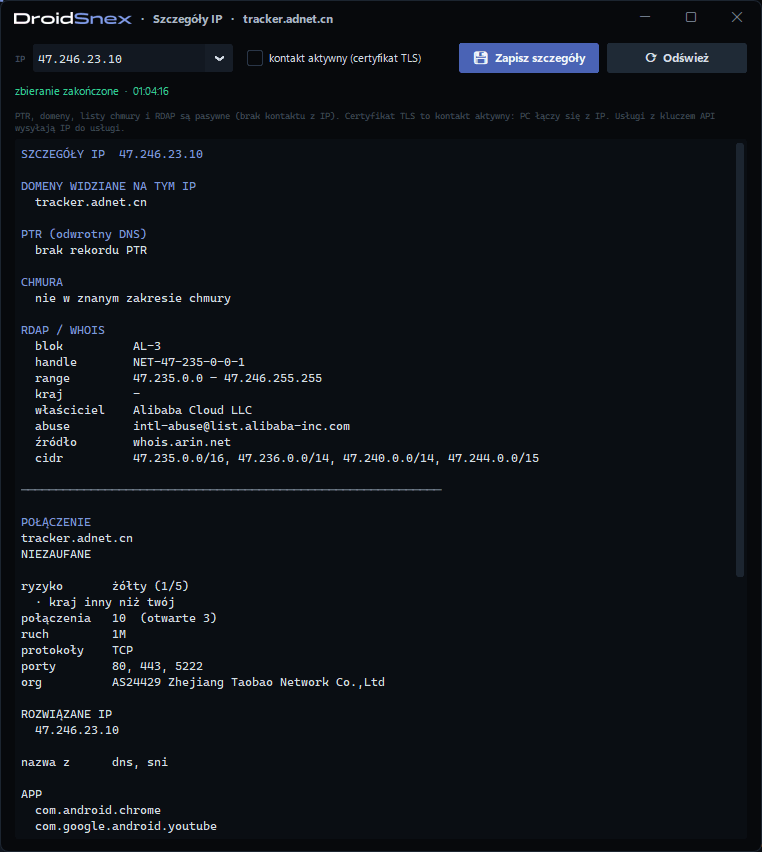

- **DOMENY WIDZIANE NA TYM IP** w sesji;
- **PTR (odwrotny DNS)**;
- **CLOUD** — czy adres IP należy do zakresów publikowanych przez AWS, Google Cloud, Azure, Cloudflare i innych (listy pobierane w Ustawieniach);
- **RDAP / WHOIS** — blok, kraj, właściciel;
- **CERTYFIKAT TLS (kontakt aktywny)** — wystawca, ważność, nazwy w certyfikacie;
- **VIRUSTOTAL, ABUSEIPDB, SHODAN, IPINFO.IO** — tylko jeśli w Ustawieniach podano ich klucze API.

U góry wybierz **IP** (jeśli miejsce docelowe ma ich kilka). PTR, domeny, listy chmury i RDAP są pasywne: brak kontaktu z adresem IP. Certyfikat TLS jest natomiast kontaktem aktywnym, komputer łączy się z adresem IP, i jest pobierany tylko przy zaznaczonym polu **kontakt aktywny (certyfikat TLS)**. Usługi z kluczem otrzymują sprawdzany adres IP.

**Odśwież** powtarza zbieranie danych. **Zapisz szczegóły** zapisuje wynik w pliku tekstowym; ścieżka pojawia się w Logu.

Szczegóły IP można też otworzyć z linii na Mapie lub węzła w Grafie: najpierw zaznacz miejsce docelowe, potem naciśnij przycisk.

## 9. Mapa

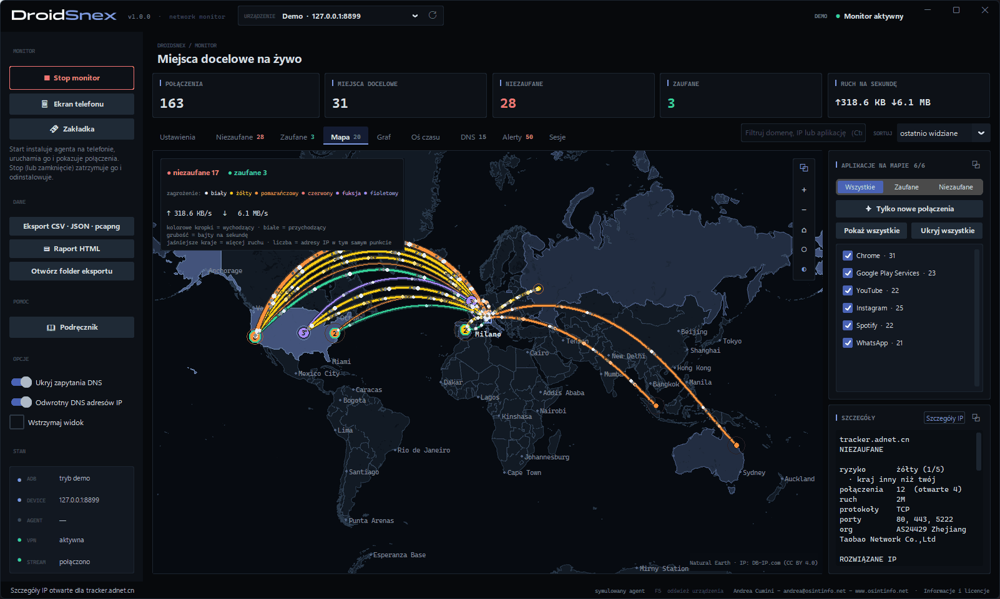

Telefon jest rysowany w twojej lokalizacji (ustaw ją w Ustawieniach); stamtąd prowadzi linia do miasta każdego miejsca docelowego: **zielona**, jeśli jest zaufane, w kolorze skali zagrożenia, jeśli jest niezaufane. Grubość rośnie z liczbą bajtów na sekundę; kolorowe kropki biegnące do celu to ruch wychodzący, białe kropki biegnące do telefonu to ruch przychodzący.

- **Kółko myszy** lub **+ / −**: powiększenie. **Przeciąganie**: przesuwanie. **Dwuklik**: przybliżenie.
- **Kliknięcie linii lub punktu**: szczegóły miejsca docelowego w panelu Szczegóły.
- **Aplikacje na mapie** (panel po prawej): wybierz **Wszystkie**, **Zaufane** lub **Niezaufane** oraz które aplikacje pokazywać, z przyciskami **Pokaż wszystkie** i **Ukryj wszystkie**.
- **✦ Tylko nowe połączenia**: od tej chwili mapa pokazuje tylko połączenia, które powstaną później; naciśnij ponownie, aby wrócić do wszystkich.
- Z daleka pobliskie miejsca docelowe są zgrupowane w **kulce z liczbą adresów IP**: najedź na nią, aby zobaczyć listę, kliknij, aby tam przybliżyć. Od powiększenia 4 adresy IP w tym samym punkcie rozchodzą się na osobne kropki wokół miasta.
- **◐** koloruje kraje według wymienionego ruchu (jaśniej = więcej bajtów).
- Nowe połączenie zapowiada błysk od telefonu do celu; impulsy na liniach mają smugę i przybywa ich wraz z ruchem.
- **Kliknięcie prawym przyciskiem** na mapie › **Ustaw tutaj moją pozycję**.
- **⧉** odłącza mapę do osobnego okna (zobacz [Odłączone panele](#17-odłączone-panele)).

Jeśli brakuje lokalizacji lub bazy miast, mapa informuje o tym komunikatem. Miejsca docelowe bez lokalizacji (prywatne adresy IP lub nieobecne w bazie) są liczone osobno.

## 10. Graf

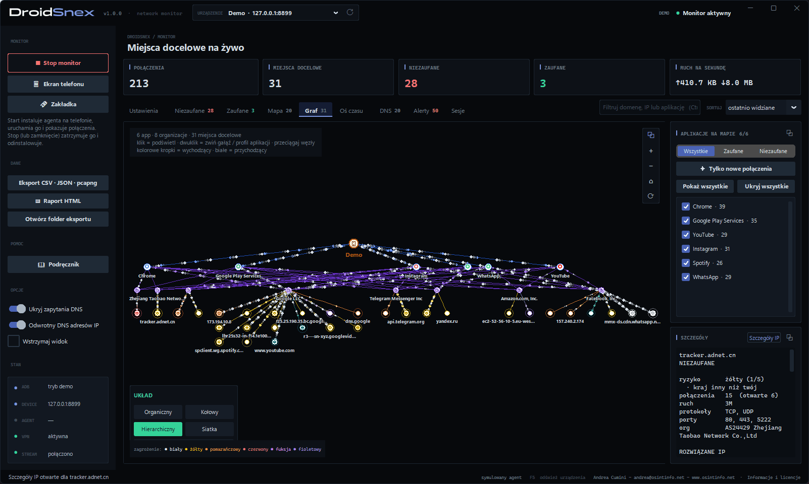

Graf pokazuje, kto z kim rozmawia: **telefon → aplikacja → organizacja (ASN) → miejsce docelowe**.

- **Kliknięcie** węzła: wyróżnia go wraz z sąsiadami; pozostałe przygasają.
- **Dwuklik** na aplikacji lub organizacji: zwija lub rozwija gałąź. Dwuklik na aplikacji (lub na aplikacji na liście) otwiera **profil aplikacji**: wersja, czy jest systemowa, data instalacji i aktualizacji, uprawnienia (wrażliwe na żółto), miejsca docelowe.
- **Przeciągaj** węzły, aby je ułożyć, przeciągaj tło, aby przesunąć widok, **kółko myszy** lub **+ / −** do powiększania, **⌂** dopasowuje graf do okna, **⟳** układa go ponownie.
- **Układ:** **Hierarchiczny** (domyślny: telefon → aplikacja → organizacja → miejsce docelowe, od góry do dołu), **Organiczny**, **Kołowy**, **Siatka**. **Zmniejsz przecięcia** próbuje kilku ułożeń i zostawia to z najmniejszą liczbą krzyżujących się linii.
- Po połączeniach biegną impulsy ruchu jak na mapie (kolorowe = wychodzący, jasne = przychodzący); miejsca docelowe z otwartymi połączeniami mają pulsujący pierścień. Etykiety nie nachodzą na siebie: najedź myszą na węzeł, aby odczytać pełną nazwę.
- **⧉** odłącza graf do osobnego okna.

Do wyświetlania organizacji potrzebna jest baza ASN (Ustawienia).

## 11. Oś czasu

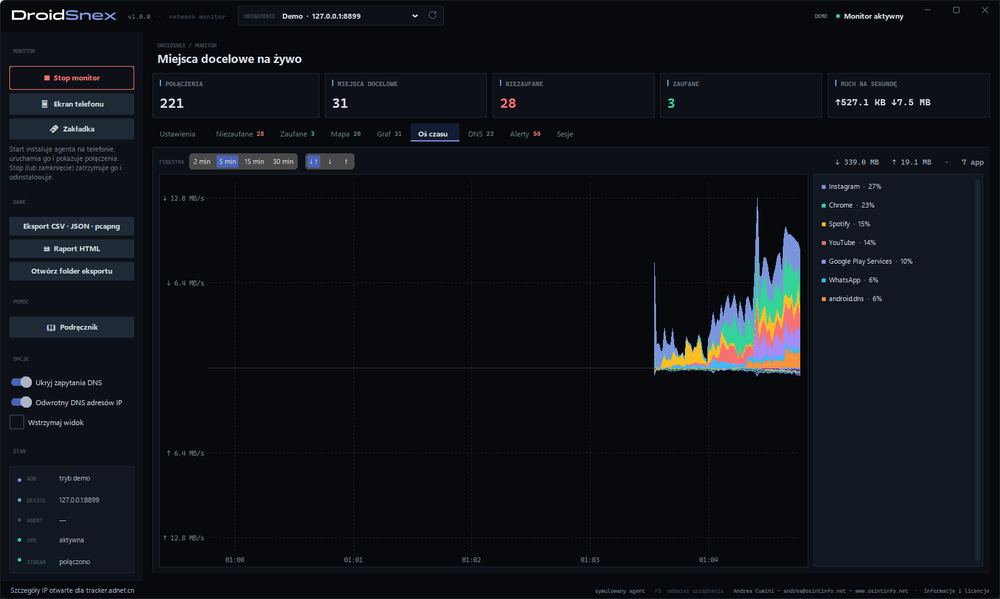

Oś czasu pokazuje bajty na sekundę każdej aplikacji w czasie. Nad osią ruch przychodzący (↓, z serwera do telefonu), pod osią wychodzący (↑): od razu widać, która aplikacja komunikuje się w tle, gdy telefon leży nieużywany, a która pobiera dane.

- Wybierz przedział czasu: **2, 5, 15 lub 30 min**.
- **Kliknięcie pozycji legendy** ukrywa lub pokazuje tę aplikację.
- **Najedź myszą** na wykres, aby odczytać wartości z danej chwili.
- Aplikacje spoza pierwszej dziesiątki są zgrupowane jako *inne*.

## 12. DNS

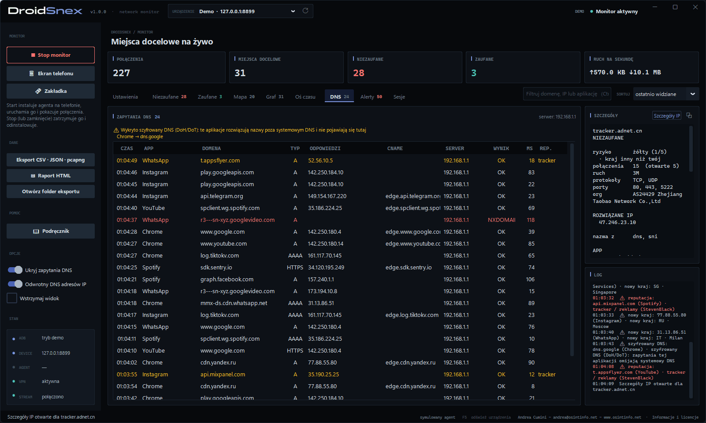

Karta **DNS** zawiera zapytania DNS telefonu: Czas, App, Domena, Typ (A, AAAA, HTTPS…), Odpowiedzi, Wynik, czas odpowiedzi w ms i Rep. **Wyczyść** opróżnia listę.

Niektóre aplikacje używają **szyfrowanego DNS** (DoH/DoT): ich zapytania nie przechodzą przez systemowy DNS i nie pojawiają się tutaj. Gdy DroidSnex to zauważy, wyświetla ostrzeżenie i generuje alert.

## 13. Alerty

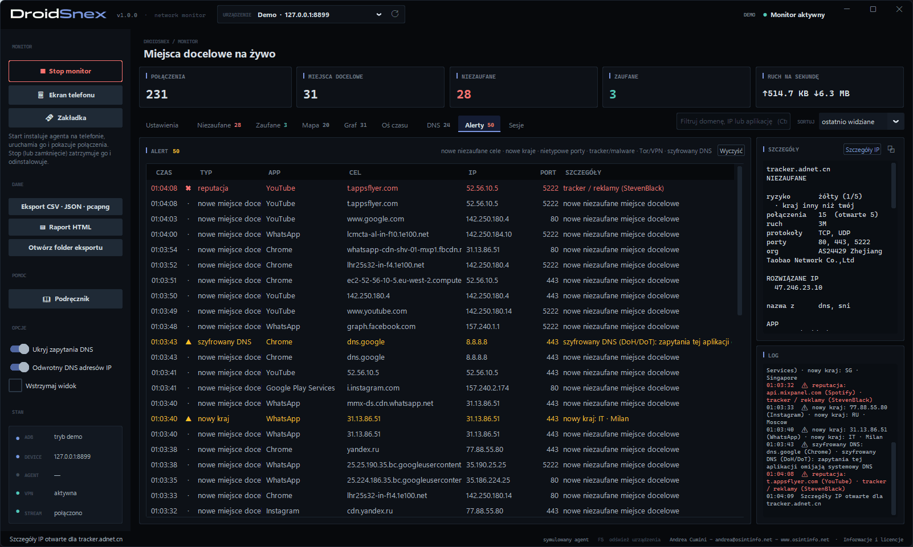

Karta **Alerty** zbiera zdarzenia, na które warto zwrócić uwagę: **nowe niezaufane cele · nowe kraje · nietypowe porty · tracker/malware · Tor/VPN · szyfrowany DNS**. Każdy wiersz podaje Czas, poziom, Typ, App, Cel, IP, Port i Szczegóły. **Wyczyść** opróżnia listę.

## 14. Ekran telefonu

Przycisk **📱 Ekran telefonu** pokazuje ekran telefonu na komputerze i pozwala sterować nim myszą i klawiaturą za pomocą scrcpy (najpierw pobierz go w Ustawieniach). Okno pozostaje na wierzchu; przeciągnij nagłówek, aby je przesunąć. Przyciski u góry wysyłają klawisze Androida: wstecz, ekran główny, ostatnie aplikacje, zasilanie, głośność − i +.

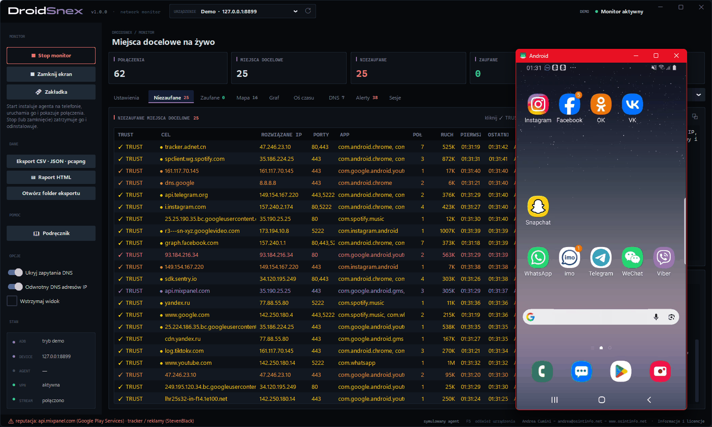

Naciśnij przycisk ponownie (**Zamknij ekran**), aby je zamknąć.

## 15. Sesje, odtwarzanie i zakładki

Każde monitorowanie, od Start do Stop, jest zapisywane jako **sesja** ze wszystkimi zarejestrowanymi zdarzeniami.

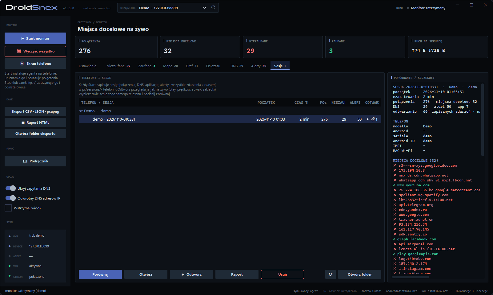

W karcie **Sesje**:

- **Telefony i sesje** (po lewej) zawiera zapisane sesje z telefonem, początkiem, czasem trwania, połączeniami, niezaufanymi i kolumną **Odtwarzanie** (▶, jeśli sesję można odtworzyć, 🔖 z liczbą zakładek).
- Zaznacz sesję: w **Porównanie / szczegóły** (po prawej) pojawiają się telefon, początek, czas trwania, miejsca docelowe, aplikacje, organizacje i zakładki.
- **Porównaj:** zaznacz dwie sesje tego samego telefonu przez **Ctrl+klik** i naciśnij Porównaj. Zobaczysz wspólne, nowe i zniknięte miejsca docelowe, nowe aplikacje, zniknięte aplikacje, nowe organizacje i nowe kraje.
- **Raport** tworzy raport HTML zaznaczonej sesji (zobacz [rozdział 16](#16-eksport-danych-i-wyczyść-wszystko)).
- **Otwórz** otwiera sesję z pliku, **Otwórz folder** otwiera folder sesji, **Usuń sesje** usuwa zaznaczone po potwierdzeniu (nie można tego cofnąć).

### Odtwarzanie

Zaznacz sesję i naciśnij **▶ Odtwórz** (przy zatrzymanym monitorze). Wszystkie widoki (listy, mapa, graf, oś czasu, DNS, alerty) przechodzą przez sesję tak, jakby działo się to na żywo.

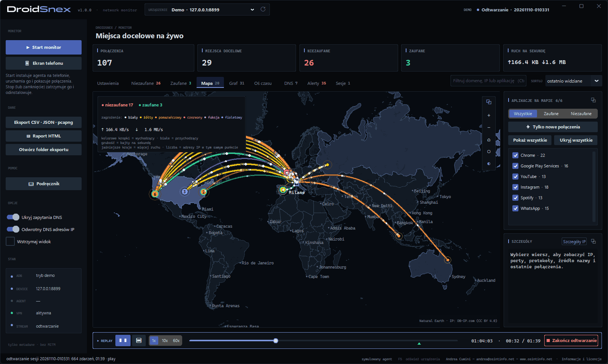

Pasek odtwarzania na dole:

- **▶ / ❚❚** odtwarzanie i pauza, **⏮** powrót na początek;
- prędkość **1x, 10x, 60x**;
- suwak czasu: przeciągnij go, aby przejść do danej chwili; zakładki są zaznaczone na suwaku. **Kliknięcie prawym przyciskiem** zakładki otwiera jej zrzut ekranu;
- **■ Zakończ odtwarzanie** wraca do trybu na żywo.

### Zakładki

Podczas monitorowania naciśnij **🔖 Zakładka** w lewej kolumnie, aby oznaczyć chwilę, na przykład „otworzyłem Instagram”. Wpisz notatkę i naciśnij **Zapisz zakładkę**. Zakładka zostaje zapisana w sesji z godziną i zrzutem ekranu telefonu.

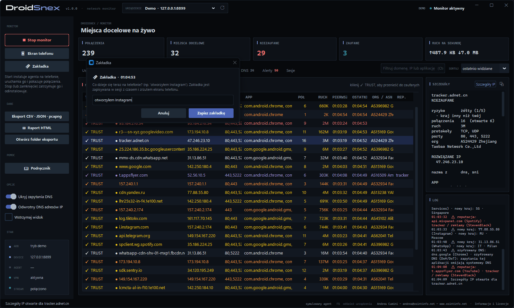

## 16. Eksport danych i Wyczyść wszystko

- **Eksport CSV · JSON · pcapng** zapisuje połączenia sesji w trzech formatach: CSV (dla arkuszy kalkulacyjnych), JSON i pcapng (otwierany w Wiresharku, tylko metadane). **Otwórz folder eksportu** otwiera folder z plikami.
- **Raport HTML** tworzy jeden plik HTML sesji (bieżącej, odtwarzanej lub wybranej w karcie Sesje) i otwiera go w przeglądarce: podsumowanie, telefon, mapa, niezaufane miejsca docelowe według zagrożenia z powodami, zaufane miejsca docelowe, ruch według aplikacji i kraju, alerty oraz zakładki ze zrzutami ekranu. Aby uzyskać PDF, użyj w przeglądarce *Drukuj › Zapisz jako PDF*.
- **🗑 Wyczyść wszystko** pojawia się przy zatrzymanym monitorze: po potwierdzeniu usuwa połączenia, zapytania DNS, alerty, mapę, graf i oś czasu bieżącej sesji. Zapisane sesje i lista zaufanych pozostają.

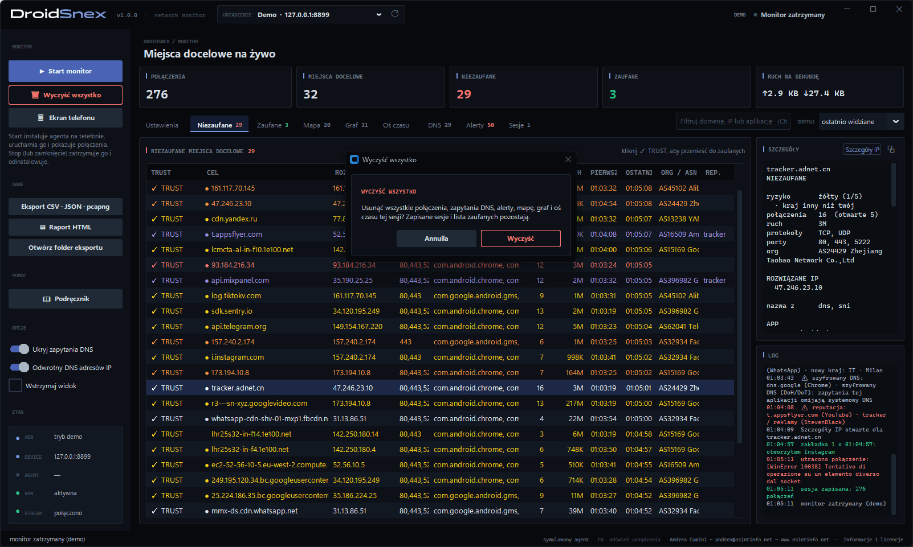

## 17. Odłączone panele

Mapa, Graf, Szczegóły i Aplikacje na mapie mają w prawym górnym rogu przycisk **⧉**: panel odłącza się do osobnego okna, które można przesuwać i zmieniać jego rozmiar, na przykład na drugim monitorze. Panel nadal się aktualizuje.

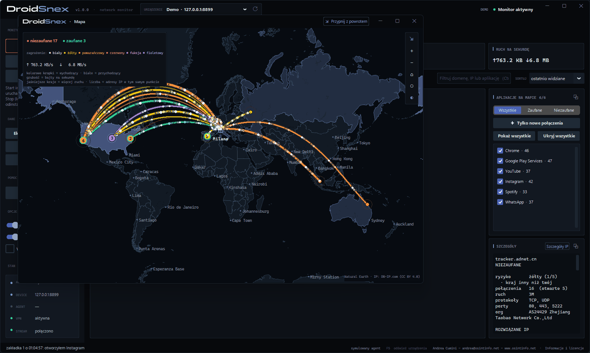

Aby go przywrócić, naciśnij **⇲ Przypnij z powrotem** w nagłówku okna, zamknij okno lub naciśnij **Przypnij z powrotem** w pustej karcie.

## 18. Informacje i licencje

Kliknij **Informacje i licencje** na dolnym pasku: okno pokazuje wersję, autora, licencję programu, dane i komponenty zewnętrzne z ich licencjami (**Wszystkie licencje**), a przycisk **Warunki użytkowania** pozwala ponownie przeczytać warunki. DroidSnex to wolne oprogramowanie, bez żadnej gwarancji.

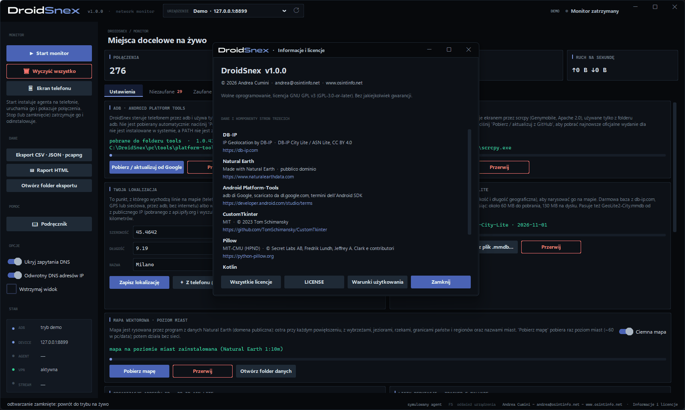

## 19. Częste problemy

| Komunikat | Co zrobić |
|---|---|
| Brak podłączonego urządzenia | Podłącz telefon przez USB z włączonym debugowaniem USB i naciśnij F5. |
| Urządzenie nieautoryzowane | Odblokuj telefon i zaakceptuj „Zezwolić na debugowanie USB?”, zaznaczając „Zawsze zezwalaj z tego komputera”. |
| Brak adb w folderze tools | Ustawienia › ADB › Pobierz / aktualizuj od Google. |
| Brak scrcpy w folderze tools | Ustawienia › Ekran telefonu › Pobierz / aktualizuj z GitHub. |
| VPN nie jest aktywny | Na telefonie stuknij OK przy prośbie o połączenie VPN; jeśli działa inny VPN, wyłącz go i ponownie naciśnij Start. |
| Brak bazy miast | Ustawienia › Baza miast dla IP › Pobierz / aktualizuj. |
| Ustaw swoją lokalizację | Ustawienia › Twoja lokalizacja › Wykryj z mojego publicznego IP (lub wpisz ją ręcznie). |
