# DroidSnex — Manuali i përdoruesit

DroidSnex tregon në kohë reale me cilët serverë lidhet një telefon Android: cili aplikacion, cili domen, cila IP, në cilin vend dhe me sa trafik. Telefoni lidhet me kompjuterin me kabllo USB; gjatë monitorimit në telefon punon një aplikacion i vogël (*agjenti*) që krijon një VPN lokale dhe lexon vetëm metadatat e lidhjeve. Përmbajtja e trafikut nuk deshifrohet kurrë (pa MITM).

## Përmbajtja

1. [Para se të filloni](#1-para-se-të-filloni)
2. [Nisja e parë: gjuha dhe kushtet e përdorimit](#2-nisja-e-parë-gjuha-dhe-kushtet-e-përdorimit)
3. [Cilësimet](#3-cilësimet)
4. [Dritarja kryesore](#4-dritarja-kryesore)
5. [Nisja dhe ndalimi i monitorimit](#5-nisja-dhe-ndalimi-i-monitorimit)
6. [Jo të besuara dhe Të besuara](#6-jo-të-besuara-dhe-të-besuara)
7. [Shkalla e rrezikshmërisë](#7-shkalla-e-rrezikshmërisë)
8. [Detajet dhe Detaje IP](#8-detajet-dhe-detaje-ip)
9. [Harta](#9-harta)
10. [Graf](#10-graf)
11. [Kronologji](#11-kronologji)
12. [DNS](#12-dns)
13. [Sinjalizime](#13-sinjalizime)
14. [Ekrani i telefonit](#14-ekrani-i-telefonit)
15. [Sesionet, riprodhimi dhe shënimet](#15-sesionet-riprodhimi-dhe-shënimet)
16. [Eksportimi i të dhënave dhe Pastro gjithçka](#16-eksportimi-i-të-dhënave-dhe-pastro-gjithçka)
17. [Panelet e shkëputura](#17-panelet-e-shkëputura)
18. [Info dhe licenca](#18-info-dhe-licenca)
19. [Probleme të shpeshta](#19-probleme-të-shpeshta)

---

## 1. Para se të filloni

Ju duhen:

- një kompjuter Windows me DroidSnex;
- një telefon Android dhe një kabllo USB për të dhëna;
- **korrigjimi USB** i aktivizuar në telefon: *Cilësimet › Rreth telefonit*, prekni shtatë herë *Numri i ndërtimit* për të zhbllokuar *Opsionet e zhvilluesit*, pastaj te *Opsionet e zhvilluesit* aktivizoni *Korrigjimin USB*.

Në lidhjen e parë telefoni pyet **"Të lejohet korrigjimi USB?"**: zhbllokoni ekranin, shënoni *Lejo gjithmonë nga ky kompjuter* dhe prekni *OK*.

DroidSnex përdor vetëm mjetet në dosjen e vet `tools` (adb dhe scrcpy) dhe nuk instalon asgjë në sistem. Herën e parë shkarkojini nga skeda **Cilësimet** (shihni [kapitullin 3](#3-cilësimet)).

## 2. Nisja e parë: gjuha dhe kushtet e përdorimit

Në nisjen e parë shfaqet një dritare që nuk mund të mbyllet dhe nuk mund të vendoset pas dritareve të tjera.

1. **Zgjidhni gjuhën.** Butonat tregojnë nëntë gjuhët në dispozicion: Italiano, English, Deutsch, Français, Español, Nederlands, Polski, Ελληνικά, Shqip. Gjuha vlen për gjithë programin dhe për agjentin në telefon; mund ta ndryshoni më vonë te skeda Cilësimet.

   

2. **Lexoni kushtet e përdorimit.** Teksti është në gjuhën e zgjedhur. Butoni **Pranoj** aktivizohet vetëm pasi ta keni rrëshqitur tekstin deri në fund. **Refuzoj** mbyll programin.

   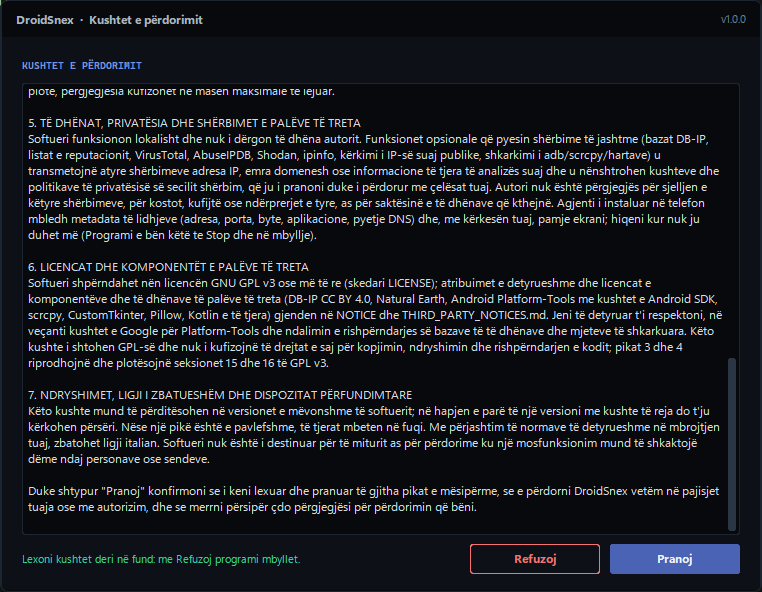

Pranimi ruhet: dritarja shfaqet përsëri vetëm nëse ndryshon versioni i kushteve. Kushtet mund t'i rilexoni në çdo kohë nga [Info dhe licenca](#18-info-dhe-licenca).

## 3. Cilësimet

Skeda **Cilësimet** mbledh cilësimet dhe shkarkimet. Çdo shkarkim bëhet vetëm kur shtypni butonin dhe mund të ndalet me **Ndërprit**.

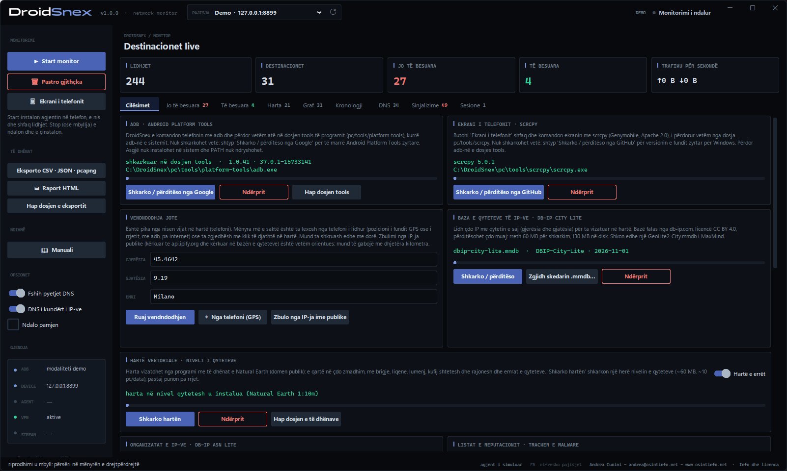

- **ADB · Android Platform Tools** — DroidSnex e komandon telefonin me adb, vetëm nga dosja `tools` e programit. Shtypni **Shkarko / përditëso nga Google** për Android Platform Tools zyrtare; **Hap dosjen tools** hap dosjen.
- **Ekrani i telefonit · scrcpy** — **Shkarko / përditëso nga GitHub** shkarkon scrcpy nga botimet zyrtare.
- **Vendndodhja jote** — pika nga nisen vijat në hartë dhe vendi që përdor shkalla e rrezikshmërisë. Mënyra më e saktë është **⌖ Nga telefoni (GPS)**: lexon me adb pozicionin e fundit të telefonit të lidhur dhe tregon burimin, saktësinë dhe moshën. Përndryshe klikoni me të djathtën mbi hartë › **Vendos këtu pozicionin tim**, ose futni GJERËSIA, GJATËSIA dhe EMRI dhe shtypni **Ruaj vendndodhjen**. **Zbulo nga IP-ja ime publike** është vetëm tregues: mund të gabojë me dhjetëra kilometra.
- **Baza e qyteteve të IP-ve · DB-IP City Lite** — lidh çdo IP me qytetin e saj për ta vizatuar në hartë. **Shkarko / përditëso**, ose **Zgjidh skedarin .mmdb…**; **Hap dosjen e të dhënave**.
- **Hartë vektoriale · niveli i qyteteve** — **Shkarko hartën** instalon hartën e detajuar (Natural Earth 1:10m, me brigje, lumenj, kufij dhe emra qytetesh); pa të shihet versioni bazë i përfshirë. **Hartë e errët** ndryshon ngjyrat e hartës.
- **Organizatat e IP-ve · DB-IP ASN Lite** — lidh çdo IP me organizatën që e menaxhon (Google, Meta, Amazon, një ofrues hostimi i panjohur…). Është baza e Grafit dhe e kolonës Org / ASN.
- **Listat e reputacionit · tracker dhe malware** — lista bllokimi publike me trackerë, malware, nyje dalëse **Tor** dhe tregues për ofruesit **VPN**. **Shkarko / përditëso listat**. Destinacionet në listë marrin shenjën dhe një sinjalizim.
- **Detaje IP · diapazone cloud** — **Shkarko / përditëso listat cloud** dhe leja për **kontaktin aktiv** (certifikata TLS) të Detajeve IP.
- **Detaje IP · shërbime me çelës API** — çelësa opsionalë për VirusTotal, AbuseIPDB, Shodan dhe ipinfo.io. **Regjistrohu** hap faqen e shërbimit; ngjitni çelësin dhe shtypni **Ruaj çelësat**. Pa çelës shërbimi mbetet joaktiv. Çelësat mbeten në kompjuter, në skedarin e konfigurimit.
- **Agjenti Android · APK** — APK-ja e agjentit që instalohet në telefon. Zakonisht mjafton **I paracaktuar**; **Shfleto…** për të zgjedhur një tjetër, pastaj **Ruaj**.
- **Përditësime** — **Kontrollo përditësimet** kontrollon, vetëm kur e shtypni, nëse ka një version më të ri në adresën e dhënë dhe tregon lidhjen me faqen e tij. Nuk shkarkon dhe nuk instalon asgjë.
- **Gjuha · Language** — gjuha e ndërfaqes; edhe agjenti në telefon do ta përdorë nga Start-i i ardhshëm.

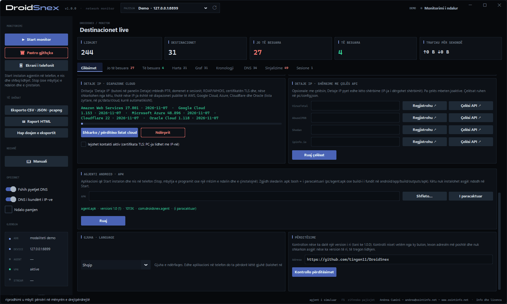

## 4. Dritarja kryesore

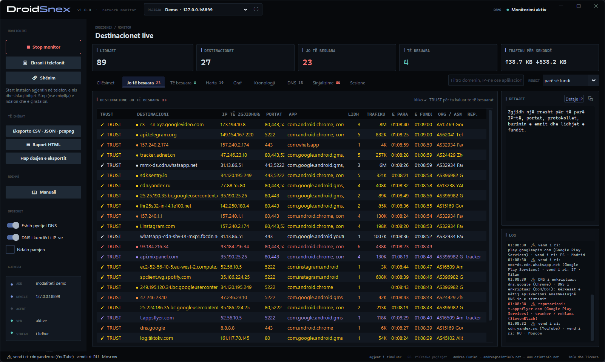

- **Kreu (lart):** logoja dhe versioni, menyja **PAJISJA** me telefonin e lidhur (butoni ↻ ose tasti **F5** e rifreskojnë listën) dhe, djathtas, gjendja e monitorimit.
- **Kolona e majtë:** komandat.
  - *Monitorimi:* **Start monitor** (kur monitorimi është aktiv i njëjti buton bëhet **Stop monitor**), **Pastro gjithçka** (vetëm kur monitorimi është ndalur), **Ekrani i telefonit**, **Shënim** (vetëm kur monitorimi është aktiv).
  - *Të dhënat:* **Eksporto CSV · JSON · pcapng**, **Raport HTML** dhe **Hap dosjen e eksportit**.
  - *Ndihmë:* **📖 Manuali** hap këtë manual në gjuhën e ndërfaqes. Në dritaren e manualit, kutia e kërkimit lart majtas (**Ctrl+F**) thekson të gjitha përputhjet: **Enter** ose **F3** kalon te tjetra, **Shift+Enter** te e mëparshmja, **Esc** pastron kërkimin.
  - *Opsionet:* **Fshih pyetjet DNS** (heq nga listat rreshtat që janë vetëm pyetje DNS), **DNS i kundërt i IP-ve** (kërkon një emër për IP-të që nuk kanë), **Ndalo pamjen** (ngrin listat që t'i lexoni me qetësi; të dhënat vazhdojnë të vijnë).
  - *Gjendja:* pesë tregues (ADB, DEVICE, AGENT, VPN, STREAM): jeshilë kur ajo pjesë funksionon.
- **Numëruesit:** Lidhjet, Destinacionet, Jo të besuara, Të besuara, Trafiku për sekondë.
- **Skedat:** Cilësimet, Jo të besuara, Të besuara, Harta, Graf, Kronologji, DNS, Sinjalizime, Sesione. Djathtas skedave, te listat, kutia **Filtro domenin, IP-në ose aplikacionin** (**Ctrl+F**) dhe menyja **RENDIT** (parë së fundi, nr. i lidhjeve, parë së pari, destinacioni, trafiku).
- **Paneli i djathtë:** **Detajet** e rreshtit të zgjedhur dhe, poshtë, **Log** me mesazhet e programit.
- **Shiriti i poshtëm:** mesazhi i gjendjes, **F5 rifresko pajisjet** dhe lidhja **Info dhe licenca**.

## 5. Nisja dhe ndalimi i monitorimit

1. Lidheni telefonin me USB dhe zhbllokojeni. Te menyja **PAJISJA** shfaqet modeli i tij; nëse keni më shumë se një, zgjidheni nga menyja.
2. Shtypni **▶ Start monitor**. DroidSnex instalon agjentin në telefon, i jep lejet e nevojshme dhe nis VPN-në lokale. Nëse në telefon shfaqet **Kërkesë për lidhje**, zhbllokojeni dhe prekni **OK**.
3. Kur treguesit e *Gjendjes* janë jeshilë, lidhjet fillojnë të shfaqen në lista. Përdoreni telefonin si zakonisht: çdo aplikacion që lidhet me internetin shfaqet me destinacionet e veta.
4. Shtypni **■ Stop monitor** për të përfunduar. Agjenti ndalet dhe **çinstalohet** nga telefoni; sesioni ruhet te skeda [Sesione](#15-sesionet-riprodhimi-dhe-shënimet).

Edhe kur mbyllni programin, agjenti ndalet dhe çinstalohet. Nëse kablloja shkëputet, DroidSnex përpiqet të rilidhet vetë; nëse kompjuteri fiket ose programi ndërpritet, agjenti ndalet vetë pak më vonë (watchdog).

## 6. Jo të besuara dhe Të besuara

Çdo destinacion (një domen, ose një IP kur emri nuk dihet) ndodhet në njërën nga dy listat:

- **Jo të besuara** — destinacionet jo të besuara. Çdo destinacion i ri fillon këtu.
- **Të besuara** — destinacionet që i keni shënuar si të besuara.

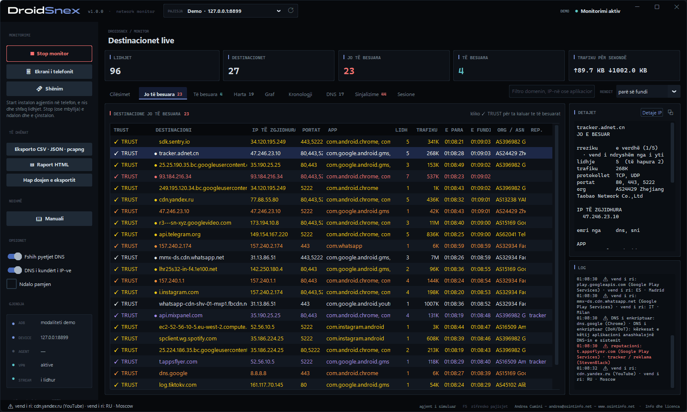

Kolonat: Destinacioni, IP të zgjidhura, Portat, App, Lidh (numri i lidhjeve), Trafiku, E para dhe E fundit (oraret), Org / ASN (organizata që menaxhon IP-në) dhe Rep. (shenja *tracker*, *malware* ose *tor* nga listat e reputacionit). Klikoni titullin e një kolone për të renditur A-Z, klikoni sërish për Z-A.

- **Për t'i besuar një destinacioni:** te lista Jo të besuara klikoni **✓ TRUST** në kolonën e parë. Destinacioni kalon te lista Të besuara.
- **Për ta kthyer:** te lista Të besuara klikoni **✕ UNTRUST**.
- **✕ Hiq besimin nga të gjitha** (lart te lista Të besuara) i kthen të gjitha destinacionet e besuara te jo të besuarat, pas një konfirmimi. Lista e ruajtur zbrazet dhe veprimi nuk mund të zhbëhet.

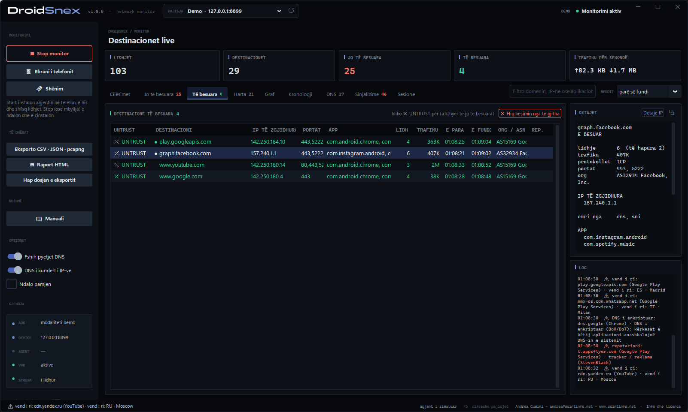

Lista e destinacioneve të besuara ruhet dhe vlen edhe për sesionet e mëvonshme dhe për telefona të tjerë.

## 7. Shkalla e rrezikshmërisë

Te lista Jo të besuara çdo rresht ka një ngjyrë që tregon sa i dyshimtë është destinacioni. DroidSnex mbledh pikë për çdo sinjal:

| Sinjali | Pikë |
|---|---|
| vetëm IP, pa emër | +1 |
| organizatë e panjohur (IP që nuk gjendet në bazën ASN) | +1 |
| vend i ndryshëm nga i yti | +1 |
| DNS i enkriptuar (DoH/DoT) | +1 |
| portë e pazakontë (jo 80, 443, 53…) | +2 |
| ofrues VPN (tregues) | +3 |
| tracker / reklamë në listë | +4 |
| nyje dalëse Tor | +4 |
| malware në listë | +5 |

Sinjalet e përgjithshme (pesë rreshtat e parë) arrijnë së bashku të shumtën 3 pikë; fuksia dhe vjollca arrihen vetëm nëpërmjet listave të reputacionit. Ngjyra është totali, deri në 5:

**0 e bardhë · 1 e verdhë · 2 portokalli · 3 e kuqe · 4 fuksi · 5 vjollcë**

Te paneli Detajet rreshti *rrezikshmëria* shpjegon cilat sinjale kanë ndikuar. Për të pasur të gjitha sinjalet duhen vendndodhja, baza ASN dhe listat e reputacionit (shihni [Cilësimet](#3-cilësimet)).

## 8. Detajet dhe Detaje IP

Zgjidhni një rresht në një listë: paneli **Detajet** tregon nëse destinacioni është I BESUAR apo JO I BESUAR, numrin e lidhjeve (dhe sa janë ende të hapura), protokollet, portat, IP-të e zgjidhura me burimin e emrit (SNI, DNS ose DNS i kundërt), rrezikshmërinë dhe lidhjet e fundit.

Butoni **Detaje IP** lart në panel hap një dritare me gjithçka që mund të dihet për IP-në:

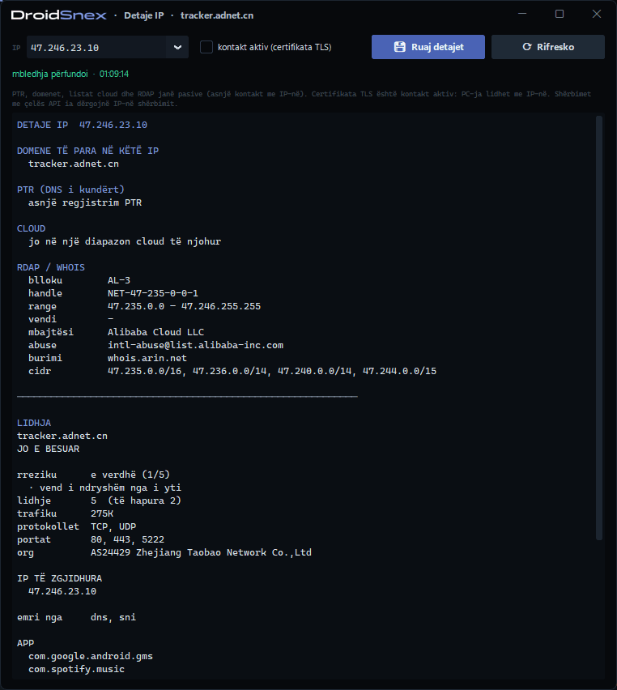

- **DOMENET E PARA NË KËTË IP** gjatë sesionit;
- **PTR (DNS i kundërt)**;
- **CLOUD** — nëse IP-ja bën pjesë në diapazonet e publikuara nga AWS, Google Cloud, Azure, Cloudflare dhe të tjerë (lista të shkarkuara nga Cilësimet);
- **RDAP / WHOIS** — blloku, vendi, mbajtësi;
- **CERTIFIKATA TLS (kontakt aktiv)** — lëshuesi, vlefshmëria, emrat e certifikatës;
- **VIRUSTOTAL, ABUSEIPDB, SHODAN, IPINFO.IO** — vetëm nëse keni futur çelësat e tyre API te Cilësimet.

Lart zgjidhni **IP**-në (nëse destinacioni ka më shumë se një). PTR, domenet, listat cloud dhe RDAP janë pasive: asnjë kontakt me IP-në. Certifikata TLS përkundrazi është kontakt aktiv, kompjuteri lidhet me IP-në, dhe merret vetëm kur kutia **kontakt aktiv (certifikata TLS)** është e shënuar. Shërbimet me çelës marrin IP-në që kërkoni.

**Rifresko** e përsërit mbledhjen. **Ruaj detajet** e ruan rezultatin në një skedar teksti; shtegu shfaqet në Log.

Detaje IP hapet edhe nga një vijë në Hartë ose nga një nyje në Graf: zgjidhni fillimisht destinacionin, pastaj shtypni butonin.

## 9. Harta

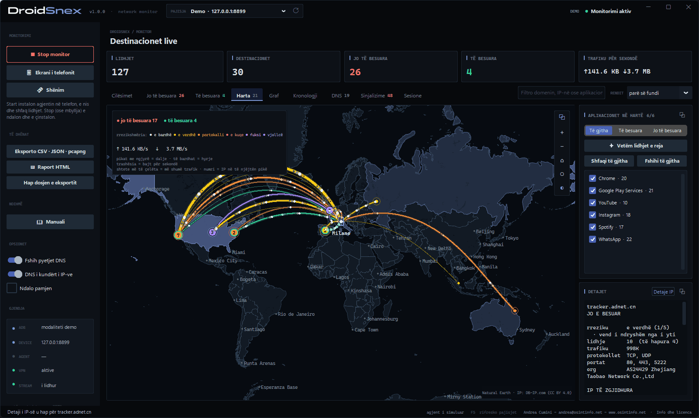

Telefoni vizatohet në vendndodhjen tuaj (caktojeni te Cilësimet); që andej niset një vijë drejt qytetit të çdo destinacioni: **jeshile** nëse është i besuar, me ngjyrën e shkallës së rrezikshmërisë nëse nuk është. Trashësia rritet me bajtët për sekondë; pikat me ngjyrë që lëvizin drejt destinacionit janë trafiku dalës, pikat e bardha që lëvizin drejt telefonit janë trafiku hyrës.

- **Rrota e miut** ose **+ / −**: zmadhim. **Tërheqje**: zhvendosje. **Klikim i dyfishtë**: afrim.
- **Klikim mbi një vijë ose një pikë**: detajet e destinacionit te paneli Detajet.
- **Aplikacionet në hartë** (paneli djathtas): zgjidhni **Të gjitha**, **Të besuara** ose **Jo të besuara** dhe cilat aplikacione të shfaqen, me **Shfaqi të gjitha** dhe **Fshihi të gjitha**.
- **✦ Vetëm lidhjet e reja**: nga ai moment harta tregon vetëm lidhjet që lindin më pas; shtypni sërish për t'u kthyer te të gjitha.
- Nga larg destinacionet e afërta grupohen në një **top me numrin e IP-ve**: kaloni miun mbi të për listën, klikoni për ta zmadhuar aty. Nga zmadhimi 4, IP-të në të njëjtën pikë hapen në pika të veçanta rreth qytetit.
- **◐** ngjyros shtetet sipas trafikut të shkëmbyer (më e çelët = më shumë bajtë).
- Një lidhje e re lajmërohet me një shkëndijë nga telefoni te destinacioni; impulset në vija kanë bisht dhe shtohen me trafikun.
- **Klikim i djathtë** mbi hartë › **Vendos këtu pozicionin tim**.
- **⧉** e shkëput hartën në një dritare më vete (shihni [Panelet e shkëputura](#17-panelet-e-shkëputura)).

Nëse mungojnë vendndodhja ose baza e qyteteve, harta e njofton me një mesazh. Destinacionet pa vendndodhje (IP private ose që nuk gjenden në bazë) numërohen veçmas.

## 10. Graf

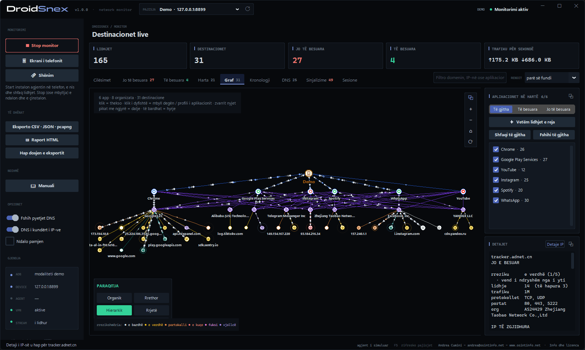

Grafi tregon kush flet me kë: **telefoni → aplikacioni → organizata (ASN) → destinacioni**.

- **Klikim** mbi një nyje: e thekson bashkë me fqinjët; të tjerat zbehen.
- **Klikim i dyfishtë** mbi një aplikacion ose organizatë: mbyll ose hap degën. Klikimi i dyfishtë mbi aplikacionin (ose mbi aplikacionin në listë) hap **profilin e aplikacionit**: versioni, nëse është aplikacion sistemi, data e instalimit dhe e përditësimit, lejet (të ndjeshmet me të verdhë), destinacionet.
- **Tërhiqni** nyjet për t'i rregulluar, tërhiqni sfondin për të zhvendosur pamjen, **rrota e miut** ose **+ / −** për zmadhim, **⌂** për ta përshtatur grafin me dritaren, **⟳** për ta rirregulluar.
- **Paraqitja:** **Hierarkik** (i paracaktuar: telefoni → aplikacioni → organizata → destinacioni, nga lart poshtë), **Organik**, **Rrethor**, **Rrjetë**. **Zvogëlo kryqëzimet** provon disa rregullime dhe mban atë me më pak vija që kryqëzohen.
- Mbi lidhjet lëvizin impulset e trafikut si në hartë (me ngjyrë = dalje, të çelëta = hyrje); destinacionet me lidhje të hapura kanë një unazë që pulson. Etiketat nuk mbivendosen: kaloni miun mbi një nyje për të lexuar emrin e plotë.
- **⧉** e shkëput grafin në një dritare më vete.

Për organizatat nevojitet baza ASN (Cilësimet).

## 11. Kronologji

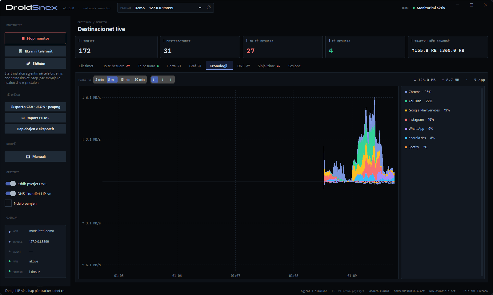

Kronologjia tregon bajtët për sekondë të çdo aplikacioni në kohë. Mbi bosht trafiku hyrës (↓, nga serveri te telefoni), poshtë tij trafiku dalës (↑): shihet menjëherë cili aplikacion komunikon në sfond kur telefoni nuk përdoret dhe cili shkarkon.

- Zgjidhni dritaren kohore: **2, 5, 15 ose 30 min**.
- **Klikim mbi një zë të legjendës** fsheh ose shfaq atë aplikacion.
- **Kaloni miun** mbi grafik për të lexuar vlerat e atij çasti.
- Aplikacionet përtej dhjetë të parave grupohen te *të tjera*.

## 12. DNS

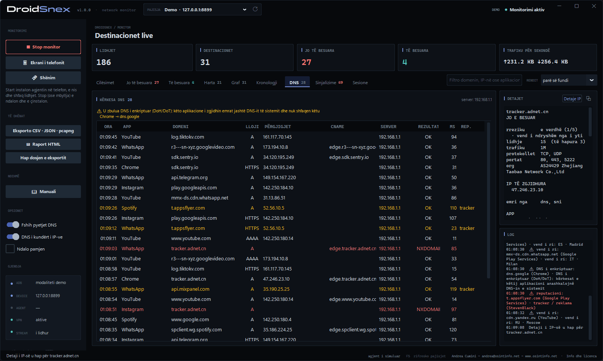

Skeda **DNS** liston kërkesat DNS të telefonit: Ora, App, Domeni, Lloji (A, AAAA, HTTPS…), Përgjigjet, Rezultati, koha e përgjigjes në ms dhe Rep. **Zbraz** fshin listën.

Disa aplikacione përdorin **DNS të enkriptuar** (DoH/DoT): kërkesat e tyre nuk kalojnë nga DNS-i i sistemit dhe nuk shfaqen këtu. Kur DroidSnex e vëren këtë, shfaq një paralajmërim dhe krijon një sinjalizim.

## 13. Sinjalizime

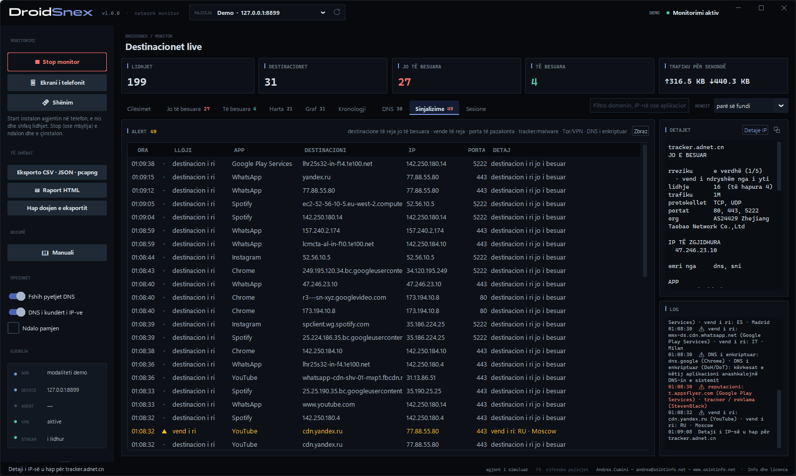

Skeda **Sinjalizime** mbledh ngjarjet që meritojnë vëmendje: **destinacione të reja jo të besuara · vende të reja · porta të pazakonta · tracker/malware · Tor/VPN · DNS i enkriptuar**. Çdo rresht tregon Orën, nivelin, Llojin, App, Destinacionin, IP, Portën dhe Detajin. **Zbraz** fshin listën.

## 14. Ekrani i telefonit

Butoni **📱 Ekrani i telefonit** tregon ekranin e telefonit në kompjuter dhe ju lejon ta komandoni me mi dhe tastierë, nëpërmjet scrcpy (shkarkojeni fillimisht nga Cilësimet). Dritarja qëndron gjithmonë përpara; tërhiqni kreun për ta zhvendosur. Butonat lart dërgojnë tastet e Android: prapa, kreu, aplikacionet e fundit, ndezja, volumi − dhe +.

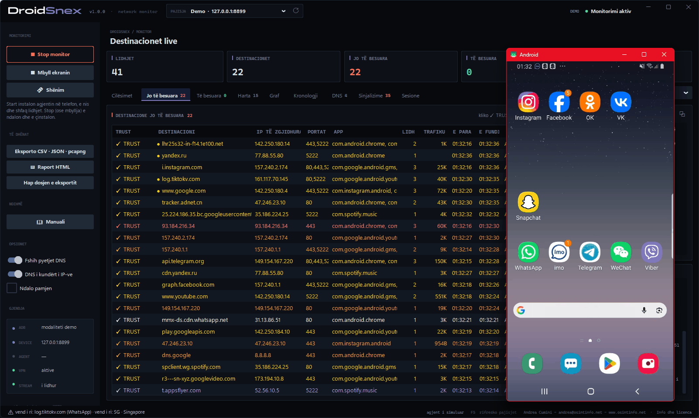

Shtypni sërish butonin (**Mbyll ekranin**) për ta mbyllur.

## 15. Sesionet, riprodhimi dhe shënimet

Çdo monitorim, nga Start deri te Stop, ruhet si **sesion**, me të gjitha ngjarjet e regjistruara.

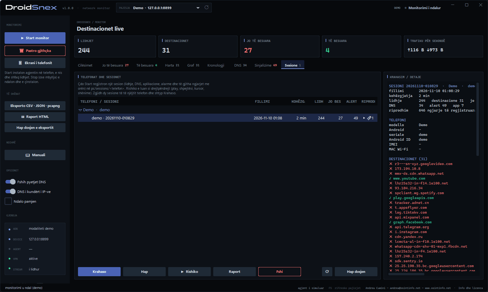

Te skeda **Sesione**:

- **Telefonat dhe sesionet** (majtas) liston sesionet e ruajtura me telefonin, fillimin, kohëzgjatjen, lidhjet, jo të besuarat dhe një kolonë **Riprodhim** (▶ nëse sesioni mund të rishikohet, 🔖 me numrin e shënimeve).
- Zgjidhni një sesion: te **Krahasim / detaje** (djathtas) shfaqen telefoni, fillimi, kohëzgjatja, destinacionet, aplikacionet, organizatat dhe shënimet.
- **Krahaso:** zgjidhni dy sesione të të njëjtit telefon me **Ctrl+klikim** dhe shtypni Krahaso. Shihni destinacionet e përbashkëta, të reja dhe të zhdukura, aplikacionet e reja, aplikacionet e zhdukura, organizatat e reja dhe vendet e reja.
- **Raport** krijon raportin HTML të sesionit të zgjedhur (shihni [kapitullin 16](#16-eksportimi-i-të-dhënave-dhe-pastro-gjithçka)).
- **Hap** hap një sesion nga një skedar, **Hap dosjen** hap dosjen e sesioneve, **Fshi sesionet** fshin ato të zgjedhura pas një konfirmimi (nuk mund të zhbëhet).

### Riprodhimi

Zgjidhni një sesion dhe shtypni **▶ Rishiko** (me monitorimin të ndalur). Të gjitha pamjet (listat, harta, grafi, kronologjia, DNS, sinjalizimet) e përshkojnë sesionin sikur të ishte live.

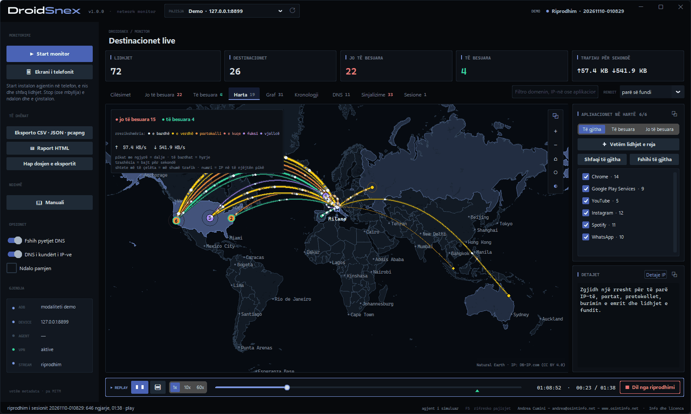

Shiriti i riprodhimit, poshtë:

- **▶ / ❚❚** luaj dhe pauzë, **⏮** kthim në fillim;
- shpejtësia **1x, 10x, 60x**;
- rrëshqitësi i kohës: tërhiqeni për të kaluar në një çast; shënimet janë shënjuar mbi rrëshqitës. **Klikimi me butonin e djathtë** mbi një shënim hap pamjen e tij të ekranit;
- **■ Dil nga riprodhimi** kthehet në modalitetin live.

### Shënimet

Gjatë monitorimit shtypni **🔖 Shënim** në kolonën e majtë për të shënuar një çast, për shembull "hapa Instagram". Shkruani një notë dhe shtypni **Ruaj shënimin**. Shënimi ruhet në sesion me orën dhe një pamje ekrani të telefonit.

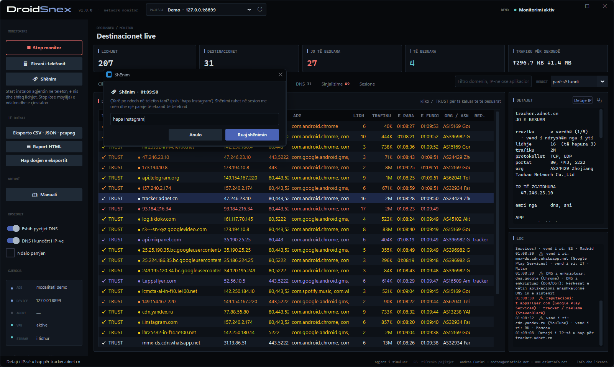

## 16. Eksportimi i të dhënave dhe Pastro gjithçka

- **Eksporto CSV · JSON · pcapng** ruan lidhjet e sesionit në tre formate: CSV (për fletëllogaritëse), JSON dhe pcapng (hapet me Wireshark, vetëm metadata). **Hap dosjen e eksportit** hap dosjen me skedarët.
- **Raport HTML** krijon një skedar të vetëm HTML të sesionit (atij aktual, atij në riprodhim ose atij të zgjedhur te skeda Sesione) dhe e hap në shfletues: përmbledhje, telefoni, harta, destinacionet jo të besuara sipas rrezikshmërisë me arsyet, destinacionet e besuara, trafiku sipas aplikacionit dhe shtetit, sinjalizimet dhe shënimet me pamjet e ekranit. Për PDF përdorni *Printo › Ruaj si PDF* në shfletues.
- **🗑 Pastro gjithçka** shfaqet kur monitorimi është ndalur: pas një konfirmimi fshin lidhjet, kërkesat DNS, sinjalizimet, hartën, grafin dhe kronologjinë e sesionit aktual. Sesionet e ruajtura dhe lista e të besuarave mbeten.

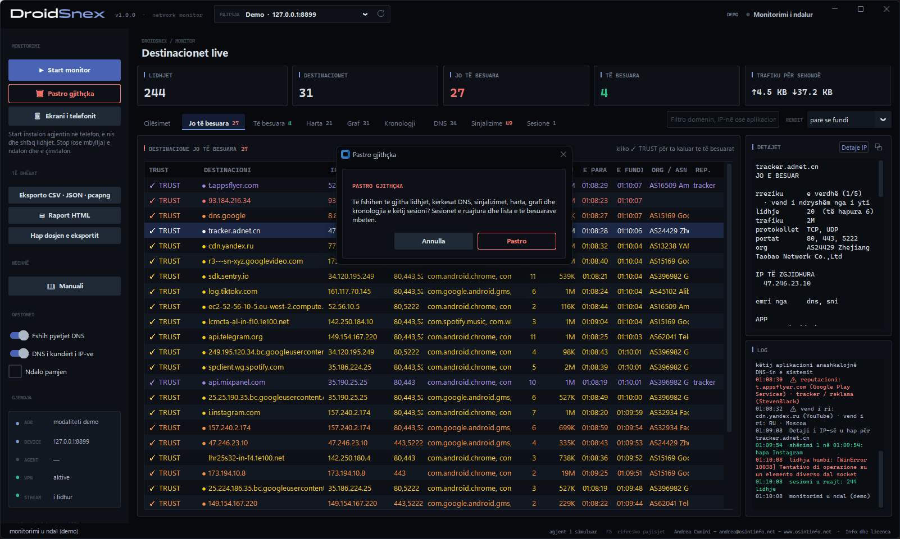

## 17. Panelet e shkëputura

Harta, Grafi, Detajet dhe Aplikacionet në hartë kanë lart djathtas butonin **⧉**: paneli shkëputet në një dritare më vete, që mund ta zhvendosni dhe t'i ndryshoni madhësinë, për shembull në një monitor të dytë. Paneli vazhdon të përditësohet.

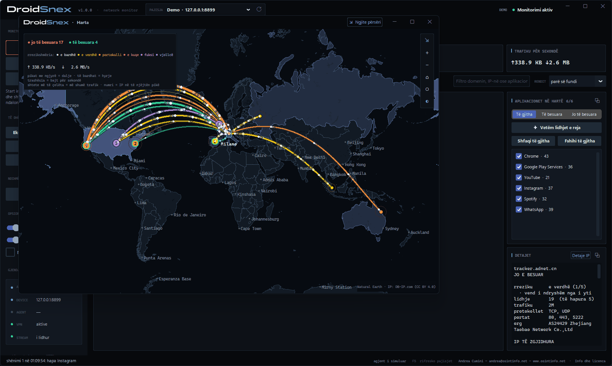

Për ta kthyer në vend, shtypni **⇲ Ngjite përsëri** në kreun e dritares, mbylleni atë ose shtypni **Ngjite përsëri** te skeda bosh.

## 18. Info dhe licenca

Klikoni **Info dhe licenca** në shiritin e poshtëm: dritarja tregon versionin, autorin, licencën e programit, të dhënat dhe komponentët e palëve të treta me licencat e tyre (**Të gjitha licencat**), dhe butoni **Kushtet e përdorimit** ju lejon t'i rilexoni kushtet. DroidSnex është softuer i lirë, pa asnjë garanci.

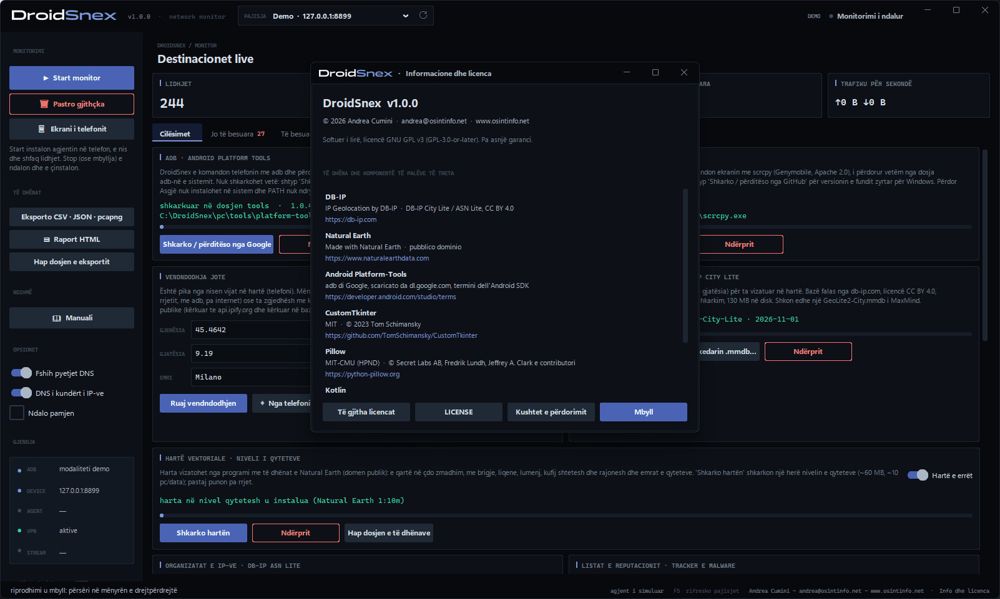

## 19. Probleme të shpeshta

| Mesazhi | Çfarë të bëni |
|---|---|
| Asnjë pajisje e lidhur | Lidheni telefonin me USB me korrigjimin USB aktiv, pastaj shtypni F5. |
| Pajisje e paautorizuar | Zhbllokoni telefonin dhe pranoni "Të lejohet korrigjimi USB?" duke shënuar "Lejo gjithmonë nga ky kompjuter". |
| adb nuk gjendet në dosjen tools | Cilësimet › ADB › Shkarko / përditëso nga Google. |
| scrcpy nuk gjendet në dosjen tools | Cilësimet › Ekrani i telefonit › Shkarko / përditëso nga GitHub. |
| VPN-ja nuk është aktive | Në telefon prekni OK te kërkesa për lidhje VPN; nëse është aktive një VPN tjetër, çaktivizojeni dhe shtypni sërish Start. |
| Mungon baza e qyteteve | Cilësimet › Baza e qyteteve të IP-ve › Shkarko / përditëso. |
| Caktoni vendndodhjen | Cilësimet › Vendndodhja jote › Zbulo nga IP-ja ime publike (ose futeni me dorë). |
